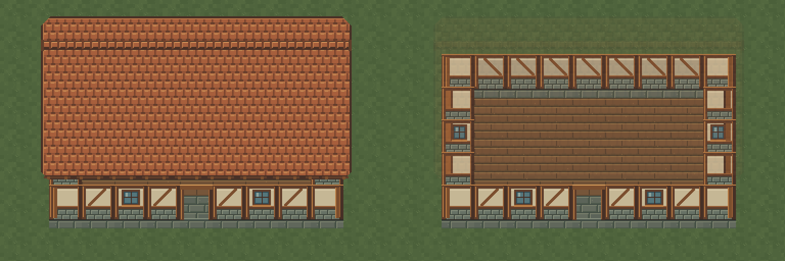

# Overhead timber-and-stone building kit

The starter kit contains 27 reusable native-pixel pieces, authored in LibreSprite:

| Master | PNG dimensions | Pieces |
|---|---|---|
| `source/walls.ase` | 256x96 | Front/back/west/east walls, three window faces, open doorframe, four corners |
| `source/roof.ase` | 96x128 | Nine roof centre/edge/corner tiles and three ridge sections |
| `source/floors.ase` | 96x32 | Three matching wood floor variants |



The pieces use the game's overhead, unrotated 32-pixel grid, upper-left lighting
and shallow wall fronts. Wall cells are 32x48 with pivot (16,40), placed at
(16,24) inside their tile. Roof/floor cells are 32x32. All artwork has binary
alpha. Roof spans repeat native tiles with clipped final repeats, preserving
pixel size rather than stretching a whole building image. Transparent atlas
cells are reserved, not additional supported pieces.

The [manifest](manifest.json) records every stable ID, source rectangle, pivot,
source/export hash and provenance. The [wall inspection sheet](previews/walls-inspection-3x.png)
shows the native wall, window, doorway and corner pixels on a checker background.

```powershell
python tools/art/build_building_pilot.py --editor "C:\Program Files\Asprite\libresprite.exe"
```

Default export reopens and preserves the three saved masters. It exports PNGs,
editor metadata and review boards, and refreshes the shared geometry header.
Keep each source to one image layer and one frame, at the dimensions above.
Trimmed cel offsets are respected. `--regenerate` explicitly replaces only these
three masters from the exact-pixel LibreSprite JavaScript originals.

The original [architectural reference](reference/workshop-reference.png) supplied
materials and style. Its camera is more frontal than the game: it is not pasted
into the world. The final overhead tiles are drawn directly at native size in
LibreSprite. [Reference brief](reference/brief.md). Sources were authored with
LibreSprite 1.3 on Linux using the existing batch JavaScript API. The reference
has no third-party image input; no separate asset licence is declared.

The first assembled building is the workshop at (65,44), nine tiles wide and
five deep, with an open south entrance at (69,48). Authoritative schema-4 shell
data owns walls and the entrance; roof fading does not alter walkability.
The furnace and crafting table remain in the yard with their existing actions.

This is a reusable structural starter kit, not every future building style or
interior furnishing. Current runtime shells are rectangular, one floor, with
one permanently open south entrance. Bank/shop assemblies, other roof styles,
interactive door leaves, additional entrance orientations and building-editing
controls are separate work. See [integration and game-camera captures](../../../docs/embervale/06-development/BUILDING_RENDERING_2026-11-19.md).
