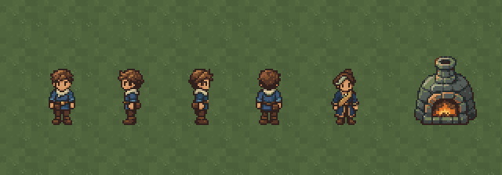

# Player, Mara and furnace pilot

**Created:** 19 November 2026. **Updated:** 20 November 2026. **Stage:** integrated static art and eight-way player walking.




The waist separation reported in the first stride frames is corrected. The
torso overlaps a retained pelvis while the legs articulate and arms counter-swing.
[Larger walk preview](previews/walk-inspection.gif) and
[all sixty-four frames](previews/walk-contact-sheet.png) expose the join on a
contrasting background. Rows in the contact sheet are south, west, east, north,
southwest, southeast, northwest and northeast; columns are poses 0-7. The four
diagonal directions have their own three-quarter views and alternating strides.

The player has a chestnut-haired, blue-teal traveller outfit with empty hands.
Mara keeps her canonical blue warden coat and gold sash, with tied-back hair and
a grey streak. The furnace uses slate stone, a short chimney and a lit arch.
All share upper-left lighting, a restrained palette and clean alpha with the
[forest kit manifest](../forest-pilot/manifest.json).

| Editable master | PNG | Contents |
|---|---|---|
| [player.ase](source/player.ase) | [player.png](textures/player.png) | 256x384 atlas; eight directions and eight poses per direction |
| [mara.ase](source/mara.ase) | [mara.png](textures/mara.png) | Static 32x48 sprite |
| [furnace.ase](source/furnace.ase) | [furnace.png](textures/furnace.png) | Static 48x64 sprite |

Masters use one image layer and one editor frame. The player's sixty-four runtime
frames are cells in an editable atlas. Rows are **south, west, east, north,
southwest, southeast, northwest, northeast**;
columns contain eight neutral/contact/passing/lift poses. Each cell is
32x48 with pivot **(16, 40)**. Mara uses the same pivot. The furnace pivot is
**(24, 56)**. Every pivot sits at **(16, 24)** in the existing 32-pixel world tile.
The image dimensions do not change gameplay occupancy.

The game chooses the player's facing from eight 45-degree sectors of visual
travel and advances the walk cycle by distance, with one cycle per 1.5 tiles. Small
perpendicular smoothing tails retain a cardinal facing. It returns to a neutral
pose of the last direction on stopping. The GIF is an eight-frame art-board
preview with authored frame durations and all directions shown together.

## Edit and export

Save edits in the masters, then run from the repository root:

```powershell
python tools/art/build_cast_pilot.py --editor "C:\Program Files\Asprite\libresprite.exe"
```

Normal export preserves all three masters, refreshes PNGs/metadata/previews and
updates the shared C++ geometry binding. World-art batches share one texture cache.
CMake copies the runtime PNGs beside the executable; restart after export
and build to see saved changes. F6 still switches to basic shapes.

Exports reject missing waist pixels and lower-body pixels disconnected from
the torso. [walk-validation.json](previews/walk-validation.json) records the
per-frame result. To rebuild the walk cells in each direction from
the saved neutral frames, add `--rebuild-walk`; this preserves neutral poses,
Mara and the furnace. It is an explicit source edit, separate from normal export.

To migrate an older 128x192 four-direction master, use `--add-diagonals`. It
appends the four diagonal rows while preserving the original cardinal neutral cells;
it rejects an already expanded master. Normal export and `--rebuild-walk`
require the eight-direction master. `--rebuild-walk` can migrate its older
four-pose layout to eight poses and preserves all eight saved
neutral poses. Normal export preserves the complete master, including hand edits.

`--regenerate` intentionally replaces the masters using the retained
[original generated reference](reference/cast-reference.png) and LibreSprite
authoring script. Preserve manual edits before using that option. LibreSprite
performs all visible artwork processing, palette cleanup, pose drawing and GIF
export; Python only supplies empty canvases and metadata/commands.

[manifest.json](manifest.json) records 66 stable frame IDs, checksums, pivots,
palette, facing order and provenance. No third-party image input was used and
no new asset licence is asserted beyond the repository distribution policy.

## In the game

See the [integration record](../../../docs/embervale/06-development/CAST_RENDERING_2026-11-19.md)
for the original River Crossing captures, and the
[eight-way animation record](../../../docs/embervale/06-development/PLAYER_EIGHT_WAY_2026-11-20.md)
for its original integration. The later
[animation polish record](../../../docs/embervale/06-development/ANIMATION_RESEARCH_2026-11-20.md)
documents eight-pose gait, steady visual movement and equipped action layers. Mara's
painted head and the furnace's opaque pixels can be clicked as their existing
interaction targets. Collision, dialogue, recipes, equipment and saves retain
their current rules. This batch owns the neutral and walking outfit; the melee
and woodcutting batches supply its equipped action layers. Other NPCs and
stations keep their existing art until their own batch is authored.
