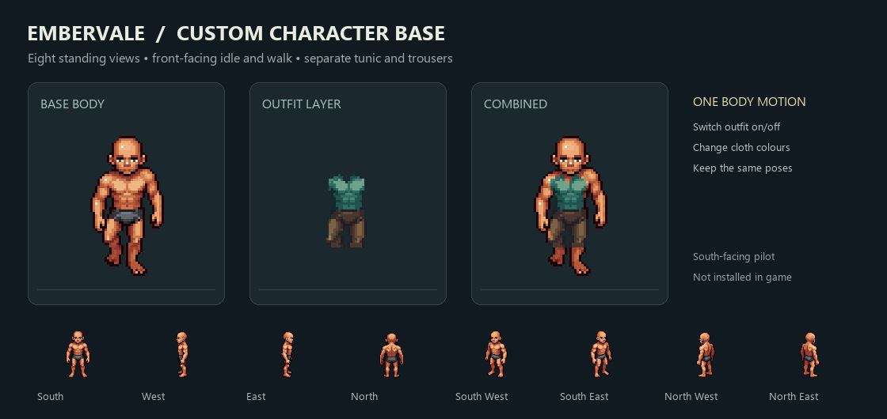

# Custom character pilot

**Status:** Retained art/customisation proof, not a runtime world-art batch.  
**Created:** 22 November 2026.  
**Owner feedback:** Improvements are required; finished visual acceptance is open.

Start with the [custom character plan](../../../docs/embervale/05-game/CUSTOM_CHARACTERS.md), [improvement register](../../../docs/embervale/06-development/CUSTOM_CHARACTER_REVIEW_2026-11-22.md) and [production workflow](../../../docs/embervale/05-game/CUSTOM_CHARACTER_WORKFLOW.md).

## Inspect the first proof

The immutable [v1 source pack](v1/README.md) contains:

- Eight original 64×64 standing source views.
- Four south idle and eight south walk source poses, stored by PixelLab at 84×84.
- Separate tunic/trouser layers and a dressed reference on 80×80 packed cells.
- Original sources, exact mask/colour decisions, palette examples and hashes.
- A [timed layer comparison](v1/previews/character-layer-preview.gif).
- A self-contained [character-workshop.html](v1/character-workshop.html); download/check out the file and open it locally. GitHub's file view does not execute it.

Use Idle or Walk facing South to inspect the clothing options. Other facings currently have standing body views only. Hair, beards, full animated coverage, equipment hand tracks, appearance saves and a game creator are future work.

## Keep the scope precise

The source front body is roughly 60 visible pixels tall. The packed cell/pivot is 80×80/(40,70); this is not the existing player's geometry and is not approved as the final world scale. Compare in the real renderer before replacing anything.

The archive's 600-ms walk preview follows the separate later PixelLab walking candidate's one-tile convention. Default master f2b5c6b has the earlier authored timing. Do not copy constants or array indices between them without reconciliation.

This folder is excluded from the named runtime image catalogue and explicit CMake asset-copy lists. It adds no loaded runtime textures. Its PNG sources and JSON decisions are not a new production importer. Existing art masters, equipment, gameplay and player save version 13 are unchanged.

## Preservation and reproduction

The 23 original files in v1 are kept byte-for-byte with their [original hash inventory](v1/sha256.json). A repository [provenance record](provenance.json) records the original archive checksum and source set. Keep later changes in explicit new revisions rather than editing this reference.

The [historical builder](v1/build_pack.py) is included as provenance and packaging support. It needs Pillow/NumPy, has Windows font paths and regenerates derived previews/evidence. It is not the normal production exporter; do not run it over the retained v1 merely to view the result. A portable source-preserving successor is planned under ART-006.

PixelLab supplied the body poses. Exact PixelLab workbench masks/colour maps supplied the garment artwork. Local assembly only preserves/packs source pixels and verifies composition. No body was manually bent, rescaled or procedurally reanimated for the pack.

The original art task used four generations. Its remaining-balance receipt was 4.75; that is historical information, not a live balance or permission to spend more. Publication and planning request no new artwork generations.

## Evidence limits

Twelve body cells are exact to their sources; garment alpha and layer composition checks pass. Those checks do not prove attractive anatomy, fabric quality, equipment clearance, eight-way animated fit or game acceptance.

The preview JavaScript passed syntax checking. A live browser interaction check was blocked because the active browser address could not be confidently verified on Windows. No successful browser UI test or game-renderer playthrough is claimed. See the [dated review](../../../docs/embervale/06-development/CUSTOM_CHARACTER_REVIEW_2026-11-22.md) for the improvement and verification record.

