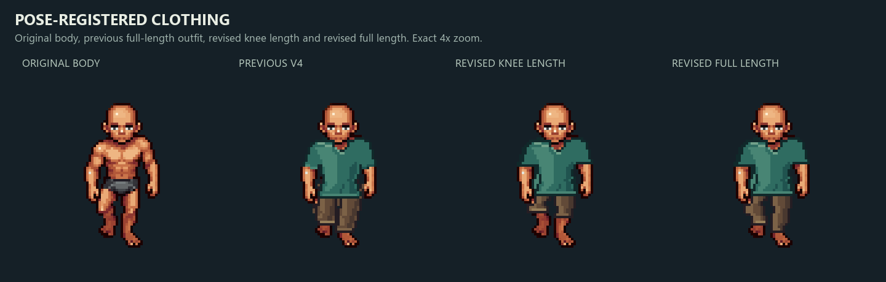

# Clothing alignment v5

**Date:** 22 November 2026.  
**Owner feedback:** V4 still did not align; inspect every pixel and frame.  
**Status:** Revised authoring candidate. Owner visual acceptance remains pending.

The garment contours now follow each original body pose. The sleeves and torso follow the actual shoulder/arm/waist outlines; both pant lengths follow the changing knee and ankle contours. The original body, its motion, timing and pivot are unchanged. The top retains its authored neckline and fabric shading.

Earlier coverage tests passed while broad shapes could still sit poorly around a moving limb. The closer review also found twenty-nine forearm pixels incorrectly included in the old trouser regions. Those pixels are now protected skin. Detached strips are removed, source gaps between the legs remain clear, and cuffs sit on measured body cross-sections with at most one extra outer pixel of fabric.

## View and inspect

- [Moving comparison](previews/before-after-walk.gif), with exact 4× pixels.
- [All knee-length poses](previews/all-poses-knee.png) and [all full-length poses](previews/all-poses-full.png).
- [Interactive workshop](character-workshop.html), with both lengths: download/open locally; GitHub's file view does not run HTML.
- [Validation](validation.json), [manifest](manifest.json) and [correction record](../../../../../docs/embervale/06-development/GARMENT_ALIGNMENT_2026-11-22.md).

Each pose has its own review board with the source body, old outfit, both new choices and 8× detail crops:

| Idle | Walk, first half | Walk, second half |
|---|---|---|
| [Idle 1](previews/frames/frame-01.png) | [Walk 1](previews/frames/frame-05.png) | [Walk 5](previews/frames/frame-09.png) |
| [Idle 2](previews/frames/frame-02.png) | [Walk 2](previews/frames/frame-06.png) | [Walk 6](previews/frames/frame-10.png) |
| [Idle 3](previews/frames/frame-03.png) | [Walk 3](previews/frames/frame-07.png) | [Walk 7](previews/frames/frame-11.png) |
| [Idle 4](previews/frames/frame-04.png) | [Walk 4](previews/frames/frame-08.png) | [Walk 8](previews/frames/frame-12.png) |

All twelve poses were individually reviewed with these enlargements. The inspection is separate from the exhaustive pixel/export checks; neither substitutes for owner visual acceptance.

## Retained production inputs

| Path | Role |
|---|---|
| source/tunic-raw.png | Final PixelLab top; twelve 84×84 cells |
| source/knee-raw.png / full-raw.png | Final PixelLab pants, same pose order |
| recipes/tunic.json / knee.json / full.json | Editable complete pixel decisions for every frame |
| recipes/pose-registration.json | Source torso/leg rows, cuff cross-sections and protected body parts |
| recipes/visual-review.json | Pose-by-pose inspection notes |
| recipes/authoring-history.json | Service IDs and actual revision history |
| exports/tunic-south.png | Shared 80×80 top layer |
| exports/trousers-knee-south.png / trousers-full-south.png | Independent pant choices |
| exports/outfit-knee-south.png / outfit-full-south.png | Garment compositions |
| exports/dressed-knee-south.png / dressed-full-south.png | Compositions with the unchanged body |

Draw the [original body](../../v1/layers/body-south.png), chosen pants and this top from the same column. Idle uses columns 0–3, walk 4–11. Retain 80×80 cells, pivot (40,70), the source-to-export offset (-2,-2), idle timing 4×400 ms and the 600-ms walk. Coverage is South only. The knee option leaves the lower legs bare; full length leaves the original feet visible.

With Pillow and NumPy available, run from this directory:

~~~bash
python validate.py
python build_preview.py
python validate.py
~~~

The builder packs/composites retained PixelLab PNGs and creates previews; it does not repaint artwork. The validator compares all 254,016 source pixels in the thirty-six garment cells against the editable masters, then independently checks source-body registration, protection, cuff placement, connectivity, leg separation, exact composition and preservation. Preview fonts may vary by host; artwork is unchanged.

All earlier revisions remain byte-for-byte preserved. No body/animation generation was purchased and no runtime assets, saves or gameplay code changed. Native game rendering and broader facing/action coverage remain open.
