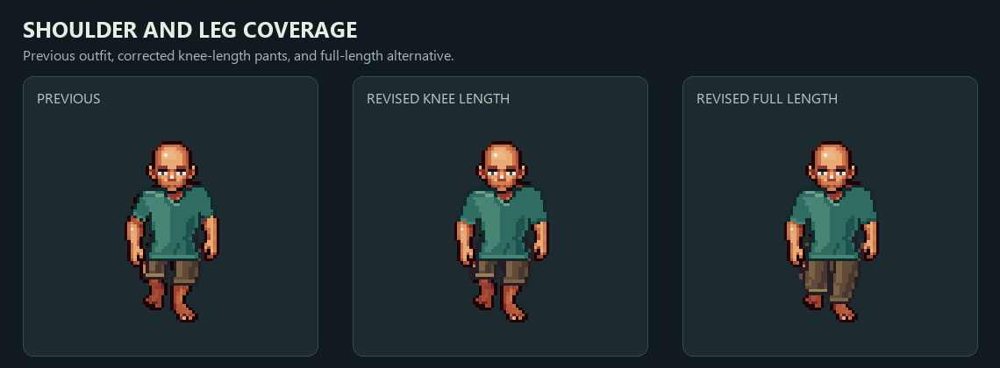

# Garment coverage v4: shared top and two pant lengths

**Date:** 22 November 2026.  
**Owner feedback:** The revised top and pants still showed skin at the shoulders and leg muscles. The owner requested both knee-length and full-length pants.  
**Status:** Revised south-facing artwork; owner visual acceptance pending.

The earlier fit checks sampled selected points and used overly broad hand rectangles. They missed shoulder rims and incorrectly protected some thigh pixels as hands. This revision expands the short sleeves, closes the remaining shoulder edges and covers the complete declared thigh areas. It also adds full-length pants covering the calves to the ankle boundaries. Both choices reuse the same original body and shared revised top.

## Review both choices

- [Moving comparison](previews/before-after-walk.gif): previous outfit, corrected knee length, full length.
- [Every knee-length pose](previews/all-poses-knee.png) and [every full-length pose](previews/all-poses-full.png).
- [Enlarged shoulder comparisons](previews/shoulders-closeups.png) and [enlarged leg comparisons](previews/legs-closeups.png).
- [Interactive workshop](character-workshop.html): download/open locally, then use **Pants length**. GitHub's file view does not execute HTML.
- [Validation](validation.json), [manifest](manifest.json) and [correction record](../../../../../docs/embervale/06-development/GARMENT_COVERAGE_2026-11-22.md).

All twelve cells remain South-facing: four idle, eight walk. The knee-length option intentionally leaves lower legs bare; full length covers the legs to the authored ankles. Feet, hands, neck opening and forearms below the sleeves remain bare. The source body and all earlier revisions are unchanged.

## Sources and reusable layers

| Path | Purpose |
|---|---|
| source/tunic-raw.png | Final transparent PixelLab top, twelve 84×84 cells |
| source/trousers-knee-raw.png | Final knee-length garment, same poses |
| source/trousers-full-raw.png | Final full-length garment, same poses |
| source/trousers-full-initial-rejected.png | Earlier candidate before the sixteen thigh-edge corrections |
| recipes/tunic.json | Complete editable final top drawing |
| recipes/trousers-knee.json | Complete editable knee-length drawing |
| recipes/trousers-full.json | Complete editable full-length drawing |
| recipes/body-coverage-domains.json | Whole source-body areas that clothing must cover, plus protected body parts |
| recipes/coverage-patches.json | Exact remaining edge corrections for all three layers |
| recipes/initial-audit.json | Diagnostic failures before the final edge corrections |
| recipes/authoring-history.json | Service IDs, actual findings and corrections |
| exports/tunic-south.png | Shared top, packed as twelve 80×80 cells |
| exports/trousers-knee-south.png | Separate knee-length layer |
| exports/trousers-full-south.png | Separate full-length layer |
| exports/outfit-knee-south.png / outfit-full-south.png | Garment-only compositions |
| exports/dressed-knee-south.png / dressed-full-south.png | Compositions with the unchanged body |

Draw the [original body](../../v1/layers/body-south.png), the chosen pants layer, then this revision's top from the same column. Idle occupies columns 0–3 and walk 4–11. Retain the (40,70) ground pivot, original timing and 80×80 cells. Packing removes only the two-pixel transparent source border.

## Check or rebuild

With Pillow and NumPy installed, run from this directory:

~~~bash
python validate.py
python build_preview.py
python validate.py
~~~

The builder only packs/composites retained PixelLab artwork and embeds it in the preview. It does not paint clothing, mutate bodies or regenerate earlier sources. Font rendering can differ by host. After a deliberate art edit, retain the new service export and update evidence/checksums explicitly.

The read-only validator checks every source-body pixel in the declared covered areas: 1,700 shoulder pixels, 2,770 knee-pant pixels and 3,781 full-pant pixels, with zero uncovered pixels. It separately protects 1,144 hand/forearm pixels and 893 foot pixels. The previous top misses ninety body pixels in the shoulder areas; the previous knee-length pants miss sixty in the corresponding covered areas. These counts include outlines as well as coloured skin. Full-length calf coverage is a new garment choice, not a retroactive defect count for shorts.

The checks also preserve original face/neck openings, the knee option's bare lower legs, all earlier hash inventories, exact compositions, lossless packing, correct embedded layers and the 600-ms walk loop. Enlarged visual review covers all twelve poses in both variants. Owner visual acceptance and native game rendering remain open.

PixelLab's exact drawing tools supplied these garment revisions without new paid body/animation generations. This pack remains outside runtime asset batches and adds no appearance save data or game creator.
