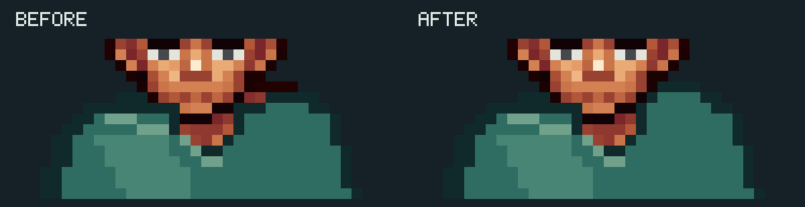

# Shoulder crest correction v6

**Date:** 23 November 2026.  
**Owner feedback:** Look at the very top of the shoulders.  
**Status:** Revised candidate; owner visual acceptance pending.

A narrow exposed ridge remained beside the jaw when either shoulder rose. Some of those shoulder pixels had incorrectly been included in the face/neck protection rectangle. This correction uses the actual jaw span on each source row.

Thirty-nine exposed shoulder pixels are covered across the eight walk poses. Local outline cleanup changes another thirty-six existing garment pixels. The four idle poses, lower top, original body and both v5 pant layers are unchanged.

- [Poses 1–4](previews/shoulders-01-04.png).
- [Poses 5–8](previews/shoulders-05-08.png).
- [Poses 9–12](previews/shoulders-09-12.png).
- [Interactive preview](character-workshop.html), with the existing knee/full selector; download/open locally.
- [Explicit pixel/jaw decisions](recipes/shoulder-boundary.json), [editable master](recipes/tunic.json), [manifest](manifest.json) and [validation](validation.json).

Use the original [body](../../v1/layers/body-south.png), either [v5 pant layer](../alignment-fit-v5/README.md), then this revision's top. Pose order, 80×80 cells, pivot (40,70) and timings remain unchanged. Coverage is South only.

The checks compare the full master/export pixels, verify all thirty-nine source-body shoulder points, protect the actual jaw and prove that every other top pixel stays unchanged. All twelve enlarged shoulder comparisons were inspected. These are authoring previews; game rendering and owner visual acceptance remain open.

The PixelLab edit rendered before the editing environment disconnected. The PNGs were recovered losslessly from the retained pixel decisions rather than downloaded as original service PNG files. Two tied neighbouring cloth samples use a deterministic highlight choice, recorded in the manifest. The PNG codec was checked against the existing v5 PNG/master and its new outputs round-trip exactly.

No new body or animation generation was purchased. All earlier revisions remain retained.
