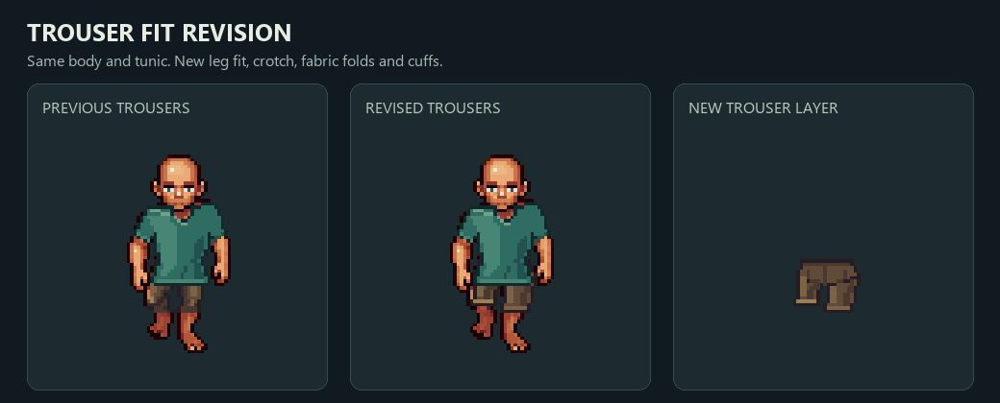

# Trouser fit v3

**Date:** 22 November 2026.  
**Status:** Revised south-facing art candidate; owner visual acceptance pending.  
**Request:** Give the trousers the same fit treatment as the tunic.

The original brown trousers used a waist-relative mask and recoloured body shading. This revision draws a separate seat, crotch and two leg panels for each pose, with fabric folds and cuffs placed around the moving thighs and knees. It keeps the original knee-length design and brown palette.

The body and the [v2 tunic](../tunic-fit-v2/README.md) are unchanged. The combined outfit here uses that tunic with these new trousers. Both earlier revisions remain intact.

## Review

- [Moving before/after comparison](previews/before-after-walk.gif): previous trousers, revised trousers, isolated new layer.
- [All twelve dressed poses](previews/all-poses.png).
- [Hip/leg study with the tunic hidden](previews/fit-study.png).
- [Interactive workshop](character-workshop.html): download/open locally; GitHub's file view does not execute it.
- [Fit checks](validation.json), [manifest](manifest.json) and [correction record](../../../../../docs/embervale/06-development/TROUSER_FIT_2026-11-22.md).

Coverage remains four idle and eight walking poses facing South. These are authoring previews; game rendering and other facings/actions remain open.

## Reuse

| File | Role |
|---|---|
| source/trousers-raw.png | Final transparent PixelLab sheet; twelve 84×84 source cells |
| source/trousers-initial-rejected.png | Earlier candidate retained with its hand-clearance failure |
| recipes/trousers.json | Editable layered drawing, with explicit geometry for every pose |
| recipes/fit-landmarks.json | Authored waist, hip, crotch, bend and cuff positions |
| recipes/acceptance-samples.json | Independent original-body coverage and leg-gap samples |
| recipes/authoring-history.json | Service IDs and the actual corrections made |
| exports/trousers-south.png | Separate garment; twelve 80×80 packed cells |
| exports/outfit-south.png | New trousers plus unchanged v2 tunic |
| exports/dressed-south.png | Original body plus the combined outfit |
| build_preview.py | Lossless packing, composition and preview assembly |
| validate.py | Read-only coverage, hand/lower-leg clearance and source-preservation checks |

Draw the [original body](../../v1/layers/body-south.png), this revision's trousers, then the [v2 tunic](../tunic-fit-v2/exports/tunic-south.png), using the same column. Idle occupies columns 0–3 and walk 4–11. Retain the (40,70) pivot, 80×80 cells and the manifest's timing. The two-pixel source border is removed without scaling or changing visible artwork.

## Check or rebuild

With Pillow and NumPy installed, run from this directory:

~~~bash
python validate.py
python build_preview.py
python validate.py
~~~

The builder reads the retained PixelLab PNG and the existing body/tunic. It rebuilds only derived exports/previews/HTML; it does not paint clothing, redraw the body or overwrite earlier revisions. Preview fonts may differ by host. After a deliberate artwork change, retain the new service source, rebuild, inspect all poses and update the evidence/checksums explicitly.

The checks cover 96 original-body fit samples, twelve actual gaps between the legs, 1,055 hand/forearm pixels and 1,192 lower-leg/foot pixels. They also verify lossless packing, exact composition, correct preview layers and both earlier hash inventories. Initial hand overlaps were found and corrected before publication; passing these checks still leaves owner visual review pending.

PixelLab's exact drawing tools produced this garment without new paid body or animation generations. This revision does not register a game asset batch or replace the playable default character.
