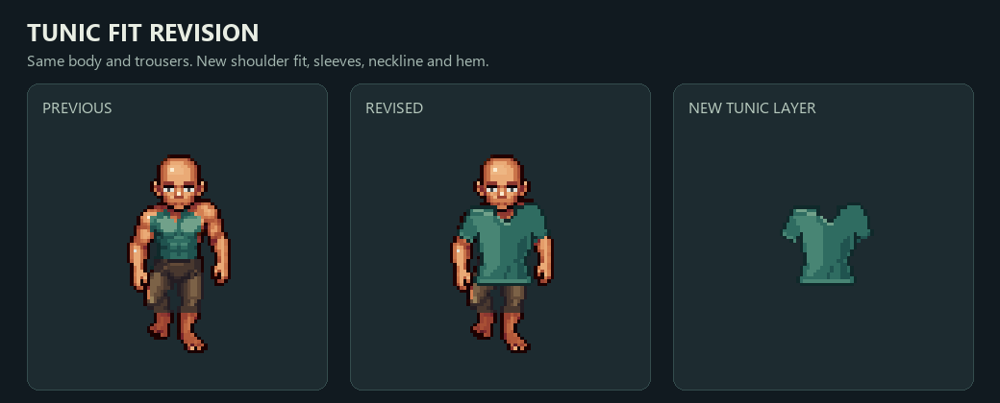

# Tunic fit v2

**Date:** 22 November 2026.  
**Status:** Revised south-facing art candidate. Owner visual acceptance is pending.  
**Owner feedback on v1:** The tunic did not fit properly.

The previous tunic was a narrow waistband-derived recolour. Its shape did not follow the shoulders through the walk, its hem was too short for the intended garment, and it inherited muscular skin shading. Passing an inside-body alpha check did not establish a proper fit.

This revision authors the actual garment around each pose's neck, shoulder crests, sleeves, armpits, waist and hips. It has short sleeves, a longer hip-covering hem and separate cloth shading. The body, trousers, foot pivots, idle/walk timing and original v1 files are unchanged.

## View it

- [Moving before/after comparison](previews/before-after-walk.gif).
- [All twelve revised poses](previews/all-poses.png).
- [Interactive workshop](character-workshop.html): download/open locally; GitHub's file view does not execute it.
- [Manifest](manifest.json), [fit checks](validation.json) and [owning defect record](../../../../../docs/embervale/06-development/TUNIC_FIT_2026-11-22.md).

Four idle poses and eight walking poses are supported, all facing South. The other standing views remain the original unclothed base reference. This is not eight-way clothing or an in-game character creator.

## Files and reuse

| Path | Purpose |
|---|---|
| source/tunic-raw.png | Exact PixelLab result: twelve 84×84 cells |
| recipes/tunic.json | Editable layered PixelLab drawing recipe for every pose |
| recipes/fit-landmarks.json | Authored neck/shoulder/sleeve/hip positions |
| recipes/acceptance-samples.json | Independent body coverage and protected hand/forearm samples |
| recipes/shoulder-crest-samples.json | Nineteen extra body samples for independently raised shoulders |
| exports/tunic-south.png | Separate 80×80 tunic cells, matching the original body order |
| exports/outfit-south.png | Original trousers plus the revised tunic |
| exports/dressed-south.png | Original body/trousers plus revised tunic, as a comparison |
| build_preview.py | Supporting lossless packing/composition and preview builder |
| validate.py | Read-only coverage, hand/face clearance, composition and source-preservation checks |
| character-workshop.html | Self-contained preview with the revised garment embedded |

Draw the unchanged [v1 body](../../v1/layers/body-south.png), unchanged [v1 trousers](../../v1/layers/trousers-south.png), then the new tunic from the same pose column. Idle uses columns 0–3; walk uses 4–11. Retain the (40,70) pivot and the manifest's source-to-export offset. These remain prototype dimensions, not current runtime bindings.

PixelLab's free exact drawing tools authored the garment; no paid body/animation generation was required. Body poses were not bent, rescaled or redrawn.

## Check or rebuild

From this directory, with Pillow and NumPy available:

~~~bash
python validate.py
python build_preview.py
python validate.py
~~~

Validation is read-only. Preview rebuilding updates only derived PNG/HTML/GIF files; it does not overwrite original v1 sources or the tunic recipe/raw source. Fonts are selected from installed Windows/Linux candidates with a default fallback; preview text can differ by host. The artwork itself is the retained PixelLab PNG.

After a deliberate art change, replay the edited recipe in PixelLab, retain its original transparent PNG, rebuild and review every pose. Update the checksums and dated evidence explicitly. Do not mark visual acceptance from passing checks alone.

## What the checks now prove

The old tunic fails the independent shoulder/chest/hip coverage check in all twelve poses. The revised tunic passes all twelve, leaves the neck opening clear and has zero overlap with the protected hand/forearm samples. A two-pixel left-hand overlap in the final walk pose was caught and corrected by changing the hem geometry.

The new garment can intentionally extend outside the naked body's outline; sleeve and cloth volume are valid geometry. This replaces the old “all garment pixels must lie inside body” rule for this garment. Face/hands, declared frame bounds, meaningful fit and actual composition are checked instead.

The checks also establish lossless padding removal, exact layer composition and preservation of the original v1 inventory. Agent review covers every revised pose; native game rendering and owner visual acceptance remain open.

