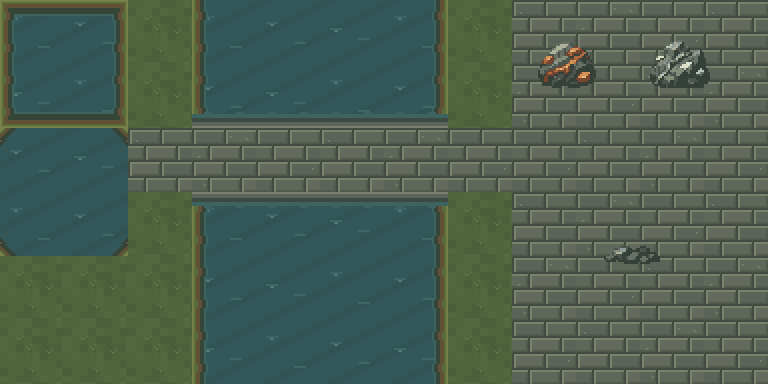

# River, stone and mining art pilot

Four editable LibreSprite masters extend the forest/cast kit at the same
32-pixel tile scale. The game selects them from existing ground and resource
definitions. This batch introduces no new ore or gathering rule.



| Source | PNG size | Contents |
|---|---|---|
| `source/terrain.ase` | 256x192 | Three water variants, three stone paver variants, 36 bank overlays |
| `source/copper.ase` | 32x40 | Copper boulder with broad warm veins |
| `source/tin.ase` | 32x40 | Craggy tin boulder with pale diagonal seams |
| `source/rubble.ase` | 32x40 | Shared low depleted pile without visible ore |

The 45 stable IDs, frame rectangles, pivots, hashes and provenance are in
[manifest.json](manifest.json). The terrain atlas has eight columns. Bank order
within each grass/earth, stone and bare-dirt family is N/E/S/W, outer
NW/NE/SW/SE, inner NW/NE/SW/SE. Transparent bank overlays draw by quarters over
complete water tiles. Unused atlas cells stay transparent. Water and pavers
are opaque. Exports use binary alpha and nearest-neighbour scaling.

Rocks use one reference sampling scale and a twelve-colour palette. Their
(16,32) foot pivot aligns to (16,24) in the occupied tile. Rubble retains that
contact point with a lower silhouette. Copper and tin keep their existing
depletion and respawn rules. Iron and coal still use basic art.

Export saved masters from the repository root:

```powershell
python tools/art/build_environment_pilot.py --editor "C:\Program Files\Asprite\libresprite.exe"
```

The default command preserves `.ase` files, reopens them in LibreSprite and
exports PNGs, editor metadata and the board. It refreshes the shared C++ layout
across all three batches. Python's standard library and the editor are needed
for authoring, not game startup. Masters use one image layer and one frame,
with the atlas dimensions above; trimmed cel offsets are respected.

`--regenerate` explicitly replaces these four masters from the script and
retained [original generated rock reference](reference/mining-reference.png),
discarding manual changes in this batch. LibreSprite JavaScript performs all
pixel drawing, sampling and palette/alpha cleanup. The reference has no
third-party image input. Distribution follows repository policy; no separate
asset licence is declared.

See [runtime integration and captures](../../../docs/embervale/06-development/ENVIRONMENT_RENDERING_2026-11-19.md).
Animated water, natural stone ground, buildings, remaining resource tiers and
the full starter kit remain future batches.
