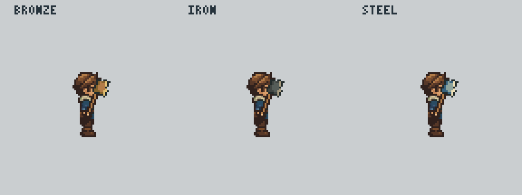

# Modular axe animation: east-facing proof

**Implemented:** 22 November 2026.  
**Status:** Isolated authoring prototype; outside the runtime catalogue and packaging.  
**Purpose:** One shared body sequence and hand track, one editable axe shape, three material appearances.



This is an engineering proof using the existing saved chopping body. Its pixels are copied unchanged from the east-facing row of the woodcutting master. It does not regenerate the old procedural body, spend AI generation credits, or claim acceptance of the current body performance. Clean body art, other directions and game integration remain separate work.

## Editable inputs

| Input | Role |
|---|---|
| [recipe.json](recipe.json) | Eight hand/aim/depth poses, source-space pivots, shared timing reference and material-to-item mappings |
| [body.ase](source/body.ase) | Eight unchanged 96x96 body cells, 768x96 master |
| [axe.ase](source/axe.ase) | One 32x40 upward tool view; local grip `(16,29)` |
| [metal-mask.ase](source/metal-mask.ase) | Independent semantic metal regions: red shadow, green midtone, blue highlight |

The body uses ground pivot `(48,64)`. Each frame places the same tool view at its authored main hand using the recorded aim vector. The offhand must remain within 1.5 native pixels of the shaft and within the declared grip interval. Authored front-hand pixels restore the original hand over the handle. Loaded poses put the tool behind the body; contact and carry use the recorded front ordering.

The track was bootstrapped once from the matching existing woodcutting geometry. Normal export reads the saved track; it does not run `player_rig.js`, recreate body poses or infer new wrist locations.

The original axe design is authored once in the tool master. Bronze, iron and steel map three semantic metal regions to their respective shadow/midtone/highlight colours. Wood, outline and silhouette are protected. Bronze midtone intentionally shares the wooden handle's RGB; the independent mask distinguishes those pixels correctly.

## Generated review files

- [Comparison GIF](previews/materials.gif): eight poses at `[260,200,200,80,80,80,100,200]` ms, total 1,200 ms; integer 3x inspection scale.
- [Contact sheet](previews/contact.png): eight poses across each material row, integer 2x scale.
- [Attachment diagnostics](previews/grips.png): red main hand, blue offhand, green blade guide and yellow ground pivot. These markers are excluded from the final comparison.
- [Body atlas](textures/body.png), [tool atlas](textures/tools.png) and [composite atlas](textures/composites.png): native-size review outputs.
- [Validation](previews/validation.json) and [export receipt](manifest.json): coverage, hashes and pixel invariants.
- [Preservation report](reports/preservation.json): existing 33 runtime masters and 33 textures remain exact.
- [Focused test log](reports/tests.txt): actual unit and LibreSprite integration results.

These are authoring previews, not native gameplay recordings. The composite atlas is a diagnostic output; production can continue drawing bodies and tools separately.

## Export and check

From the repository root, normal export preserves all three editable masters:

```powershell
python tools/art/build_modular_axe_pilot.py --editor "C:\Program Files\Asprite\libresprite.exe"
python tools/art/build_modular_axe_pilot.py --check
```

The editor path is host-specific. On a restricted host, point `APPDATA` at a writable private LibreSprite profile for the command. This session used the task's sibling `art-profile` folder; normal unsandboxed artist sessions can use their usual profile.

`--check` verifies the recipe, exact master/output hashes and compiler/timing identities without writing files. Text fingerprints normalize CRLF to LF for portability; binary masters, PNGs and GIFs remain byte-exact. Unknown output entries, changed binaries and stale inputs reject.

The initial `--import-legacy` mode creates missing proof masters once from the saved east-facing body row and the single axe design. It refuses to overwrite any existing proof master. Do not use it for normal editing or export. `--output` selects a separate private pilot tree for test fixtures.

All candidate artwork is assembled and checked in a private staging tree before destination replacement. Output files are replaced individually and the receipt is written last. An interrupted multi-file publication is detectable through `--check`; it is not a cross-file atomic transaction. Invalid recipe data and invalid decoded mask pixels preserve previous usable outputs.

## Editing a material or attachment

Edit a material's three `metal` colours in the recipe, then export. No body/hand track edit is required. New proof materials can be mapped in the same bounded list (maximum eight); these records do not add real gameplay items or runtime coverage.

Edit the shared hand/aim/depth track to correct an attachment once across every material. Edit the tool master to change its shape, retaining a valid grip and mask. Edit the mask when the metal region changes. A different tool design or grip style still needs a fit/visual review; this proof supports one axe view and east-facing chopping only.

## Verification

Run the focused suite against the actual editor:

```powershell
$env:EMBERVALE_ART_EDITOR = "C:\Program Files\Asprite\libresprite.exe"
python -m unittest discover -s tests -p test_modular_equipment.py -v
```

The pure recipe tests run without an editor. The real-exporter cases explicitly skip if that environment variable is absent, so a pure-data run must not be described as a full export pass.

Current checks cover exact body reuse, distinct material appearances with identical alpha, protected body/handle pixels, portable text receipts, binary corruption refusal, deterministic normal export, master preservation, duplicate/invalid definitions, invalid grips and preservation after a real malformed mask is rejected.

See the [implementation report](../../../docs/embervale/06-development/MODULAR_AXE_PROTOTYPE_2026-11-22.md) and [production plan](../../../docs/embervale/05-game/MODULAR_EQUIPMENT_ANIMATION_PLAN.md). Original project body/tool art and editable sources are retained; no third-party sprites or new external generations were introduced. Repository distribution policy applies; no separate asset licence grant is asserted.
