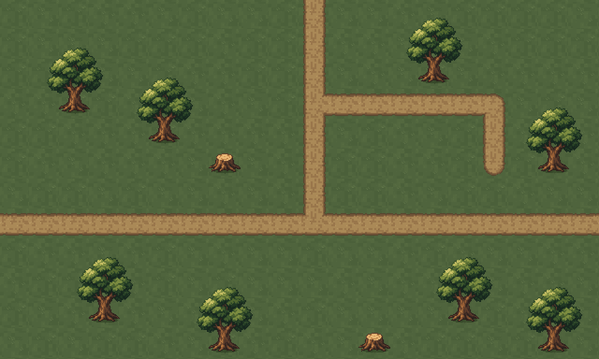

# Embervale forest art pilot

**Created:** 19 November 2026. **Stage:** editable art batch and first runtime pilot.
The SDL client now draws this grass, dirt and normal-tree kit. A generated C++
binding supplies its geometry; this authoring manifest is not a runtime JSON
import format. [See the actual River Crossing renderer capture](../../../docs/embervale/06-development/art/2026-11-19/woodland.png).



## Contents

| Editable master | Export | Contents |
|---|---|---|
| [terrain.ase](source/terrain.ase) | [terrain.png](textures/terrain.png) | Three grass variants and sixteen connected dirt path tiles, each 32x32 pixels |
| [oak.ase](source/oak.ase) | [oak.png](textures/oak.png) | Ordinary tree, transparent 64x96 canvas |
| [stump.ase](source/stump.ase) | [stump.png](textures/stump.png) | Matching depleted tree, transparent 64x96 canvas |

[manifest.json](manifest.json) records all 21 stable IDs, atlas rectangles,
pivots, source/output checksums, palette and provenance. The single-frame
`textures/*.export.json` files come from LibreSprite; the manifest subdivides
the terrain image into individual tiles. Master files are editable RGBA pixel
art with one image layer and one frame; animation and separate bark/canopy
layers are future work.

The tree and stump begin with the retained original
[generated reference](reference/oak-and-stump.png). LibreSprite JavaScript
samples both at the same scale, removes translucent edge pixels and maps them
to a shared twenty-colour palette. Grass and paths are drawn directly in
LibreSprite by the script. No third-party image input was used. No separate
asset licence is declared by this batch; the repository's distribution policy
continues to apply.

## Placement and style

- Ground tiles use the existing 32-pixel grid and a quiet moss-green palette.
- Dirt uses warmer values and broad rounded corners, with restrained pebbles.
- Lighting comes from the upper left. Trees use clustered olive foliage and
  warm bark; the stump shares the tree's scale and ground contact point.
- Tree and stump pivots are **(32, 88)** on their 64x96 canvases. The sample
  scene places that pivot at **(16, 24)** within the occupied tile.
- The intended interaction footprint stays one tile. Canopy size does not
  define collision. The authoring metadata does not change game geometry.
- The resource exports use only alpha 0 or 255; the preview adds a small
  ground-contact shadow separately.

Terrain atlas cells are read left to right, then top to bottom, on a 4-column
grid. Cells 0-2 are grass variants; cells 3-18 are path masks 0-15; cell 19 is
unused transparent space. Path bits are **N=1, E=2, S=4, W=8**. Combine bits to
choose a tile: north/south is 5, east/west is 10, and a four-way crossing is 15.
Mask 0 is an isolated round dirt patch. These are cardinal path pieces, not a
complete diagonal terrain or river autotile set.

## Edit and export

Open the `.ase` files in LibreSprite, edit pixels and save. From the repository
root, export those saved masters and rebuild both previews:

```powershell
python tools/art/build_forest_pilot.py --editor "C:\Program Files\Asprite\libresprite.exe"
```

Python 3.9+ and the installed **LibreSprite 1.1-dev** JavaScript API are used.
Python supplies empty canvases, launches the editor and writes metadata;
LibreSprite performs all drawing, resampling, palette work and PNG exports.
The default command preserves the editable masters and reads their actual
pixels for the preview. It also refreshes the generated
`src/Graphics/ForestPilotLayout.h` binding when geometry changes. Each export reopens its `.ase` file in a new editor
process. Script exceptions are treated as failures even if the editor exits 0.

To intentionally recreate the original masters from the reference and drawing
script, add `--regenerate`. **This replaces manual edits in the three master
files.** Normal export never requires that option. Use a writable editor
settings location; a portable LibreSprite copy with `libresprite.ini` beside
the executable works where the installed user profile cannot be written.

## Review boundary

The batch has been checked for matching grass/path edges, source reopening,
export dimensions, alpha and palette, and inspected in its offline scene at
native and 2x scale. [forest-pilot.png](previews/forest-pilot.png) is 640x384;
the enlarged preview uses exact nearest-neighbour 2x pixels. The scene is a
composition of this kit, not a capture of the running game or River Crossing.

The runtime now selects the kit with its pivots, resource state, depth ordering,
nearest-neighbour scaling and per-image fallback. **F6** switches the game
between forest art and basic shapes. Opaque canopy pixels can target the tree;
its one-tile gameplay footprint is preserved. Tall trees fade when overlapping
the player behind them. See the
[integration record](../../../docs/embervale/06-development/FOREST_RENDERING_2026-11-19.md)
for captures, the real renderer preview command and remaining review limits.

A player, NPC, station, water, rocks and a settlement kit still need their own
art work. ART-001 and the general asset importer/Studio preview gates are not
marked complete by this small runtime pilot.
