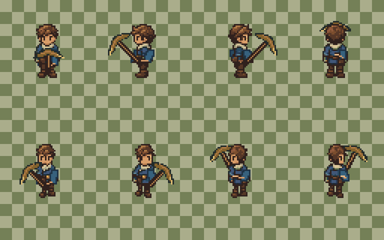
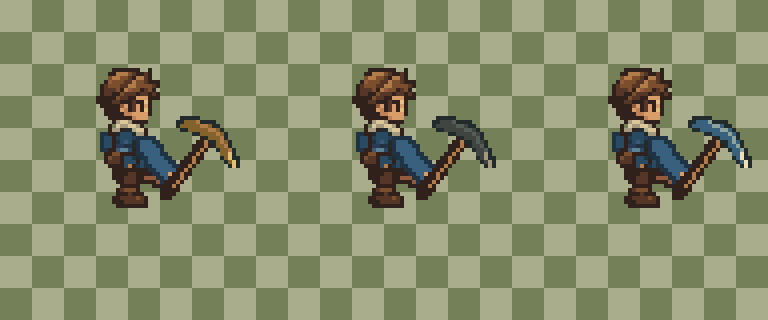

# Mining action sprites

**Added:** 20 November 2026. Eight directions, six action poses and three pickaxe tiers.



The traveller raises a curved pickaxe and strikes low toward the selected rock.
The point turns with the facing and leads into the rock on contact. Feet remain
grounded while the hands move through ready, raise, backswing, contact,
follow-through and recovery. Runtime uses the shared 1.2-second cosmetic
gathering cycle. The GIF uses LibreSprite's default preview timing.

| Editable source | Runtime image | Contents |
|---|---|---|
| [player.ase](source/player.ase) | [player.png](textures/player.png) | 48 body poses; 384x640 |
| [pickaxes.ase](source/pickaxes.ase) | [pickaxes.png](textures/pickaxes.png) | 144 pickaxe overlays; 384x1920 |

Cells are 64x80 with pivot **(32,52)** at ground point **(16,24)** in the existing
32-pixel tile. Rows are south, west, east, north, southwest, southeast, northwest
and northeast. Tool rows repeat that order for bronze, iron and steel. The
two atlases add 3.75 MiB of RGBA texels and about 0.94 MiB of cached alpha.



The original traveller outfit, palette and corrected tool-facing geometry are
reused from the cast/woodcutting authoring helpers. The mining module authors a
lower strike and a tapered double-ended pickaxe head. No external image input
is added. [Manifest](manifest.json), [all poses](previews/mine-contact.png) and
[validation](previews/validation.json) retain geometry, provenance and checksums.
Repository distribution policy applies; no separate asset licence is asserted.

## Edit and export

Edit saved masters, then run:

```powershell
python tools/art/build_mining_pilot.py --editor "C:\Program Files\Asprite\libresprite.exe"
```

Default export preserves both masters and refreshes PNGs, metadata, previews,
validation and the generated C++ binding. `--regenerate` explicitly recreates
both masters from the current cast neutrals and retained authoring scripts.
`--rebuild-pickaxes` replaces only the tool overlays. Preserve manual edits
before using either source-rebuilding option.

Validation checks binary alpha, all 48 body cells, connected lower bodies,
all 144 tool cells and clipping. Renderer checks additionally inspect the
leading point's actual pixels for every direction/tier/contact combination.
CMake packages both PNGs; missing action art falls back to the standing player.

## In the game

Copper, tin, iron and coal use the existing action and skill requirements.
The equipped bronze, iron or steel pickaxe selects its visual tier. Approaching
plays walking; only a running, valid nearby mining action plays the swing.
Movement, cancellation, depletion, wrong tools, missing targets and death stop
it. Cosmetic chips mark contact. Ore/Mining XP notices come only from committed
world rewards, including the final use that leaves rubble. Failed attempts
produce no reward notices.

[Implementation and local checks](../../../docs/embervale/06-development/MINING_ANIMATION_2026-11-20.md).
