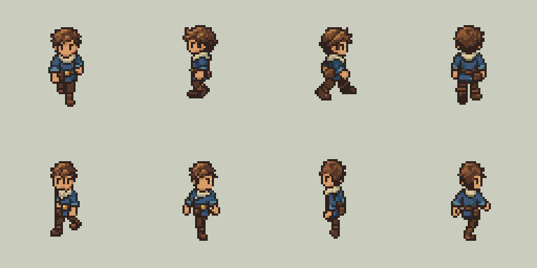
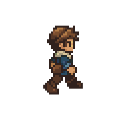

# PixelLab eight-way walking

The owner liked the east-facing PixelLab trial and requested the next implementation step. This batch imports the complete eight-direction Walking animation for the empty-handed player. Full in-game visual acceptance remains open. Equipped walking, Mining, Woodcutting and melee still use their existing complete body/equipment batches; matching those actions is subsequent art work.

## Source and geometry

- `generated/walking-all-directions.zip`: complete PixelLab character export with service metadata.
- `generated/walking/`: checked PNG inputs, eight separate idles and 64 walking frames.
- `source/player.ase`: editable lossless atlas, nine 64x64 cells per direction.
- `textures/player.png` and `player.export.json`: 576x512 runtime atlas and editor metadata.
- `manifest.json`: source/output hashes, bindings, provenance and shared preview/runtime timing.
- `previews/walk-contact-sheet.png`, `walk-cycle.gif`, `validation.json`: all directions and bounded pixel checks.

| Row | Direction | Columns |
|---:|---|---|
| 0 | South | 0 idle; 1–8 walking |
| 1 | West | 0 idle; 1–8 walking |
| 2 | East | 0 idle; 1–8 walking |
| 3 | North | 0 idle; 1–8 walking |
| 4 | South-West | 0 idle; 1–8 walking |
| 5 | South-East | 0 idle; 1–8 walking |
| 6 | North-West | 0 idle; 1–8 walking |
| 7 | North-East | 0 idle; 1–8 walking |

All cells use pivot `(32,48)` and tile ground point `(16,24)`. Walking advances by actual visual travel: one full cycle per tile. The eight moving holds are `[80,70,80,70,80,70,80,70]` ms, a 600-ms cycle at ordinary walking speed; running traverses the distance-based cycle faster. Idle is excluded from moving frames. PixelLab supplied the poses; atlas assembly, transparent-background preservation, integer preview enlargement and retiming do not deform or redraw them.



## Export

Normal export preserves the editable master:

```powershell
python tools/art/build_pixellab_pilot.py --editor "C:\Program Files\Asprite\libresprite.exe"
python tools/art/check_world_art.py --check --summary
```

The LibreSprite path is host-specific. Replacing the master from a complete service export requires explicit `--import-zip PATH`; the importer rejects missing directions, wrong frame counts, duplicate archive names, invalid PNGs and oversized input. Every cell is checked for alpha, content and clipping before an existing master is replaced. Archive member names never become destination paths. The complete shared resource gate runs before regenerating renderer bindings. Missing runtime art falls back to the original player per image.

The source character is [Embervale traveller](https://www.pixellab.ai/create-character/73253a5c-9983-4f58-8d67-cd31a1c928d5), low top-down, 64x64, eight supplied views. Walking uses PixelLab's Walking template and PixMiniMax. No subscription or API credentials were added.

## Historical east-only trial

The following records describe the earlier trial. Its files and timings are retained unchanged; the complete walking batch above supersedes its pending-integration status.

Status: eight existing views imported into PixelLab; one eight-frame east-facing walking animation generated and exported. Owner review and runtime integration remain pending.

The owner requested a dedicated AI sprite animation workflow after rejecting the procedural animation quality. This folder prepares a single east-facing walk test. It is not part of the runtime asset catalogue, and it does not replace any existing master or export.

- `reference/player-*-64.png`: the eight existing empty-handed neutral views, each translated onto a transparent 64x64 canvas without scaling or redrawing.
- `reference/provenance.json`: exact source rectangles, source/output hashes and ground pivot.
- `walk-east-prompt.txt`: the desired eight-frame walk brief. The current Character Creator uses its Walking preset rather than this full custom prompt.
- `generation.json`: actual service, character page, model, direction, settings and reported generation-unit costs.
- `generated/character-export.zip`: original PixelLab export, containing the eight supplied neutral views, eight generated east-facing PNG frames and service metadata.
- `generated/frames/`: untouched generated 64x64 PNG frames with transparency.
- `generated/walk-east-review-4x.gif`: nearest-neighbour preview at 4x scale and 100 ms per frame (800 ms per loop). These are the service's poses; only display scale and playback timing differ.
- `generated/walk-east-review-4x.png`: matching contact sheet.
- `generated/walk-east.gif`: original direct GIF export, retained separately. Its green background is absent from the PNG-frame ZIP export; use the PNGs for later integration.



All eight views were supplied through Character Creator's Create from Reference flow, with the low top-down camera selected. No replacement directional sprites were generated. PixelLab reports 0.25 generation units for fitting the imported skeletons. The first animation uses the Free motion Walking preset, PixMiniMax model, East direction and an eight-frame output; its displayed cost is one generation unit. Single color outline and Medium shading were selected, with Medium detail, the original 64x64 canvas and no forced palette. The service's completed-job details confirm Walking, eight frames, East only and Keep first frame On. Other directions and actions have not been requested.

The direct GIF uses 200 ms per frame (1,600 ms per loop). It was not retimed or overwritten. The 800-ms inspection preview is assembled through LibreSprite from the untouched PNG sequence, enlarged by an integer factor with nearest-neighbour scaling. No new pose drawing, interpolation or rig deformation was applied. Recorded frame checks confirm all eight PNGs are nonempty 64x64 images with transparent corners; this is an export check, not a judgement of animation quality or game-ready acceptance.

Review the loop at native scale and normal game zoom before requesting other directions or actions. Adjust the motion or use pose guidance if the generated gait is poor; do not infer visual approval from a successful generation.

Generated images must be retained separately from the reference, with the selected model/settings and service-reported cost recorded. No new subscription, paid credit purchase or API credential has been authorized. Inspect the actual frame count, transparency, alignment, character consistency, gait and equipment needs before integrating a selected result through the existing editable-master pipeline.
