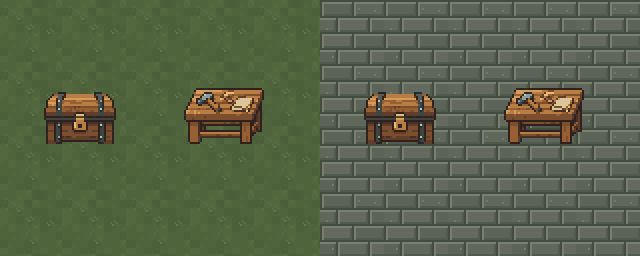

# Bank chest and crafting table

Two editable LibreSprite sprites replace the bank and crafting-table blocks
in River Crossing, using the existing upper-left lighting, warm timber and
muted metal palette at the 32-pixel ground scale.



| Source | Runtime PNG | Stable frame ID |
|---|---|---|
| `source/bank.ase` | `textures/bank.png` | `station.bank.idle` |
| `source/crafting-table.ase` | `textures/crafting-table.png` | `station.crafting_table.idle` |

Both canvases are 48x48. A (24,40) pivot lands at (16,24) in the existing
occupied tile. Chest ink is up to 36 pixels wide; table ink up to 40. Padding
and the gaps between legs stay transparent. Masters use one image layer,
one frame and binary alpha. Runtime scaling is nearest neighbour.

The static chest has iron bands and a brass latch. The workbench has a
hammer, parchment and scraps on top. These details grant no items or recipes.
Both use the existing station actions and single-tile blocking/approach rules.
An open/close chest animation is not implemented.

Export saved sources from the repository root:

```powershell
python tools/art/build_service_pilot.py --editor "C:\Program Files\Asprite\libresprite.exe"
```

Default export preserves the `.ase` masters and writes PNGs, editor metadata,
[manifest.json](manifest.json), the shared C++ layout and the review images.
The [4x inspection](previews/service-inspection-4x.png) shows native pixels on
a transparency checker. Trimmed cel offsets are respected. Python uses its
standard library; LibreSprite JavaScript performs all visible pixel work.
Neither the editor nor Python is required to play.

`--regenerate` explicitly replaces these two masters from the retained
[original reference](reference/service-reference.png), discarding manual
edits in this batch. LibreSprite samples to native size, applies the shared
eighteen-colour palette and converts alpha to binary. The reference has no
third-party image input. Source/output hashes and provenance are in the
manifest; no separate asset licence is declared.

See [integration and game captures](../../../docs/embervale/06-development/SERVICE_RENDERING_2026-11-19.md).
Buildings, remaining NPCs, other resource tiers and the complete visual kit
remain separate work.
