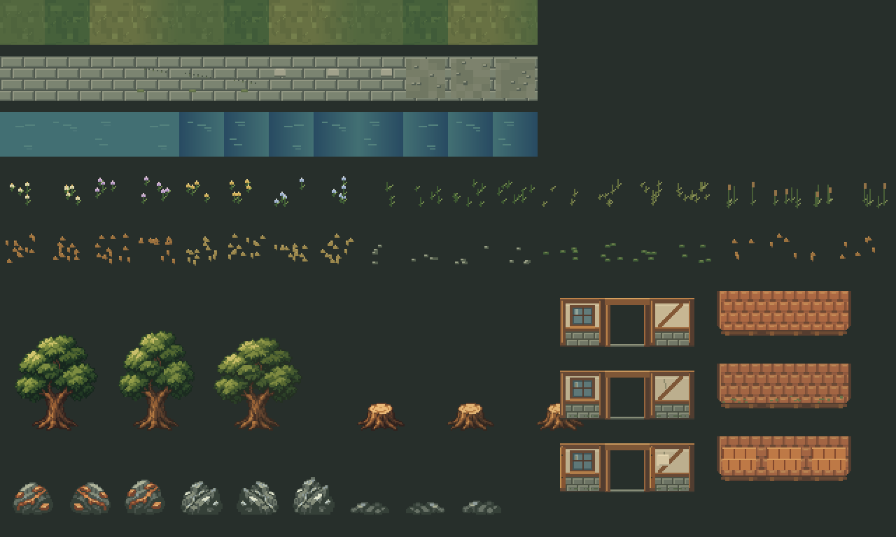

# Contextual landscape and building variation

Editable LibreSprite masters and runtime PNGs for the first world-wide variation
pass. The existing 32-pixel overhead grid, lighting and object pivots are retained.
The corrected player walk sheet is unchanged.



## Contents

| Master | Frames | Use |
|---|---:|---|
| grass | 162 | Meadow, lush/shaded and dry grass; 81 compatible corner patterns with two surfaces each |
| paths | 204 | Maintained, worn and overgrown dirt; four surface variants, sixteen connected edges and a full interior per surface |
| water | 48 | Shallow/deep corner blends with three quiet ripple patterns |
| stone | 12 | Clean, worn, repaired and rough mining ground, three variants each |
| flora | 40 | Eight wildflower groups, eight grass clumps, four reeds, eight leaf beds, four debris groups, four moss patches and four sparse-leaf groups |
| walls | 72 | Twelve original kit parts in new, weathered and repaired conditions; two panel variations |
| roof | 72 | Twelve parts in three conditions and two materials: terracotta and slate |
| floors | 9 | Three wooden surfaces in three conditions |
| trees / stumps | 3 + 3 | Fixed-root normal-tree silhouette and stump variants |
| rocks | 9 | Three copper, three tin and three depleted rubble silhouettes |

Total: **634 frames in eleven editable masters/PNGs**. Together with the earlier
five batches the renderer caches 747 frames in 26 PNGs. The manifest records
geometry, IDs, source/export checksums and layout. Runtime uses the generated
binding, not a new JSON importer.

## Placement rules

`WorldArtVariation` builds stable presentation fields from the actual world:

- Buildings, services and friendly NPC homes define maintained settlement areas.
  Roads alone do not turn distant woodland into a village.
- Distance from those areas increases wilderness density. Distance to dirt and
  stone suppresses plants at busy approaches and keeps flowers off path edges.
- Nearby water favours lush grass and reeds. Shared vertex depths blend shallow
  and deeper water. Broad coherent patches create dry and meadow grass.
- Flowers grow in small clusters around suitable open-meadow anchors. Four flower
  families each have two group shapes; they avoid tree shade, water, stone,
  resource/service cells, buildings and maintained approaches.
- Tree cover comes from actual normal/oak/willow resource positions. It creates
  denser leaf beds beneath quiet woodland canopies and sparse leaves at busier
  edges. Litter remains around depleted stumps. Ore resources do not seed leaves,
  even though legacy map occupancy also calls those cells `TREE`.
- Mining resources favour rough ground and loose stone. Damp shaded areas can
  receive moss. All dressing draws beneath entities and has no collision or
  interaction target.

Coordinate hashes select shapes within suitable contexts. They do not consume
gameplay RNG. The field is cached by map revision and placement counts; moving
the player, changing camera/zoom, gathering or rendering another frame does not
scatter the scenery again. Terrain/building edits invalidate the cache.

## Buildings and age

The workshop's stable ID selects a **repaired terracotta** profile: older panels
and roofing with bounded fresh plaster, replacement beams and a small roof
repair. The repairs occupy specific sections rather than every panel. Future
building IDs have stable condition/material defaults; explicit profiles belong
in the presentation selector. New and weathered versions and slate roofing are
available in the kit. Only the existing workshop is assembled in this world.

These are authored visual conditions, not simulated years, decay, durability,
repair costs or seasonal changes. Walls, doors, roof fading and pathfinding keep
their existing rules. Normal-tree and copper/tin alpha picking uses the same
selected silhouette as drawing. Oak/willow and other ore tiers retain their
earlier primitive objects while receiving contextual ground dressing.

## Edit and export

Open any `source/*.ase` master in LibreSprite. Keep its canvas, cell dimensions,
one layer/frame and binary alpha. Export without replacing manual work:

```powershell
python tools/art/build_variation_pilot.py --editor "C:\Program Files\Asprite\libresprite.exe"
```

`--regenerate` explicitly replaces this batch's masters with the native pixel
authoring script. The default only exports saved masters and rebuilds metadata,
the contact sheet, checksums and shared C++ binding. LibreSprite performs every
pixel operation; Python supplies blank canvases and export orchestration.
Original project masters are preserved.

CMake copies only the eleven runtime PNGs. Missing images fall back to earlier
art independently; missing decoration disappears safely. F6 retains basic mode.
The [game-camera record](../../../docs/embervale/06-development/WORLD_VARIATION_2026-11-19.md)
contains actual previews and the remaining scope.
