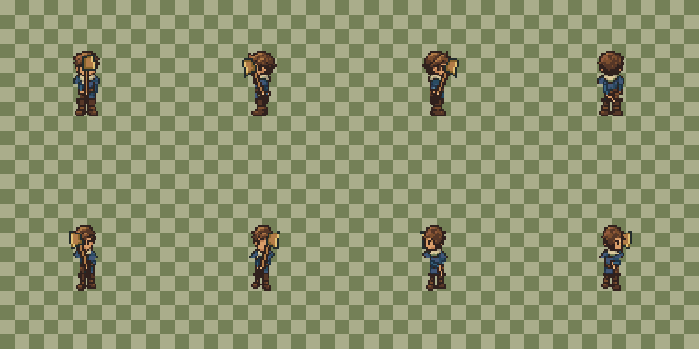
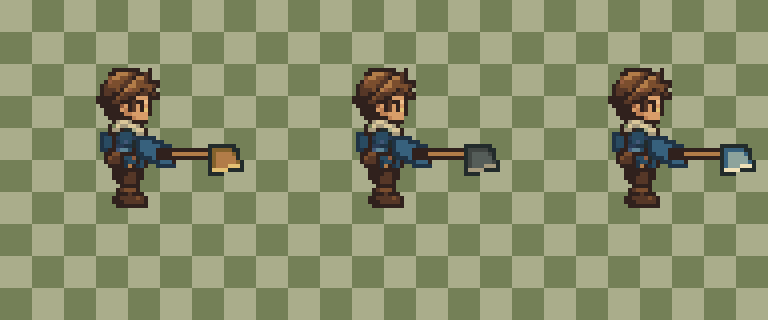

# Woodcutting action sprites

**Added:** 20 November 2026. Eight directions, six action poses and three axe tiers.



The default traveller raises the axe, swings toward the selected tree, follows
through and recovers. Feet and the pelvis stay grounded. The game uses a
1.2-second cosmetic swing cycle while a valid gathering action runs. The GIF
shows six poses using LibreSprite's default preview timing.

| Editable source | Runtime image | Cells |
|---|---|---|
| [player.ase](source/player.ase) | [player.png](textures/player.png) | 48 body poses; 384x640 |
| [axes.ase](source/axes.ase) | [axes.png](textures/axes.png) | 144 tool poses; 384x1920 |

Each cell is 64x80 with pivot **(32,52)** at ground point **(16,24)** in a
32-pixel tile. Six columns are ready, raise, backswing, contact, follow-through
and recovery. Body rows are south, west, east, north, southwest, southeast,
northwest and northeast. Axe rows repeat that order for bronze, iron and steel.
Rear-facing tools draw behind the body; other views draw in front. The two
textures add 3.75 MiB of RGBA texels and about 0.94 MiB of cached alpha bytes.



The outfit comes from the existing eight-way cast master. Original walking
art remains intact. Body poses, arms and axes are authored through LibreSprite
JavaScript using the cast palette, with no new external image input. The
[manifest](manifest.json) records provenance, stable IDs, geometry and checksums;
no separate asset licence grant is asserted beyond repository policy.

## Edit and export

Edit the saved masters, then export from the repository root:

```powershell
python tools/art/build_woodcutting_pilot.py --editor "C:\Program Files\Asprite\libresprite.exe"
```

Default export preserves the masters and refreshes PNGs, metadata, previews,
validation and the shared generated C++ layout. All batch exporters retain the
woodcutting binding when its manifest exists. CMake packages both textures with
the client and relevant graphics tests. Missing action art falls back to the
standing player; F6 retains basic shapes.

`--regenerate` explicitly replaces these two action masters using the current
cast neutral poses and the retained authoring script. Preserve manual edits
before choosing it. Normal export does not regenerate poses. Validation checks
binary alpha, all 48 body cells, connected lower bodies, all 144 axe cells and
tool clipping. [Contact sheet](previews/chop-contact.png) and
[validation report](previews/validation.json).

## Runtime behavior

The live action must belong to the player, be running, target an active nearby
tree and have a usable axe. Approaching plays walking until the player visually
settles. The character faces the tree while chopping and retains that facing
after stopping. Movement, cancellation, depletion, missing targets, wrong tools
and death stop the action animation.

Contact chips are cosmetic. Floating log and XP notices consume committed
world reward events, including the final use that depletes a tree. Failed rolls
and cancelled attempts produce no success notices. Each simulation update is
consumed before another catch-up tick can replace its events.

See the [implementation and verification record](../../../docs/embervale/06-development/WOODCUTTING_ANIMATION_2026-11-20.md)
for the actual River Crossing captures and local checks. Mining, combat and
equipment shown outside this action remain separate work.
