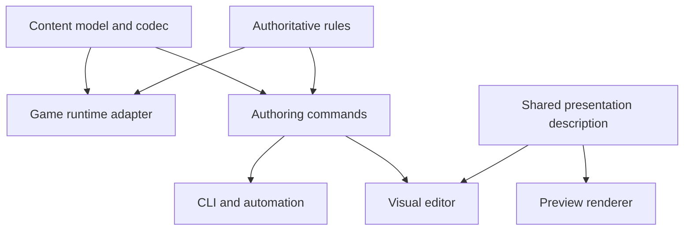

# Engine and authoring architecture

**Current implementation, 20 November:** Shared commands/history, schemas 1-4 and the Python/Tk bridge extend the original pinned architecture. See [current status](../01-current-state/CURRENT_STATUS.md) and [reviewed evidence](../06-development/PROJECT_REVIEW_2026-11-20.md). Keep the proposed broader capability diagram separate from delivered bounded code.

**Document status:** Runtime behaviour is source verified at `e9d32932e8f9b27e96283313cca320058792a81f`. The [original export boundary](../07-decisions/ADR_016_READ_ONLY_WORLD_EXPORT.md) is extended by [bounded runtime import](../07-decisions/ADR_017_BOUNDED_STARTER_WORLD_IMPORT.md). Bounded shared editing is implemented; broader publication and gameplay-authoring architecture remain proposed.\
**Updated:** 18 November 2026\
**Audience:** Engine developers, Studio developers, coding agents and technical reviewers.

## 1. What this document decides

Embervale should gain a content authoring layer around its existing game systems. The first useful result is an existing resource moved through an editor, validated, saved, reopened and loaded by the game. This does not require replacing the game loop, converting the whole project to a new entity framework, or implementing multiplayer first.

Keep three meanings separate throughout implementation:

| Meaning | Example | Owner |
|---|---|---|
| Authored definition | The normal-tree resource type and its gathering requirements | Content catalogue |
| Authored placement | A particular normal tree starts at tile `(5,5)` | Region document |
| Runtime state | That tree is depleted and will recover after a timer | Authoritative world |

Studio edits the first two through validated content operations. Gameplay changes the third. A playtest must not accidentally save an NPC's wandering position or a depleted tree as the permanent map design.

For status, source links and the broader system inventory, use [Implemented systems](../01-current-state/IMPLEMENTED_SYSTEMS.md). For work order, use the [Master roadmap](../02-roadmap/MASTER_ROADMAP.md).

### Current starter-content bridge

The snapshot model, canonical writer, bounded parser and runtime validator now belong to `GameEngineCore`. `EmbervaleWorldSnapshot` remains an interface compatibility target linking the core. Optional standalone commands export compiled content and validate selected input; disabling those executables does not remove game import support.

`EngineConfiguration::starterWorldSnapshot` passes an owned validated document into World construction. The world installs underlying terrain, registers its selected spawn definitions and follows explicit lifecycle order before using existing gameplay systems. Default construction retains the compiled path. `GameEngine --world` selects file input and isolates player-save behaviour unless an explicit save is provided. See [ADR-017](../07-decisions/ADR_017_BOUNDED_STARTER_WORLD_IMPORT.md) and [current commands](../04-studio/STARTER_WORLD_IMPORT.md).

## 2. Architecture already present

The repository defines `GameEngineCore`, with world simulation, entities, commands, movement, combat, gathering, crafting, quests, dialogue, shops, persistence and validation among its source groups. The SDL3 executable adds the application engine, input and graphics. Client and graphics-test build options control whether SDL3 is required. These are useful existing boundaries to extend, not planned features to recreate. [Source: CMakeLists.txt](https://github.com/Adzffs/GameEngine/blob/e9d32932e8f9b27e96283313cca320058792a81f/CMakeLists.txt).

The world constructor currently creates the development map and content from compiled catalogues. It applies terrain regions, registers NPC spawn definitions, creates initial characters and monsters, then resources and stations. Additional starter characters and advanced monsters are created when player registration triggers the relevant helpers. `World` also processes queued commands and tick-driven systems. [Source: World.cpp](https://github.com/Adzffs/GameEngine/blob/e9d32932e8f9b27e96283313cca320058792a81f/src/World/World.cpp).

Here, **authoritative** means that the world owns decisions such as accepted movement, interactions, rewards and state changes. It does not prove that an online server, account service or production MMO infrastructure exists. A future network transport must submit intentions to this authority rather than letting clients directly award items or set positions.

### Current integration boundaries

| Area | Existing location | What a Studio change must preserve |
|---|---|---|
| Development geography | `World/Development/DevelopmentWorldContent.*` | Dimensions, spawn, rectangle order and placement inventory |
| Grid and blocked tiles | `World/Map.*`, `World/Tile/*` | Bounds and actual walkability |
| Object creation | `World/Object/Manager/ObjectManager.*` | Resource/station lifecycle and temporary identity |
| NPC placement | `NPC/NpcSpawnDatabase.*`, `World.cpp` | Canonical spawn checks, population and delayed creation |
| Content correctness | `Content/ContentValidator.*` | Existing definition and reference checks |
| Save lifecycle | `Persistence/*`, `Core/Engine.*` | Load failures, state reconstruction and controlled save policy |
| Presentation | `Graphics/Graphics.*`, `Input/*` | Camera, zoom, picking and visible collision agreement |

This table describes responsibilities, not an exhaustive dependency graph. Exact extraction points belong in a reviewed architecture decision before changing build targets.

### Implemented export boundary

`EmbervaleWorldExport` links `EmbervaleWorldSnapshot`, which links existing `GameEngineCore`. These optional content-tool targets require no SDL and add no dependency from the game back to authoring. The game’s construction and persistence paths remain unchanged. See [ADR-016](../07-decisions/ADR_016_READ_ONLY_WORLD_EXPORT.md) and [current CMake](../../../CMakeLists.txt).

## 3. Proposed dependency direction

Use a small SDL-free content model and codec that can be shared by the runtime and authoring tools. Studio commands use that model and call authoritative validation or simulation adapters from the existing core. Avoid a dependency loop where the game core must link the GUI and the GUI defines gameplay semantics.

Arrows show reusable capabilities feeding their consumers. The diagram does not prescribe CMake target names or require a large abstraction framework. A first implementation may use a few small classes and clearly owned functions. Record the JSON dependency, target split and catalogue-provider interface in an architecture decision record.

### Responsibility rules

| Component | Must own | Must not own |
|---|---|---|
| Model/codec | Schema parsing, typed data, canonical output | SDL windows, gameplay ticks, filesystem policy hidden in entities |
| Runtime adapter | Converting accepted content into a world | Free-form scripting or silently repairing invalid maps |
| Authoring commands | Candidate edits, diffs, inverse operations | Mutating a running player's inventory or quest state |
| Validator | Shared structural and gameplay checks | A second approximate collision system that disagrees with the game |
| GUI/CLI | Input and presentation of command results | Separate implementations of a move, delete or paint operation |
| Preview | Reproducible visual evidence | Granting validity merely because an image looks correct |

## 4. Integration hazards that shape the first release

### Terrain is currently mixed with occupancy

`Map` starts with grass and, when large enough, creates water at `(10,10)`. `Tile` marks water, tree, wall and station tiles blocked. Object creation can replace a tile with an occupancy-like type. Exporting only the final tile grid loses the terrain beneath objects; removing a tree could otherwise turn river water into grass. [Sources: Map.cpp](https://github.com/Adzffs/GameEngine/blob/e9d32932e8f9b27e96283313cca320058792a81f/src/World/Map.cpp), [Tile.cpp](https://github.com/Adzffs/GameEngine/blob/e9d32932e8f9b27e96283313cca320058792a81f/src/World/Tile/Tile.cpp).

The proposed authoring model keeps ground terrain separate from placements. A compatibility adapter initially reproduces existing runtime blocking. Recompute affected runtime tiles from base terrain and the complete occupancy set when a placement changes; do not guess the old tile from the moved object alone. A later collision refactor can replace the adapter after parity has been demonstrated.

### NPC coordinates are validated against a compiled catalogue

The `CreateNpc` and typed `CreateMonster` paths compare supplied spawn fields with `NpcSpawnDatabase::TryGet`, including position and other spawn properties. Passing different coordinates from JSON into the existing creation function is therefore not a complete implementation. The canonical catalogue view must deliberately resolve the selected validated content package while retaining identity, type, population and lifecycle checks. Removing those checks to make an editor appear to work would weaken the authority boundary. [Source: World.cpp](https://github.com/Adzffs/GameEngine/blob/e9d32932e8f9b27e96283313cca320058792a81f/src/World/World.cpp).

### Identity and creation order have different jobs

`ObjectManager` assigns increasing runtime IDs as resources and stations are created. These IDs are not permanent authored placement IDs. Introduce durable placement IDs separately, and preserve creation order during initial migration so a compatibility exercise does not unexpectedly change runtime observations. Do not promise that a runtime number is the same across restarts. [Source: ObjectManager.cpp](https://github.com/Adzffs/GameEngine/blob/e9d32932e8f9b27e96283313cca320058792a81f/src/World/Object/Manager/ObjectManager.cpp).

Canonical files can sort placements by durable ID while the runtime follows explicit initialisation-stage/order metadata or a preserved baseline registry. Never infer creation order from sorted file order. The [content contract](CONTENT_MODEL.md) makes this distinction explicit.

### Presentation needs a shared interpretation

The current renderer contains terrain colours, camera transformations and fixed development-area labels. A preview that copies only a few colours may look plausible while representing different blocked tiles or old label positions. Extract a modest shared presentation description or test a renderer adapter against the same data. The preview backend remains an implementation choice: software raster output or a separate SDL-capable target are possibilities. Parsing, editing and validation must work without SDL; an optional rendering target must not change that guarantee. [Source: Graphics.cpp](https://github.com/Adzffs/GameEngine/blob/e9d32932e8f9b27e96283313cca320058792a81f/src/Graphics/Graphics.cpp).

## 5. Safe integration sequence

1. Recover a trustworthy build/test baseline and record the exact commit and environment.
2. Inventory construction paths and capture deterministic observations of the existing world.
3. Build a read-only exporter; inspect the exported 100×100 development world without changing runtime loading.
4. Implement schema checks and canonical round-trip tests on small fixtures and the export.
5. Introduce an explicitly selected runtime loader behind a temporary compatibility switch.
6. Compare old and imported worlds at construction, after player creation, after representative actions and after save/reload.
7. Add one reversible resource move through the command layer.
8. Attach a thin GUI to the same operations, then expand placement categories.

This sequence is a dependency order rather than a calendar promise. A discrepancy is investigated; it is not resolved by accepting a new snapshot simply because the loader produced it.

## 6. Determinism and observability

Compare stable, relevant observations: ground terrain, effective collision, placement identity, spawn lifecycle, approach reachability, inventory effects and saved persistent state. Freeze test RNG seeds and action/tick sequences. Keep runtime entity IDs in a separate compatibility report when construction order matters; exclude incidental addresses, wall-clock times and log ordering from semantic equality.

Every failed import should identify the region, field or placement, validation code and reason. Every loaded world should expose the selected content revision/hash for a bug report. Performance measurements should distinguish parse, validation, world construction, preview and frame/tick time; a single total hides the source of a regression.

## 7. Extension points and boundaries

Reserve a surface identity in content now, with only `ground` accepted for the first runtime path. Cliffs, stairs, bridges and upper floors need an explicit movement, interaction, rendering and save design before activation. A height number alone does not make two overlapping tiles navigable.

Similarly, an optional AI protocol wrapper should call the same command service as the CLI. Multiplayer, collaborative editing and live-world deployment are separate capabilities. Do not make them prerequisites for moving a tree safely in a local development map.

Continue with [Content model](CONTENT_MODEL.md), [Save compatibility](SAVE_COMPATIBILITY.md) and [Studio design](../04-studio/STUDIO_DESIGN.md).
