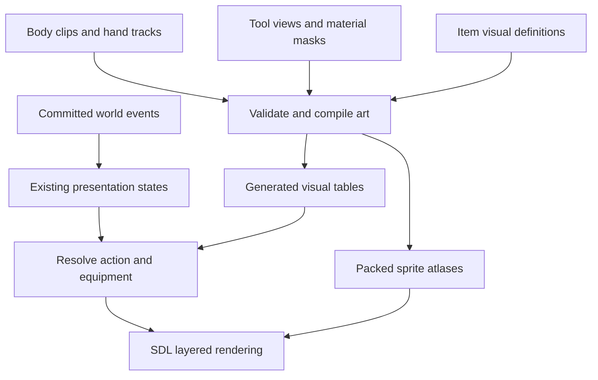

# Modular equipment animation production plan

**Date:** 22 November 2026.  
**Owner task:** ART-005, in progress.  
**Document status:** Detailed implementation plan; the modular pipeline described here is proposed. Existing working equipment rendering is identified separately.  
**First complete delivery:** One readable eight-direction chopping animation shared by bronze, iron and steel axes, followed by a demonstrated workflow for adding another appearance without reanimating the player.

**Implementation checkpoint, 22 November:** The [first east-facing axe proof](../06-development/MODULAR_AXE_PROTOTYPE_2026-11-22.md) now assembles an unchanged existing body strip, one explicit hand track, one tool view and three masked material appearances. Eight focused tests pass, including actual editor exports. This is bounded engineering progress on MEA-02/04; clean body quality, eight-way coverage, runtime registry and gameplay migration remain open.

## 1. The production decision

Build equipment animation from reusable body motions, tool shapes, material palettes and explicit hand attachments. Author the motion for a compatible family once, then reuse it for the items in that family.

For example, bronze, iron and steel versions of the same axe shape should share chopping poses, hand movement, timing and directional behaviour. Their metal appearance changes through a palette or material mask. An axe with a different head needs new tool artwork; a heavy two-handed axe may also need a different shared grip and motion profile.

Keep the character's good drawn or AI-generated poses. Equipment reuse does not require returning to the procedural body animation whose appearance the owner rejected. The automation assembles equipment around authored poses; it does not automatically redraw the player's limbs.

Pause production of complete body-plus-equipment animations for every loadout. The existing sword-and-shield PixelLab pilot remains a useful reference and preserved experiment. Further generations should target a missing reusable body motion, tool view or deliberate special animation.

### What this changes for content production

| Addition | Expected new authored work | Reused work |
|---|---|---|
| Iron axe with an existing silhouette | Metal palette and item visual mapping | Axe shape, hand tracks, chopping motion, directional setup |
| Another colour of the same sword | Material palette and mapping | Sword artwork and compatible action clips |
| Axe with a new head shape | Tool views, grip position and any necessary angle corrections | Compatible body motion and timing |
| Longer or unusually heavy axe | Shape plus a fit review; a shared heavy profile if the ordinary grip is unsuitable | Materials and compatible existing profiles |
| Pickaxe | Pickaxe artwork and one mining motion family | The attachment/export system; material palettes where appropriate |
| New shield | Shield views, forearm attachment and overlap corrections | Compatible shield-carry body poses and equipment composition |
| Bow or another genuinely different action | Its own motion family and attachment rules when gameplay exists | Catalogue, export, validation and review tools |

Materials that change construction or silhouette count as new shapes. A recolour must not conceal a missing design change.

## 2. Scope and current starting point

This work concerns the player's visible equipment, the authoring pipeline and its presentation integration. New item statistics, recipes, progression, gameplay speeds and combat rules are separate content decisions. Visual definitions must not grant an item gameplay capabilities.

The following source versions were checked while preparing this plan:

| Source | Actual state |
|---|---|
| Published master `f2b5c6b210654040e449ffe8101f32052a93d980` | Integrated player actions, nine art batches, 32 textures and 3,063 bound frames |
| Draft walking line `4b75ca19f31d8e8f22a65954c24dc1f160a025a0` | Empty-handed PixelLab walk plus a documentation handoff; ten runtime batches, 33 textures and 3,135 bound frames |
| Retained local equipped pilot | Eight neutral views and an east-facing walk; outside runtime packaging; diagonal handedness still needs correction |

These are baseline records, not results from implementing this plan. Read [current status](../01-current-state/CURRENT_STATUS.md), [player action integration](../06-development/PLAYER_ACTION_INTEGRATION_2026-11-20.md), [PixelLab walking](../06-development/PIXELLAB_WALKING_2026-11-21.md) and the [equipped pilot handoff](../06-development/PIXELLAB_EQUIPPED_HANDOFF_2026-11-21.md) before starting implementation.

### Existing capabilities to build on

- `ForestSprites` already draws player bodies, weapons and shields separately. It selects front/back ordering and has complete legacy equipment batches.
- The current melee authoring script shares tool geometry across bronze, iron and steel, using different metal colours.
- The renderer currently binds five melee body styles and nine equipment entries through fixed tables and an item switch. Gathering uses three axe tiers and three pickaxe tiers.
- `GatheringPresentationState` already provides a shared read-only boundary for Mining and Woodcutting, including reward routing and consumable cosmetic contact edges.
- Existing builders preserve editable LibreSprite masters during normal export, produce manifests and bindings, and run bounded resource checks before packaging.

The missing pieces are authored hand tracks for the better body poses, reusable shape/material definitions, convenient review tooling, and eventually a visual registry that can grow beyond the present fixed item tables.

### Deliberately deferred scope

Full armour/custom-body paperdolls, a new rendering engine, general skeletal body deformation, runtime asset downloading and a universal editor are later investments. Equipment attachments can be useful before those exist. Whole outfits currently baked into a character's body frames do not become interchangeable automatically.

## 3. Success criteria

The first delivery succeeds when all three existing axe materials use the same eight-direction chopping body motion and attachment tracks, with correct tool orientation, readable contact and stable feet. Changing material must leave the motion unchanged.

The wider pipeline succeeds when:

1. A new compatible material requires no new player animation frames.
2. A new compatible tool shape requires artwork and an attachment/fit definition, with bounded exceptions rather than a full character redraw.
3. Main-hand and offhand items remain independent; the catalogue does not enumerate every sword/shield combination.
4. Directions, grip styles, unsupported combinations and fallbacks are explicit and inspectable.
5. Generated output is deterministic for the same inputs, normal export preserves manual edits, and rejected inputs preserve earlier usable output.
6. Existing gameplay results, movement, save format, sounds and interruption behaviour retain their contracts.
7. Resource reports expose the actual cost of adding items; authoring savings are not mistaken for constant runtime memory.
8. A contributor can add an appearance by following a documented recipe without editing the player motion or adding another per-item rendering branch.

Engineering checks and an agent's visual review support these criteria. Owner acceptance of the overall animation quality remains separately recorded under ART-005. Routine frame/direction reviews should proceed without repeatedly asking the owner for permission.

## 4. Separate four kinds of variation

### 4.1 Motion family

A motion family describes how the body and hands move for an action and grip style. It is shared across compatible items. A material name must never be part of a motion-family ID.

| Initial family | Shared behaviour | Compatibility boundary |
|---|---|---|
| Standard woodcutting | Load, chop, contact, rebound and recovery | Ordinary axes that fit the established chopping grip |
| Standard mining | Lift, rock contact and pick rebound | Compatible pickaxes; preserve its current six-pose contract initially |
| One-handed carry | Idle and distance-based travel | Compatible one-handed tools/weapons; an optional shield posture needs matching offhand poses |
| Two-handed carry | Both hands support the weapon | Items whose two grip points fit the authored pose |
| One-handed melee slash | Guard, preparation, committed contact and recovery | Swords and other items whose intended action actually matches this trajectory |
| Heavy two-handed melee | A heavier shared preparation and recovery | Compatible heavy equipment; a different attack may need another family |
| Unarmed melee | Existing punch behaviour | Retained independently |

Create only action/family combinations the game needs. Do not generate every possible cross-product. Walking with a pickaxe, mining with it and attacking with it are distinct action uses even if they reference the same shape and material.

A shared motion can have a small number of authored offhand postures: relaxed, shield carry or secondary grip. Those variants are reusable across many items; they are not separate poses for every shield design.

### 4.2 Tool shape

A shape owns silhouette, handle length, grip placement, cutting edge or point, and the views needed to draw it convincingly. The main grip is a named point in the tool's own image coordinates. A two-handed shape also has a second grip point or allowed grip region.

One illustration may serve several poses, but one rotated sprite is not guaranteed to look correct from all eight directions. Author additional face, edge, rear or diagonal views where perspective and pixel clusters require them. Several facings may deliberately share a view; record that mapping rather than assuming mirroring is safe.

A shape can specify a few corrected poses for a difficult angle, smear or contact. Corrections are exceptions tied to a named motion/view, not an excuse to create a separate full body animation for the item.

### 4.3 Material

A material owns the appearance of tagged regions, such as metal shadow, midtone, highlight and trim. Bronze, iron and steel can share an axe silhouette when the design calls for it.

Use semantic masks or authored palette slots so changing metal does not recolour the wooden handle, skin, clothing or outline. A global tint of a finished body-and-tool image is unsuitable. Preserve the original outline and light direction unless a material explicitly defines a different treatment.

Wood, metal, leather, cloth and gems are separate regions where needed. Animated glows or effects are optional additional layers with their own budgets, introduced only for actual items.

### 4.4 Gameplay item

A gameplay item selects a shape, material and supported motion set through a presentation definition. Its gameplay identity remains the existing item identity. The same visual shape/material can be referenced by multiple items if that is intentional; visual reuse does not merge their statistics or ownership.

## 5. Proposed data contracts

Keep the first format small, versioned and validated offline. Compile checked definitions into the game's existing generated presentation tables. Runtime JSON parsing is not required for the initial delivery.

| Record | Required information | Main validation |
|---|---|---|
| Body clip | Stable ID, action/family, supported facings, frame references, source canvas, ground pivot, timing source | Complete declared frames/directions; valid geometry; known action |
| Attachment track | Main/offhand positions, tool aim/view, per-pose draw ordering, optional grip-hand overlay | All required poses covered; bounded finite coordinates; anatomical hand consistency |
| Tool shape | View images, local grip(s), material-region masks, edge/tip guides, allowed families and size class | Valid masks, pivots and compatibility; no clipped silhouettes |
| Material | Stable ID and colours for the shape's declared semantic regions | Complete valid palette; protected regions unchanged |
| Item visual definition | Existing item identity, shape, material, supported motion set, offhand/carry policy and fallback | References resolve; no ambiguous item mapping; bounded catalogue size |
| Export recipe | Selected body/track/shape/material revisions, output geometry, packing and preview settings | Exact input hashes; deterministic output; resource limits |

Illustrative proposed item definitions:

```json
{
  "schema": "embervale.equipment-visuals",
  "version": 1,
  "items": [
    {
      "item": "BRONZE_AXE",
      "shape": "axe.starter",
      "material": "bronze",
      "motion_set": "axe.standard"
    },
    {
      "item": "IRON_AXE",
      "shape": "axe.starter",
      "material": "iron",
      "motion_set": "axe.standard"
    },
    {
      "item": "STEEL_AXE",
      "shape": "axe.starter",
      "material": "steel",
      "motion_set": "axe.standard"
    }
  ]
}
```

This is a design example, not an implemented file schema. The three entries deliberately select the same shape and motion set.

### Coordinate and identity rules

- Hand positions belong to a declared authored frame space, before atlas trimming. Tool grip points belong to the tool view's own space.
- Transform a grip onto its matching hand, then apply the authored aim and view. Convert to the world through the body's ground pivot. Atlas trimming must update offsets without moving the world anchor.
- The PixelLab body uses 64x64 cells and pivot `(32,48)`; legacy action masters use 96x96 cells and pivot `(48,64)`. Preserve existing geometry and translate through declared origins; do not rescale old art to force one canvas size.
- Equipment can extend outside the body canvas. Use a sufficiently large staging canvas, then lossless packing and adjusted pivots. Reject clipping.
- Preserve facing order: South, West, East, North, South-West, South-East, North-West, North-East.
- Main/offhand mean anatomical hands. Screen-left and screen-right are not stable hand identities.
- Source IDs survive changes to filenames and atlas rectangles. A tool's material or shape name must not become a new gameplay save identity.

## 6. Production and runtime architecture

The proposed flow keeps art compilation separate from authoritative play:



### First implementation: assemble equipment offline

Use editable body poses and hand tracks to produce matching equipment overlays during export. Material masks produce bronze/iron/steel outputs from the same shape. Keep the body's matching hand/forearm layer where it must cover the grip.

The first axe proof should target the existing runtime binding contracts. It can replace a deliberately selected candidate body/axe batch only after all directions are ready and checked. The prototype exporter does not need a new general runtime skeleton system.

The compiler can share identical pixels/rectangles where that is valid, while retaining distinct stable references. Output atlases remain generated deliverables; shapes, palettes and hand tracks are the editable source of truth.

### Later implementation: replace fixed item selection

Once the visual proof works, add a bounded item-visual lookup and generated definitions in the presentation layer. Replace the expanding item switch and fixed tier assumptions through an adapter, keeping the old complete batches available during migration.

The current `GatheringAnimation` stores `toolTier`, which is insufficient for a large appearance catalogue. Add the actual item identity or a stable resolved visual key to the read-only presentation snapshot, and revalidate it when the equipped tool changes. Preserve the old tier field or mapping only where the legacy fallback still needs it. Do not index an array directly with an arbitrary item enum.

Visual metadata may identify an item that already works in gameplay. Adding a genuinely new tool still requires separate gameplay definitions, requirements and content verification.

### Catalogue growth is a separate measured decision

Offline assembly reduces authoring and generation work, but baked output can still grow with the number of appearances. After measuring the pilot and a synthetic larger catalogue, choose whether to retain baked tool frames, deduplicate more views, or introduce bounded material/shape caches or additional layered rendering.

Runtime rotation, palette processing or a different graphics path is not a prerequisite for the first delivery. Select those only when measurements justify their complexity. Any later cache needs explicit keys, allocation limits, invalidation and missing-asset behaviour.

## 7. Pixel-art quality and attachment rules

### Preserve the body performance

Use a complete approved body motion as the starting point. AI-generated frame sequences do not automatically include correct skeleton coordinates; hand positions and visibility must be authored or corrected per frame. Tracking assistance may suggest anchors, but the exported pixels need inspection.

The empty-handed walk cannot automatically serve every carry posture. A shield brace or a two-handed grip needs suitable body poses. The sword-and-shield pilot has equipment baked into the body and cannot safely be made universal by automatically erasing the sword and shield.

The older procedural body can support engineering fixtures while new data is developed. Its existing tests do not establish acceptance of its appearance. The first visual delivery must use poses that satisfy the intended quality review.

### Make the grip convincing

Place the tool's handle through the hand and keep the hand visually wrapped around it. Record any small front-hand overlay or occlusion mask as part of the shared body clip. When the tool crosses the torso, a single whole-tool front/back flag may be insufficient: use an authored rear-tool segment, body/arm pass and front-tool segment where required.

A larger tool must fit both grip points for a two-handed pose. Do not stretch arms or change character proportions silently to accommodate it. Select a compatible size/profile or author a deliberate correction.

### Preserve perspective and handedness

Inspect every facing at identical phases. A mirrored sword/shield pair can swap anatomical hands. A mirrored asymmetric axe can reverse its cutting edge. Only use a mirrored view when the item's design, lighting, depth and hand relationship remain correct.

For chopping, the cutting edge approaches the tree. For mining, the leading point approaches the rock. Heavy swings should communicate weight through the body and timing rather than merely drawing a larger weapon on the sword motion.

### Keep native pixels deliberate

Rotate and rasterize tool views on the authored pixel grid during export, then inspect the result. Nearest-neighbour display scaling preserves sharpness, but it cannot make a poorly rasterized angle look hand-drawn. Add a small authored angle correction when necessary. Avoid blur, fractional rescaling of the body or automated deformation to hide defects.

Review at native scale and the actual game zoom, as well as enlarged contact sheets. The 4x preview is useful for finding pixels; normal-scale motion determines readability.

## 8. Timing, actions and sound contracts

Maintain one authored timing source for the runtime and its previews. Frame counts stay specific to an action; do not enlarge or shrink every table to one universal count.

| Current contract | Preserve during the initial migration |
|---|---|
| Simulation | 600-ms authoritative ticks and existing catch-up limits |
| PixelLab locomotion | Separate idle slot 0, moving slots 1-8; phase follows visual distance |
| Ordinary PixelLab walking preview | `[80,70,80,70,80,70,80,70]` ms; one tile per 600-ms cycle |
| Legacy walking | Its separate eight-pose layout and current timing remain the fallback contract |
| Woodcutting | Eight authored poses; `[260,200,200,80,80,80,100,200]` ms cosmetic cycle |
| Mining | Six authored poses and the existing 1,200-ms cosmetic cycle |
| Legacy equipped atlas | Eight carry/walk slots plus eight melee slots, sixteen per direction |
| Melee | Existing style-specific preparation/recovery around committed results |

Visual tool contact is cosmetic. It must not award resources, XP or damage. Gathering rewards follow committed reward events. Melee contact/recovery follows the committed attack result, including misses, blocks, equal-damage repeats and killing blows.

Keep once-only swing/contact edges, action interruption and catch-up snapshots. A dead or removed target must not erase a committed killing blow. Changing equipment must not leave a detached old tool, stale swing or repeated sound. A paused simulation must not resolve an attack because its animation reached a frame.

Material changes use identical motion timing. If a new gameplay item is intentionally slower, that change belongs to gameplay and its verified presentation mapping; the material palette cannot create it implicitly.

## 9. Art source and export workflow

### Source ownership

Use separate editable masters for shared body motion, tool views and any hand/occlusion corrections. Keep material definitions and attachment tracks as small text assets. Preserve imported PNGs and raw service exports separately from edited masters.

A future modular authoring folder should contain:

```text
assets/embervale/equipment-modular/
  README.md
  source/                 # body/tool/hand-overlay editable masters
  motions/                # per-family timing references and attachment tracks
  shapes/                 # view, grip, region-mask and compatibility definitions
  materials/              # named semantic palettes
  items/                  # gameplay item to visual mappings
  imports/                # raw service exports and provenance
  textures/               # generated packed PNGs
  previews/               # generated review sheets and loops
  reports/                # validation, resource and comparison results
```

This path is a proposed layout; create it when implementation starts. Keep initial prototypes isolated until the resource catalogue intentionally adopts them.

### Export sequence

1. Read the selected source masters, definitions and timing revision without modifying them.
2. Validate IDs, counts, references, masks, hand tracks, compatibility and numeric bounds.
3. Stage tool poses for the selected supported item/action pairs; apply material regions and matching grip/layer rules.
4. Check alpha, nonempty required content, clipping, grip alignment and exact body preservation where reuse promises it.
5. Pack outputs losslessly, maintaining each frame's world pivot and source-space offset.
6. Produce synchronized previews and a report of body, shape, material and item coverage.
7. Run the complete shared resource gate against the proposed catalogue and both binding implementations.
8. Publish the checked output/bindings from staging through one owner; preserve previous usable output if an earlier stage rejects.

Normal export must never regenerate an editable master. Replacing imported source is an explicit operation. Preserve earlier raw evidence when an import fails. Guard importing an archive from the same path as its retained copy; this remains a known follow-up in the local pilot review helper.

### Deterministic build identity

Record hashes for masters, tracks, shapes, palettes, mappings, timing, exporter version and outputs. A palette-only change should invalidate the affected appearances rather than unrelated body masters. The build report should explain which inputs changed and which outputs were reused.

For a future runtime cache, a key must include body/rig revision, clip, facing, pose, shape/view, material and any relevant correction revision. Item name alone is insufficient when artwork changes beneath it.

## 10. Review tools to make iteration practical

Start with the existing LibreSprite scripts and `EmbervaleRenderPreview`. Add a small focused preview tool or mode before considering a larger editor.

Required controls and outputs:

- Select action, facing, material, tool shape and optional offhand.
- Play at the authored speed; pause, scrub and step one frame.
- Show native scale and integer inspection zoom against representative light/dark ground.
- Toggle hand/grip markers, ground pivot, tool edge/tip, image bounds and draw layers.
- Show all eight directions at the same phase and compare all three axe materials side by side.
- Compare before/after through the same world fixture, camera, timeline and equipment.
- Export a contact sheet, timed GIF, actual-renderer sequence and a machine-readable coverage/resource report.

A visible marker is a diagnostic overlay; it is not part of the final artwork. Preview loops must label their timing and whether they show source assembly, software rendering or native gameplay.

Bulk preview generation should identify missing views and suspicious grip/clipping cases before a person inspects the sheet. Keep full animation playback as part of review; a contact sheet alone cannot establish weight or rhythm.

## 11. Resource and production cost model

### Authoring cost

The work becomes approximately:

`shared body/hand-track poses + tool views + material palettes + item mappings + explicit corrections`

It should not require a new full character sequence for every combination of item, material and offhand. Eight-direction work remains for the shared clips and for tool views whose silhouettes require it.

For a simple illustration, one eight-pose action across eight facings has 64 body/hand-track poses. Three materials can reuse those 64 poses. If their silhouettes match, their differences are three palette definitions and item mappings. An offline exporter may still produce 192 tool-overlay frame references; those are generated output, not 192 individually authored body poses.

These are frame/asset counts, not PixelLab generation charges. Record the service's actual cost per submitted job. Do not multiply subscription credits by animation frame count or promise a monthly budget before a representative pipeline is measured.

### Runtime cost

The checked walking-candidate baseline has 33 textures, 3,135 bound frames, 24,342,528 logical RGBA bytes and 6,085,632 transparency bytes. The existing policy caps images at 64, frame bindings at 16,384, logical textures at 64 MiB and transparency at 16 MiB. Read the [resource policy](ASSET_RESOURCE_LIMITS.md) and actual generated report before each implementation pass.

As a stress example, 100 appearances times eight facings times eight poses times three actions produces 19,200 tool-frame references before counting the body or world. That already exceeds the present 16,384-frame policy if represented naively as separate bindings. Compressed PNG size does not establish acceptable memory use.

The plan therefore requires a scale probe before bulk equipment production. Measure atlas count, binding count, logical texture/alpha/staging costs, load time and frame time. Report body reuse and tool/material duplication separately. Deduplication that saves pixels may still leave many binding records; measure both.

Keep current caps for the pilot. If the later catalogue cannot fit, propose a bounded representation or cache change with measurements. Raising limits alone does not demonstrate a scalable design.

### Content growth probe

Use three existing materials for the real gameplay proof. Then create a synthetic visual-only catalogue of 10, 50 and 100 appearances for export/resource analysis. It need not add 100 real gameplay items or imply online multiplayer support.

For rendering, compare the existing scene at 1280x720, normal zoom and 1.5 zoom on the same hardware/configuration. Use one actor and, when a controlled fixture is available, 25 and 100 equipped test actors. Record median and high-percentile frame time, draw calls where available, initialization time and cache use. Establish the baseline first; a provisional target is no more than 10% additional high-percentile frame time for equivalent scenes, subject to measured results rather than an invented performance claim.

## 12. Implementation sequence and deliverables

The MEA identifiers below are work units inside this plan under ART-005. They do not add duplicate entries to the canonical project backlog. All implementation units start as planned; writing this document does not complete them.

| Unit | Deliverable | Depends on | Completion criterion |
|---|---|---|---|
| MEA-01 | Recover and pin the working baseline | Existing integration records | Source, local changes, masters, pilot and resource report are inventoried without overwriting work |
| MEA-02 | Minimal motion/shape/material/visual contracts | MEA-01 | Versioned definitions and bounded validation cover the axe proof |
| MEA-03 | One clean east-facing chopping performance and hand track | MEA-02 | Body, grip, contact, recovery and silhouette pass native-scale review |
| MEA-04 | One axe shape, three materials and deterministic exporter | MEA-03 | Material-only changes reuse the same motion and protected regions stay unchanged |
| MEA-05 | Complete eight-direction axe authoring proof | MEA-04 | All facings share the intended timing, correct hands and cutting-edge direction |
| MEA-06 | Actual-game axe integration with complete fallback | MEA-05 | Current three axes render correctly through approach, chopping, cancellation and rewards |
| MEA-07 | Bounded item visual registry and scalable mappings | MEA-06 | Compatible appearances use definitions rather than another per-item render branch |
| MEA-08 | Mining migration | MEA-07 | Existing three pickaxes reuse one suitable motion, retaining the initial six-pose contract |
| MEA-09 | Modular equipped idle/walking and shield composition | MEA-07 | Loadout changes and eight-way travel retain correct body/hand/item relationships |
| MEA-10 | Melee profiles and two-handed integration | MEA-09 | Committed contacts, sounds, grip compatibility and interruption cases remain correct |
| MEA-11 | Larger-catalogue resource/performance proof | MEA-07, then repeat for new families | 10/50/100-look reports establish the next representation decision within stated budgets |
| MEA-12 | Content recipe, evidence and migration closeout | MEA-08 through MEA-11 | Another appearance is added by the documented process; current status accurately records remaining acceptance |

### Stage A: baseline and minimal format, MEA-01 and MEA-02

Inspect the retained local work before applying earlier scaffolding. Keep the published combined build, empty-handed candidate and local equipped experiment distinguishable. Pin actual source hashes and capture one existing chop, mine, carry and melee fixture.

Measure the current resources and identify the smallest set of new definitions needed for three axe materials. Declare supported families and facings explicitly. Create validators for duplicate IDs, unresolved references, missing frames, invalid masks, impossible grips and oversized inputs before using generated geometry in the game.

The engineering part can proceed with existing local art while service credits are unavailable. Clean new body motion may require new art later. Do not spend credits reproducing known source files or per-material copies of an existing motion.

### Stage B: prove one direction, MEA-03 and MEA-04

Use east-facing woodcutting as the first controlled case. Produce or select an acceptable clean body sequence for that action; the approved empty-handed walk does not automatically supply chopping poses. Author eight chopping poses and matching grip/visibility data using the current action timing.

Fit one axe silhouette, identify its cutting edge and material regions, and export bronze, iron and steel through that same track. Compare the three tools at the same frame. Their body pixels and hand coordinates should match; only declared material pixels differ where the design shares a silhouette.

Review start, load, contact, rebound and return at native scale. Fix a body or attachment defect once in its shared source and demonstrate that every material receives the correction. This proves the main production saving before expanding to other directions.

### Stage C: eight directions and gameplay, MEA-05 and MEA-06

Expand the reviewed action to the remaining facings. Supply additional tool views where needed, especially diagonal/rear views. Check stationary rotation, synchronized contact and recovery, and head/torso occlusion. Preserve anatomical hands and the axe's cutting edge.

Use a separate candidate batch or staging tree until every required direction is complete. Then integrate through the existing chopping presentation and binding boundary, changing both resource validation tables only if the declared layout actually changes.

Run real World/Engine/Graphics paths for all three axe items. Exercise approach, start, multiple contacts, success/failure, final depletion, movement cancellation, equipment change, wrong tool, target disappearance and death. Check actual resource/XP notices and once-only contact sounds.

If a modular composite cannot be drawn, select a complete usable fallback for that action/loadout. Do not silently show a steel axe as bronze or retain half a new composite with half an incompatible legacy pose. A missing exact appearance may require a labelled development fallback or primitive presentation when no exact complete legacy batch exists.

### Stage D: generalize selection after the proof, MEA-07

Extract only the equipment selection responsibilities that the proof needs. Introduce a generated visual lookup and a legacy adapter, while leaving unrelated terrain/building rendering alone.

Replace assumptions that visual identity equals a three-entry material tier. Preserve the actual tool/item identity in presentation snapshots and resolve shape/material/family through validated definitions. Keep unsupported combinations explicit.

Prove that adding an appearance requires a definition and source assets rather than another new motion or rendering switch case. Generate only declared, used combinations. Update Python/C++ validators and packaging together; do not weaken the existing bounded resource gate.

### Stage E: expand actions, MEA-08 through MEA-10

Migrate Mining first using the shared gathering state and its existing six-pose timing. Check the leading pick point, low rock contact, rebound and actual ore reward routing.

Next author suitable idle/carry/walking poses for one-handed and two-handed equipment. Use actual visual travel for phase, a separate neutral idle, and the current bounded tick-gap handling. Keep a shield's own design independent from the sword's material. Define the shared shield posture and the game's existing back-carry behaviour for two-handed equipment explicitly.

Migrate one-handed melee before heavy/two-handed styles. Keep the action/result contract and weapon snapshot. Review hit, miss, block, equal-damage repeats, immediate opening completion, killing blows, catch-up ticks and gear changes. A heavy profile needs a meaningful silhouette and grip fit; it must not be created solely by slowing the sword GIF.

Gathering can temporarily show its appropriate action tool while the normal carry loadout follows existing game rules. Switching visual modes must clear stale grip/layer state and return to the correct equipped idle.

### Stage F: prove scale and hand off, MEA-11 and MEA-12

Run the larger appearance probe before producing a large catalogue. Identify whether output frames, image pages, alpha copies or draw cost become the first constraint. Make the next storage/cache choice from that report.

Add one further compatible material and one new compatible tool shape as a content-authoring exercise. Track the actual work required, including angle corrections. Confirm a shared body/track correction propagates without manual edits to each material output.

Publish sources, editable masters, definitions, exporter, generated bindings, packaged outputs and exact evidence together. Update current documentation and retain old results as dated history. Remove an old runtime path only after all of its required uses have a verified replacement; keep archived editable sources.

## 13. Targeted verification and visual acceptance

| Area | Checks that matter | Evidence |
|---|---|---|
| Reuse | Three materials reference one motion/track; material change does not redraw body or wood/skin | Definition audit, source/output hashes, pixel comparison |
| Attachments | Grip alignment, two-hand fit, correct view, clipping and tool edge/point | Marker overlays, native-scale sheets and full playback |
| Direction | Eight authored facings; asymmetric items keep their anatomical hand | Synchronized rotation/action fixtures |
| Timing | Shared preview/runtime durations; walking phase agrees across render rates | Timing report and existing presentation tests |
| Export preservation | Normal export leaves masters untouched; repeat export is stable; rejected import preserves usable files | Checksums, private rejected-input fixtures and staging comparison |
| Runtime selection | Correct item identity; immediate equipment changes; supported/offhand combinations | Actual renderer and gameplay integration cases |
| Fallback | Missing body, tool, view, material or hand overlay never produces a detached partial loadout | Corrupt/missing optional asset fixtures |
| Events and sound | Cosmetic contact separated from committed rewards/damage; once-only sound edges | Gathering/melee/audio integration cases |
| Budgets | Count, geometry, PNG, texture, alpha and staging limits remain enforced | Existing resource checker plus scale reports |
| Visible quality | Weight, silhouette, readable contact, foot stability and recovery at game zoom | Actual scene playback and separately recorded owner feedback |

Reuse relevant existing tests such as `PlayerAnimationTests`, `WoodcuttingGraphicsTests`, `MiningGraphicsTests`, `MeleeGraphicsTests`, presentation tests, `WorldArtResourcesTests`, `WorldArtResourceGraphicsTests` and packaging integration. Add tests for new risks; do not duplicate every implementation detail with a matching test.

For the planning change itself, run the documentation checker and synchronized backlog validation. Runtime build/test results belong to implementation commits, not this plan.

## 14. Fallback and migration policy

Migrate one action family at a time. Resolve the complete required body, main-hand item, offhand posture and masks before drawing the composite. Only switch to the new path when all required parts for that declared combination are ready.

Existing complete legacy batches remain useful fallbacks during migration. Missing optional new art should not disable unrelated world textures. If no correct full legacy representation exists, use the established primitive/development fallback and record the coverage gap rather than silently displaying the wrong item.

Preserve the current special cases until their replacements are explicitly authored: unarmed attacks, two-handed shield back-carry, axe/pick gathering selection and committed fatal-melee snapshots. A visual registry must not redefine equipment-slot legality or two-handed gameplay rules.

Keep new visual state transient. Player save version 13 can continue to store existing gameplay equipment identities; no new visual-cache state should enter player saves. Any genuinely required save/schema change needs its own justification and migration plan.

## 15. Risks and planned responses

| Risk | Response |
|---|---|
| AI frames move or redraw the hands inconsistently | Author/correct tracks against the actual final poses; repair bad source poses before reuse |
| Baked equipment cannot be separated cleanly from generated body art | Retain the pilot as reference; create clean body/hand source rather than automatic destructive erasure |
| A single rotated tool looks flat or jagged | Add deliberate view/angle corrections, then inspect at native scale |
| Rear views hide the axe inside the head | Author per-pose occlusion/segments and readable silhouettes |
| Materials tint wood, skin or clothes | Use semantic masks/palette slots and protected-region pixel checks |
| Bigger equipment stretches the hands or loses grip | Validate both grip points and size compatibility; choose another shared profile when needed |
| Eight-way mirroring swaps hands or blade direction | Explicit facing/view mappings and an asymmetric rotation review |
| Export automation saves authoring time but exhausts runtime resources | Measure binding and texture growth separately; run the larger-catalogue probe early |
| Broad refactoring delays the visible result | Prove the existing three-axe action through current bindings before generalizing item selection |
| Tool swapping leaves stale audio/poses | Reuse the current interruption/result boundaries and exercise rapid gear/action changes |
| New formats bypass old resource safeguards | Extend both validators and the one packaging owner together |
| Service credit exhaustion blocks art | Continue metadata/export work using existing assets; use paid generations only for missing shared art and record actual job cost |

## 16. Ongoing content-authoring recipes

### Add another material to an existing shape

Confirm the silhouette and grip are unchanged. Define only its material regions/colours, add the gameplay item's visual mapping, regenerate affected outputs, compare protected regions and all required views, and inspect it in the actual game. There should be no new body clip or hand track.

### Add a compatible new tool shape

Choose the existing family and size class, author the necessary views, mark main/secondary grips and edge/tip guides, assign material regions, preview all required actions/facings and add only necessary corrections. Add the item mapping and export. A compatible shape should not require a new player performance.

### Add a new way of using a tool

Define the gameplay action separately where needed. Author one reusable body/hand-track family, its timing/result mapping, allowed size/grip classes and coverage. Prove one direction before expanding. Reuse shapes/materials that fit it; record unsupported combinations explicitly.

### Fix a shared animation defect

Edit the owning body clip or attachment track, regenerate every affected appearance, and compare the same fixtures and phases. Avoid patching exported material sheets individually. The report should list all affected items so a shared correction cannot silently omit one.

## 17. Documentation and ownership

Keep this as the production plan linked from the animation guide, current status and roadmap. ART-005 remains the canonical owner task; REL-004 remains complete for its already integrated scope. The MEA work units organize the new implementation without duplicating the main task inventory.

Each implementation unit should record source revision, changed masters/definitions, exact export commands, actual service settings/cost where used, validation results, resource totals and visual findings. Distinguish proposals, local prototypes, published implementation and owner acceptance.

Existing historical reports remain unchanged. In particular, the [equipped handoff](../06-development/PIXELLAB_EQUIPPED_HANDOFF_2026-11-21.md) records a real interrupted experiment; this plan supersedes its idea of expanding complete body-plus-loadout sets as the default production route. Recover its saved art, but use new generations according to the modular plan.

## 18. Immediate next implementation brief

Start with MEA-01 through MEA-04: recover the baseline, define the small data contract, and produce one east-facing chopping body/hand track with one axe shape and three material appearances. Use existing local assets for engineering fixtures; create clean reusable action art where the visible proof needs it.

Deliver the editable body and tool sources, eight-frame track, material masks/palettes, item mappings, deterministic exporter, three synchronized previews and a short validation/resource report. Show that one grip or body correction updates every material automatically.

After that visual proof passes, complete the other seven directions and integrate the current three axe items. Continue with the registry, Mining, equipped carry and melee in the order above. Credit availability affects missing art generation; it does not require reproducing per-material character sequences.

## 19. Source references and implementation locations

Repository sources inspected for this plan:

- [ForestSprites interface](../../../src/Graphics/ForestSprites.h) and [equipment rendering](../../../src/Graphics/ForestSprites.cpp): existing separate body/equipment tables and composition.
- [Graphics integration](../../../src/Graphics/Graphics.cpp): action priority, locomotion and current draw selection.
- [Gathering presentation](../../../src/Gathering/GatheringPresentationState.h) and [implementation](../../../src/Gathering/GatheringPresentationState.cpp): tier identity, skill-specific timing, reward and contact boundaries.
- [Existing equipment authoring](../../../tools/art/melee_pilot.js), [body rig](../../../tools/art/player_rig.js) and [batch guide](../../../assets/embervale/melee-pilot/README.md): current geometry/material reuse and its quality limits.
- [Timing data](../../../assets/embervale/player-animation.json), [Python resource checks](../../../tools/art/world_art_resources.py), [C++ resource checks](../../../src/Content/Assets/WorldArtResources.cpp) and [numeric limits](../../../assets/embervale/world-art-limits.json).
- [Animation guide](ANIMATION_GUIDE.md), [research and historical findings](../06-development/ANIMATION_RESEARCH_2026-11-20.md) and [art production guide](ART_AND_AUDIO.md).

Primary external references checked on 22 November 2026:

| Source | Directly supported principle | Our project-specific decision |
|---|---|---|
| [Spine skins guide](https://en.esotericsoftware.com/spine-skins) | Animations can be reused with different attachment sets | Reuse shared motion and independent equipment appearances |
| [Spine runtime skins](https://eu.esotericsoftware.com/spine-runtime-skins) | Slot-based attachment selection and explicit attachment placement conventions | Use stable visual definitions and declared grip/source spaces |
| [SDL texture scale mode](https://wiki.libsdl.org/SDL3/SDL_SetTextureScaleMode) | Texture scaling mode is configurable | Keep deliberate nearest-neighbour pixel presentation and inspect actual output |
| [SDL rotated texture drawing](https://wiki.libsdl.org/SDL3/SDL_RenderTextureRotated) | SDL supports explicit rotation centres and flipping | Runtime rotation remains an optional later choice; start with reviewed offline equipment assembly |

These references support the reuse and drawing concepts. The proposed formats, phases, budgets, compatibility rules and choice to assemble overlays offline are design decisions for Embervale; they are not claims that the referenced tools implement this pipeline for the project.
