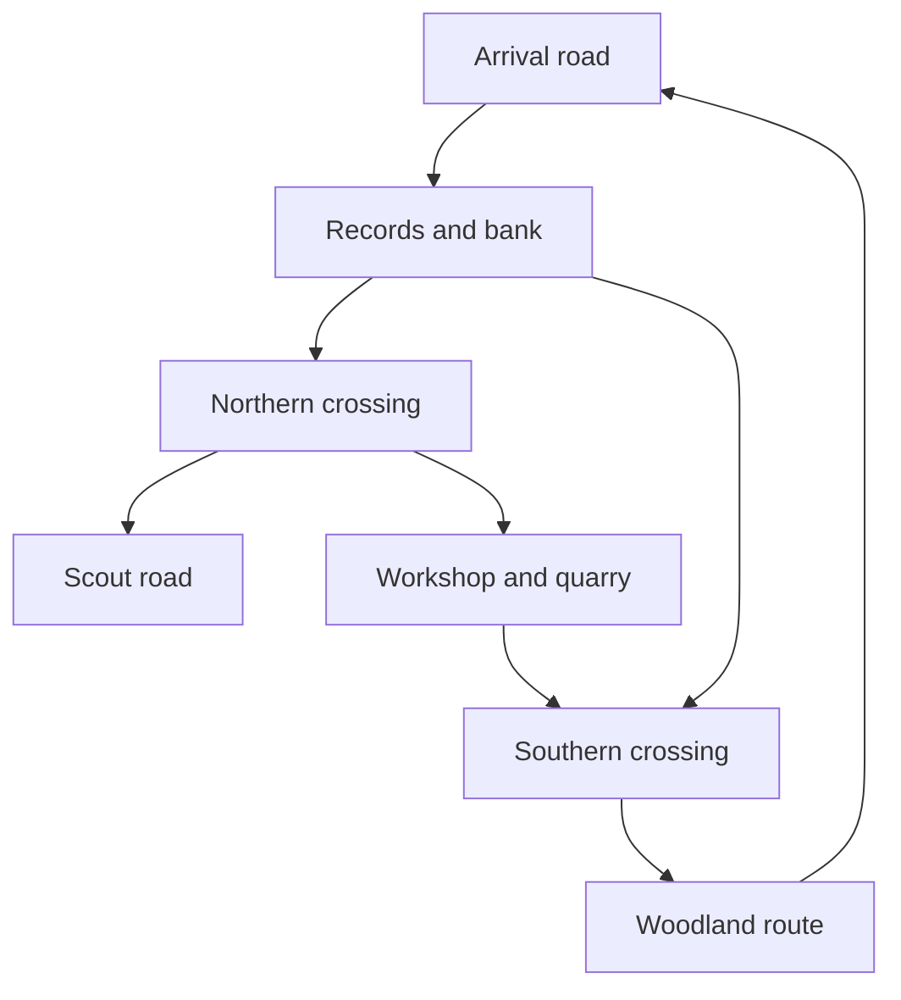

# River Crossing: geography and settlement blockout

**Status:** Proposed candidate for future authoring and playtesting. No map in this document has been implemented or accepted as final geography.  
**Reviewed:** 18 November 2026.  
**Design constraints:** Balanced starter experience; no central service core; flat ground first; preserve the existing development world during migration.  
**Related:** [Game design](GAME_DESIGN.md), [content catalogue](CONTENT_CATALOGUE.md), [Studio workflows](../04-studio/EDITOR_WORKFLOWS.md).

## 1. What this candidate tests

River Crossing is a settlement spread across two working banks of a river. Arrival and records sit along the northern road. Woodland and a smaller residential lane occupy the western bank. A workshop and quarry occupy the eastern bank. A second crossing closes a walking loop and gives the player another way home. Each district has a purpose, so the crossing is a geographic landmark without becoming a central square containing every service.

The current engine represents a flat tile grid. Its tile types do not establish a bridge deck above walkable water, an upper floor or a height transition. This candidate therefore uses two **ground-level land causeways**: gaps in the water filled with ordinary passable ground. They are a blockout representation of crossing routes, not an implemented bridge system. Later art may make their purpose clearer; overlapping surfaces remain separate future engine work. Sources: [Map.cpp](https://github.com/Adzffs/GameEngine/blob/e9d32932e8f9b27e96283313cca320058792a81f/src/World/Map.cpp), [Tile.cpp](https://github.com/Adzffs/GameEngine/blob/e9d32932e8f9b27e96283313cca320058792a81f/src/World/Tile/Tile.cpp).

This is deliberately a coordinate-complete starting hypothesis for routes and key entities, rather than a promise that these numbers are balanced. Exact positions should change after navigation and pacing tests.

### Planning diagram

[Open the scalable SVG](../assets/river-crossing-proposed.svg). The [reproducible plotting script](../assets/render_river_crossing.py) reads the coordinates from this document. Short dashed lines reserve the specified service connections; their final width and interaction access still require runtime validation. Symbols mark anchor positions rather than complete collision footprints.

## 2. Coordinate and authoring contract

| Property | Candidate value |
|---|---|
| Working canvas | 100×100 tiles; valid coordinates `0..99` on both axes |
| Origin | Northwest corner `(0,0)` |
| Axes | `x` increases east; `y` increases south |
| Surface | One flat `ground` surface |
| Rectangle notation | Inclusive minimum and maximum coordinates |
| Proposed test-player arrival | `(5,28)`; does not replace the current `(0,0)` default |
| Road width | Three passable tiles for the two main loops, narrower paths only after testing |
| Building rectangles | Reserved visual/functional footprints, not completed buildings or automatic collision masks |
| Suggested region identity | A new River Crossing candidate identity, assigned through the future content registry |

The existing map is also 100×100, but equal dimensions do not make this candidate save-compatible. The old spawn, seeded pond, placements and lifecycle need their own preserved parity fixture. Source: [DevelopmentWorldContent.h](https://github.com/Adzffs/GameEngine/blob/e9d32932e8f9b27e96283313cca320058792a81f/src/World/Development/DevelopmentWorldContent.h).

Paint in a defined order: base ground, river, explicit causeways, roads, reserved service access, resource placements and then decoration. Do not let a generic road brush silently cut additional crossings through water. Inspect final collision after each pass.

## 3. Terrain contours

The following river bands make a gently changing channel in the first blockout. Their stepped edges are temporary. Later shoreline detail may adjust individual bank tiles, while preserving crossings and mandatory routes.

| North–south interval | Water columns, inclusive | Purpose |
|---|---|---|
| `y=0..17` | `x=46..51` | Narrow northern entry |
| `y=18..35` | `x=48..54` | Eastern bend beside the records district |
| `y=36..53` | `x=45..51` | Western bend opposite the workshop |
| `y=54..71` | `x=48..55` | Wider southern working reach |
| `y=72..99` | `x=45..52` | Southern exit and quieter bank |

After painting the channel, restore passable ground on `x=48..54, y=29..31` and `x=48..55, y=62..64`. These are the northern and southern causeways. Water remains impassable elsewhere. Add bank grass, dirt shoulders and stone patches only after confirming the exact collision edge.

Use woodland density, stone patches, fences and changes in ground texture to imply upland or sheltered areas without inventing height. A quarry can be a flat working yard in the first release. Cliff faces, stairs, upper terraces and waterfalls that imply traversable elevation belong to the elevation milestone.

## 4. Roads and route loops

Road polylines below use horizontal or vertical segments. Paint a three-tile corridor, with a one-tile offset on either side of each centreline. Fill the 3×3 square at each turn to avoid a corner pinch. When a corridor meets a boundary, clip it to the map bounds.

| Route | Centreline vertices in travel order | Role |
|---|---|---|
| Northern through-road | `(0,28) → (20,28) → (20,30) → (62,30) → (62,26) → (99,26)` | Arrival, bank frontage, north crossing and outward road |
| Woodland return | `(20,30) → (20,42) → (18,42) → (18,63) → (48,63)` | Safe western activity route and southern crossing approach |
| Western riverside | `(40,30) → (40,63)` | Shorter return route and a second woodland-side connection |
| Eastern working route | `(62,30) → (62,56) → (74,56) → (74,63) → (48,63)` | Workshop access and southern crossing loop |
| Quarry branch | `(74,56) → (82,56) → (82,70)` | Mining access without routing through a building |
| Workshop frontage | `(62,53) → (76,53)` | Approaches to processing stations |

Add short passable connectors from the main road to Mara `(14,25)`, the bank approach `(33,28)`, and Sera `(80,24)`. Connect Nessa `(16,51)` through `(18,51)`. Connect both workshop approach tiles to the frontage at `y=53`; connect Brann `(80,54)` to the quarry branch at `(80,56)`.

This diagram describes connectivity, not scale. The full loop should allow a player to combine tasks or take a different return route. It must not force a long circuit whenever someone only wants to bank one item.

## 5. Building and service reservations

These reservations give later art a coherent footprint. During the first blockout, use walkable ground and simple markers. When adding solid walls, derive doors and walkable interiors explicitly and rerun access validation. A roof image alone must never determine collision.

| Place | Reserved rectangle | Gameplay anchor | Required approach |
|---|---|---|---|
| Arrival watch lodge | `x=8..15, y=20..24` | Mara `(14,25)` | Clear ground toward `(14,28)` |
| Records store and bank frontage | `x=29..37, y=22..27` | Bank `(33,27)`; Elia `(35,27)` | Bank approach `(33,28)` connected to road |
| Two-home residential reserve | `x=27..35, y=37..43` | Decorative for the first test | Keep river route at `x=40` clear |
| Forester's shed | `x=7..13, y=44..49` | Nessa `(16,51)` | Connector to `(18,51)` |
| Workshop shell | `x=65..75, y=40..48` | Outdoor processing yard to the south | No mandatory route through its future interior |
| Quarry shelter | `x=78..83, y=47..52` | Brann `(80,54)` | Connector to `(80,56)` |
| Scout post | `x=77..83, y=16..21` | Sera `(80,24)` | Connector to northern road at `(80,26)` |

Place the furnace at `(68,50)` with approach `(68,51)` and the crafting table at `(73,50)` with approach `(73,51)`. Torren stands at `(70,51)`. Each station needs at least one valid approach under the actual interaction rules; the nominated tile is an assertion to test, not a replacement for runtime pathfinding.

The bank is intentionally separated from the workshop. This may produce a useful route choice, or it may create excessive travel. Record the result before moving or adding services. A second bank is a gameplay and economy decision, not an automatic fix for every long path.

## 6. Entity budget for the candidate

| Category | Existing development placements | Proposed candidate | Reason for initial budget |
|---|---:|---:|---|
| Normal trees | 1 | 8 | Several approachable beginner nodes across a managed woodland |
| Oak trees | 1 | 3 | A recognisable next-tier grove |
| Willow trees | 1 | 1 | A visible future gathering goal near water |
| Copper rocks | 1 | 2 | Paired beginner mining supply |
| Tin rocks | 1 | 2 | Balance the basic bronze inputs spatially |
| Iron rocks | 1 | 1 | Progression landmark |
| Coal rocks | 1 | 1 | Later material goal |
| Functional stations | 3 | 3 | Reuse bank, furnace and crafting table |
| Named friendly NPC spawn records | 6 | 6 | Reposition the existing cast |
| Monster spawn records | 4 | 4 | Preserve one example of each existing encounter type initially |

The current placement column is sourced from [development content](https://github.com/Adzffs/GameEngine/blob/e9d32932e8f9b27e96283313cca320058792a81f/src/World/Development/DevelopmentWorldContent.cpp) and [spawn definitions](https://github.com/Adzffs/GameEngine/blob/e9d32932e8f9b27e96283313cca320058792a81f/src/NPC/NpcSpawnDatabase.cpp). The candidate totals **18 resource placements, 3 stations and 10 NPC/monster spawn records**. These are authored counts, not a promise about simultaneous live instances.

### Proposed resource coordinates

| Type | Candidate positions |
|---|---|
| Normal tree | `(8,55)`, `(12,58)`, `(7,63)`, `(15,66)`, `(24,51)`, `(28,55)`, `(26,61)`, `(32,65)` |
| Oak tree | `(5,72)`, `(14,74)`, `(25,73)` |
| Willow tree | `(38,74)` |
| Copper rock | `(84,60)`, `(88,58)` |
| Tin rock | `(87,64)`, `(91,61)` |
| Iron rock | `(91,68)` |
| Coal rock | `(95,69)` |

Keep at least one reachable approach tile at each resource and enough nearby free ground to see the target. Treat non-harvestable trees as decoration with a distinct interaction policy. Do not disguise an impassable decorative tree as a harvestable resource or silently add a resource definition merely to fill scenery.

### Proposed encounter anchors

Mossling begins at `(27,68)` as an optional passive encounter. Ashfang begins at `(84,82)`, Stoneback at `(91,80)` and Cinder Warden at `(93,92)`. Preserve their existing type and lifecycle rules during the first placement test. These positions intentionally put aggressive encounters beyond the quarry rather than on the service loop.

This placement is only a hypothesis: validate actual wander, detection, pursuit and leash behaviour against the new terrain. A safe-looking distance in a table does not establish that the player is protected. If a threat can reach a required beginner approach tile, either move the spawn or revise its authored zone through a separately reviewed change.

## 7. Environmental details and readability

Give each working place a small set of specific clues. Timber stacks and cut stumps explain the workshop supply route. Survey markers and spoil patches explain the quarry. A noticeboard or supplies marker helps identify the arrival lodge. Records crates or a key symbol distinguish the bank. Small gardens and washing lines imply habitation without creating another service cluster.

Place details after routes, collision and interaction access are proven. Start with a limited palette of reusable props, then add variation where it helps orientation. Keep causeway entrances, junctions, door approaches and station frontages visually open. Put tall silhouettes behind important targets or provide a clear reveal/occlusion policy in the future renderer.

Use a single strong landmark per district rather than many equally bright objects. An accessible landmark can be visited; a distant landmark can orient the player. Do not use a closed-looking gate or a painted stair as an unexplained invisible wall.

## 8. Validation and playtest gates

Before any subjective playtest, check bounds, water collision, unique IDs, placement overlap, approach access, door access, both crossing routes and connections from arrival to every mandatory service. Verify diagonal movement around riverbanks and occupied tiles using the same rules as the runtime.

Run a complete beginner route with a recorded starting profile. Current development defaults award extra skill XP, so a normal debug start cannot establish beginner pacing. The source enables test-player bonuses of 2,000 Woodcutting XP and 5,000 each in Mining and Smithing; player construction also provides Bronze axe and Bronze pickaxe under development defaults. Sources: [DevelopmentConfig.h](https://github.com/Adzffs/GameEngine/blob/e9d32932e8f9b27e96283313cca320058792a81f/src/Core/DevelopmentConfig.h), [Player.cpp](https://github.com/Adzffs/GameEngine/blob/e9d32932e8f9b27e96283313cca320058792a81f/src/Player/Player.cpp).

| Question | Measurement | Change if it fails |
|---|---|---|
| Can a new player find help and one activity? | Time, wrong turns and help requests | Adjust sightlines, cues or local distances |
| Can they form a useful trip? | Route chosen, banking frequency, unfinished errands | Move a service or combine objectives |
| Is the first upgrade achievable at the intended pace? | Total elapsed time and time by activity | Tune input costs, resource counts or travel |
| Is danger a deliberate choice? | First aggression location and escape outcome | Move threats or strengthen the warning boundary |
| Do both crossings matter? | Route usage and stated reasons | Shorten, repurpose or remove an unused loop |
| Does recovery work? | Path from respawn to recovery and ability to resume | Revisit spawn, recovery rules or encounter access |

Record the map hash, game commit, player profile, tester experience, problems and proposed change for each session. Publish a candidate only after its validation report and playtest findings are attached. Keep the prior candidate available for comparison.

## 9. Implementation sequence

First preserve and export the current world. Next prove one resource move through the shared content pipeline. Then author this candidate's ground, water and roads; inspect its connectivity before placing any NPC. Add the three services and existing cast, followed by beginner resources. Add progression resources and encounters only after the safe loop works. Finally add building shells and a limited decoration pass.

Introduce custom art after the blockout answers the route and density questions. Add height only after an isolated engine test proves movement, interaction, rendering and saves across surfaces. The settlement plan should support those later improvements without depending on them for its first useful version.
