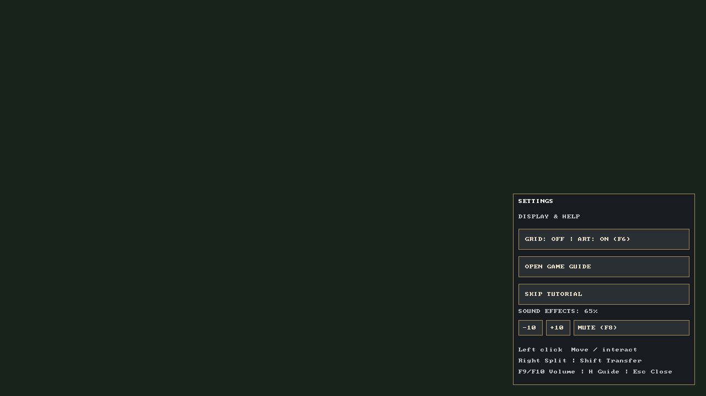

# Action audio and runtime asset packaging

**Date:** 20 November 2026.  
**Published code:** [9b496c8](https://github.com/Adzffs/GameEngine/commit/9b496c8e59556511c2e274394b6c8c071f09c63a).  
**Starting point:** [66576af](https://github.com/Adzffs/GameEngine/commit/66576af8511d8fe6242831489913c09365ae79f6).  
**Tasks:** ART-004, STUDIO-063; supporting GAME-004 evidence.  
**Status:** Working first sound pass and verified packaging correction. Full starter, audible quality and original local melee integration acceptance remain open.

The replacement Linux workspace contained an older checkout, without the interrupted Windows GameEngine-next worktree. Current published source was restored in an isolated checkout. This independent work improves that source without replacing the missing local animation implementation. REL-004 remains in progress; its [recovery handoff](INTEGRATION_HANDOFF_2026-11-20.md) still applies.

## What changed

The client now plays restrained feedback for axe/pickaxe contact, melee swing and hit/miss/block, successful gathering/crafting, accepted equipment actions, drops, crafting inventory interaction and food use. The [audio batch](../../../assets/embervale/audio-pilot/README.md) has fifteen original PCM files, an editable deterministic generator, a manifest and provenance.

Settings provides effects volume and mute. **F8** toggles mute; **F9/F10** change volume by ten percentage points. Volume starts at 65%, clamps to 0-100%, and is independent from mute. Controls apply to the current session; persistent preferences, music, ambient loops and footsteps are outside this pass.

Runtime files now have one copy owner. The previous per-executable post-build commands could race while copying to the same output directory. They also left damaged or missing packaged files unrepaired when the executable did not need linking.

No gameplay timing, rolls, damage, recipes, item ownership, XP policy or save schema changed. The published visual inventory stays at 1,175 frames in 30 textures; the separate melee/polish inventory is not being claimed as integrated.

## Event and playback boundaries

| Boundary | Implemented behavior |
|---|---|
| Tool contact | The shared gathering presentation emits a consumable edge when entering contact pose 3. Cancellation/invalid gathering clears it. It grants no item or XP |
| Gathering success | The router reads actual committed local item/XP rewards after every world update, including catch-up |
| Melee start | A local published melee start selects the normal or godsword swing |
| Melee result | A per-tick vector preserves every recorded outcome through fatal-hit display cleanup. Positive damage, zero-damage hit and miss choose separate cues |
| Crafting | Current World source records RECIPE completion after successful TryCreateRecipe, so that existing event supplies production confirmation |
| Equipment, food, drop and cursor interaction | The client remembers the command ID and confirms only an accepted local result; rejected commands remain silent |
| Duplicate delivery | The router consumes each world tick once and retires processed command IDs; actor changes clear its state |
| Resource limits | At most 16 routed cues per tick, 64 pending command identities and six playback streams; cooldowns coalesce repetition and overload drops playback instead of queuing latency |
| Variants | Wood, stone and hit have two deterministic cosmetic variants; a missing variant falls back to an available alternate without using gameplay RNG |
| Mute/zero volume | Apply stream gain, clear queued data and discard new cues; unmuting cannot replay a stale queue |
| Device/assets | Optional initialization failure leaves gameplay running. Missing, invalid, wrong-format or oversized optional clips are rejected with restrained diagnostics |
| Headless core | Routing and outcome facts are SDL-free. Playback is built only for SDL client/graphics configurations |

The fatal-result vector is separate from the map used for short-lived visual labels. Display cleanup can remove that map's entry when someone dies; the committed vector remains until the next world update. Its completion tick identifies when the outcome happened. This addition preserves damage authority and makes fatal feedback available without looking up a removed target.

The generator produces mono 48 kHz, signed 16-bit little-endian PCM with short attack/release envelopes and zero endpoints. The 15 clips contain 284,640 sample bytes, peak at approximately 0.28 full scale and total 285,300 WAV bytes. Six voices at maximum gain 0.45 have a calculated worst-case summed peak of 0.756. That headroom calculation is not an audible mixing review.

## Packaging correction and reproduction

GameEngineWorldArt is the sole runtime copy target, and SDL executables depend on it. Its commands use the active configuration's executable directory, create required directories and copy images/sounds only when bytes differ. The target checks assets even when no C++ source changes or executable relinks.

The reproduction first restored the old CMake file on the baseline build, corrupted three build-output textures and rebuilt GameEngine. All three stayed corrupt. Restoring the copy-owner fix repaired them. Deleting two packaged textures and rebuilding all targets in parallel also repaired them. These repairs required no C++ recompilation.

Final verification compares **30 PNGs and 15 WAVs** against their source bytes. A separate Ninja Multi-Config Release copy test used graphics tests as the first consumer, with the game client disabled and spaces in the output path. All 45 files matched there too. That test exercised packaging only; it did not build or approve a Release gameplay executable.

The broader image/atlas memory and resource-limit requirements of STUDIO-063 remain open.

## Executed verification

| Check | Result | Scope |
|---|---:|---|
| Linux SDL client configuration | 107/107 CTest entries | 89 headless, 7 client, 11 graphics; includes five new entries |
| Separate configuration with client/graphics disabled | 89/89 entries | Audio routing builds without SDL; linked AudioFeedbackTests dependencies contain no SDL |
| Python editor unit suite | 42/42 tests | Python 3.12.14 |
| Actual editor/CLI bridge | 12/12 cases | Included in one CTest entry above |
| AudioFeedbackTests | 32 assertions | Current/local results, command rejection/deduplication, catch-up, bounds, gathering interruption/no XP and a real fatal World melee action |
| AudioPlaybackTests | 21 assertions | Audio-enabled SDL streams, cooldown, saturation, mute/volume, missing/invalid/oversized inputs and alternate fallback |
| AudioUnavailableTests | 2 assertions | Forced unavailable driver remains nonfatal |
| AudioGraphicsTests | 9 assertions | Actual Settings clicks, F8/F9/F10 event handling and key-repeat behavior |
| Original effect checks | 15/15 clips | Exact regeneration, format, length, endpoints, peak/RMS and manifest |
| Packaged output | 45/45 files | Source-byte equality in Debug and the separate multi-configuration copy fixture |
| Documentation consistency | 96 Markdown files, 1,167 links | 96 synchronized task records, acyclic dependencies and 45 retained legacy IDs |
| Fresh production replay before/after audio | Identical output | Shield tick 245, sword 376, prepared return 454; no material/XP/coin injection |
| Timber production replay before/after audio | Identical output | 60 -> 54 -> 48 coins across two full cycles |

Environment: **Linux, GCC 14.2.0, CMake 4.4.5, Ninja 1.13.2 jobserver build, SDL 3.4.12, Python 3.12.14**. The existing local SDL library initially had audio disabled; the playback test caught it. An audio-enabled SDL build with dummy/disk drivers was installed for the executed final playback checks. No audio test was skipped to accommodate the old SDK.

See [results and tested source blobs](audio/2026-11-20/results.json), [packaging reproduction and hashes](audio/2026-11-20/packaging.json), [starter replay](audio/2026-11-20/starter-replay.json) and [timber replay](audio/2026-11-20/timber-replay.json).

The Settings fixture was captured with the software renderer and inspected for readable controls and panel bounds:

## Reproduce

Use an audio-enabled SDL3 installation. From the repository root:

~~~bash
cmake -S . -B build-client -G Ninja -DCMAKE_BUILD_TYPE=Debug \
  -DBUILD_TESTING=ON -DGAMEENGINE_BUILD_CLIENT=ON \
  -DGAMEENGINE_BUILD_GRAPHICS_TESTS=ON -DCMAKE_PREFIX_PATH=/path/to/SDL3
cmake --build build-client --parallel 6
SDL_VIDEODRIVER=dummy SDL_AUDIODRIVER=dummy \
  ctest --test-dir build-client --output-on-failure --parallel 4

cmake -S . -B build-headless -G Ninja -DCMAKE_BUILD_TYPE=Debug \
  -DBUILD_TESTING=ON -DGAMEENGINE_BUILD_CLIENT=OFF \
  -DGAMEENGINE_BUILD_GRAPHICS_TESTS=OFF
cmake --build build-headless --parallel 4
ctest --test-dir build-headless --output-on-failure --parallel 4

python3 tools/audio/build_audio_pilot.py --check
python3 -m unittest discover -s tests -p 'test_*.py'
python3 tools/check_documentation.py
./build-client/EmbervaleEconomyReport --replay-starter-upgrade \
  --world content/worlds/river-crossing.blockout.json
~~~

For an actual device check, launch the normal client without dummy audio selection and use an isolated fresh profile:

~~~bash
./build-client/GameEngine --world content/worlds/river-crossing.blockout.json \
  --profile fresh --no-save
~~~

## Source references and remaining acceptance

Playback uses the installed SDL3 API and its primary documentation:
[open a device](https://wiki.libsdl.org/SDL3/SDL_OpenAudioDevice),
[create a stream](https://wiki.libsdl.org/SDL3/SDL_CreateAudioStream), and
[bind streams](https://wiki.libsdl.org/SDL3/SDL_BindAudioStreams).
No additional audio dependency was introduced.

Dummy/software checks establish plumbing, bounds and control behavior. They do not establish sound quality on speakers/headphones or approve Windows hardware behavior. Audible review, balance during real play, persistent preferences if desired and original melee animation synchronization remain open under ART-004.

GAME-005 still needs the complete visible/uncoached route, actual elapsed upgrade time, combat/food pressure, death/recovery and native save-failure choices. The repeated production replay ends at prepared combat supplies; it is not that playthrough.

When recovering GameEngine-next, preserve this newer published CMake/audio work. Add the melee textures to the existing copy owner. Preserve GetMeleeCombatEvents, its per-tick clearing and the committed snapshot after recording an outcome, alongside any additional melee pose/position/weapon fields. Keep the consumable gathering contact edge when adopting weighted authored timing.

REL-004 remains open until the original sources, editable art, outputs and previews are recovered, reconciled, tested and published. ART-005 remains owner-deferred; no animation visual acceptance is implied by these results.
