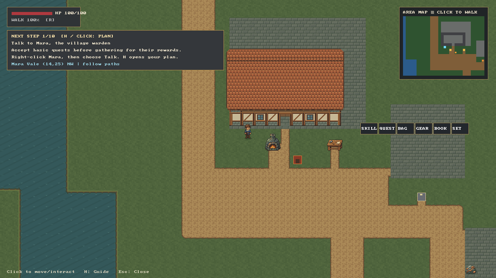
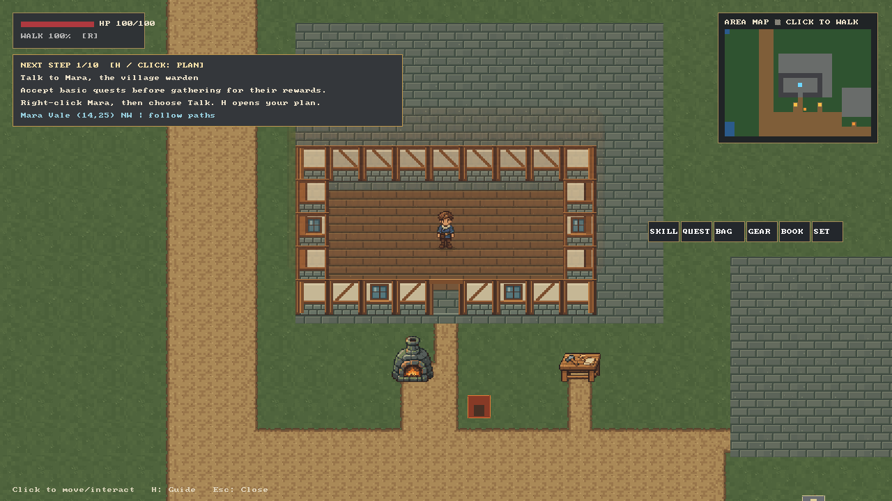

# First workshop and modular building kit

**Date:** 19 November 2026\
**Base:** master `be1fc875a8892aa96060193c79c44f2b3c864fb6` (bank/table art).\
**Work packages:** ART-001/002, STUDIO-061/062; bounded structural content extension.\
**Result:** Modular kit and first workshop integrated; Linux client/tools builds,
production validation, editor round trip and game-camera previews completed.





## Kit and projection

The [building kit](../../../assets/embervale/building-pilot/README.md) contains
27 pieces in three editable LibreSprite masters: twelve directional wall/window/
door/corner frames, twelve roof/edge/corner/ridge sections and three floors.
The shared cache now covers 113 frames in fifteen PNGs across five art batches.
The architectural reference supplied materials; final native pixels use the
game's overhead camera and unrotated 32-pixel grid, with shallow visible wall
fronts. They are not the more frontal reference image inserted into the map.

Roof coverage repeats native pieces and clips final repeats without stretching
pixels. Walls join the ground-sorted object queue. The roof draws above objects,
easing to 25/255 opacity while it overlaps the player or the player is inside,
and restoring outside. Foreground wall pixels that hide the player also fade.
Alpha has no effect on collision. F6 shows basic walls; unavailable art falls
back per image, retaining the same footprint and open entrance.

## First authored workshop

The shell is nine tiles wide and five deep at (65,44), within the existing
workshop stone footprint. There are 23 blocked perimeter cells, 21 interior
floor cells and one open south doorway at (69,48), with a short dirt route to
the yard. Furnace (68,50), crafting table (73,50), NPC homes and other service/
resource positions are unchanged. The room is currently unfurnished.

[ADR-020](../07-decisions/ADR_020_STATIC_BUILDING_SHELLS.md) defines schema-4
static shells. Structural/collision validation, World/Map, Studio overlays and
the renderer consume the same authored geometry. The parser/canonical writer
retain historical schemas 1..3. River Crossing's schema-2 actors migrate with
explicit default respawn delays; player save formats remain unchanged. Existing
saved-position walkability/reachability recovery covers positions on new walls.

Studio displays the footprint and preserves it through commands and drafts.
Floor edits that violate the stone foundation, placements on walls and blocked
entrances fail validation. Existing undo/redo/spawn edits preserve schema 4.
Shell creation/movement controls are not yet exposed in the editor.

## Reproduce

Update the checkout and run `Play-RiverCrossing.cmd` on the supported Windows
setup. It rebuilds the game against the updated content. For authoring:

```powershell
python tools/art/build_building_pilot.py --editor "C:\Program Files\Asprite\libresprite.exe"
```

The default command preserves saved masters; `--regenerate` explicitly replaces
only this batch's three masters. It exports PNGs, metadata, review boards and
the shared C++ layout. Python uses its standard library; LibreSprite performs
all pixel work. CMake packages only the three new runtime PNGs.

With content tools, the SDL 3.4+ renderer can reproduce the views:

```powershell
cmake --build build-client --target GameEngine EmbervaleRenderPreview EmbervaleWorldValidate --parallel 6
.\build-client\EmbervaleWorldValidate.exe content/worlds/river-crossing.blockout.json
.\build-client\EmbervaleRenderPreview.exe content/worlds/river-crossing.blockout.json workshop.png --focus 66 49
.\build-client\EmbervaleRenderPreview.exe content/worlds/river-crossing.blockout.json inside.png --focus 69 46 --zoom 1.5
```

## Evidence and limits

[results.json](art/2026-11-19/buildings/results.json) records Linux/GCC 14.2,
CMake 4.4.5, SDL 3.4.12 and LibreSprite 1.3, client/content-tool and tools-disabled
client builds, source-preserving exports, matching packaged PNGs, production
world validation and the real Studio bridge's edit/undo/redo/save/reopen cycle.
The bridge retains building metadata, rejects invalid foundation edits and
historical-schema building data, and leaves its source file unchanged.

Actual game-renderer captures cover the workshop at native and
[1.5x zoom](art/2026-11-19/buildings/workshop-1_5x.png), the interior, the
[doorway](art/2026-11-19/buildings/doorway.png),
[restored roof after leaving](art/2026-11-19/buildings/exit-restored.png) and
[basic mode](art/2026-11-19/buildings/basic-interior.png). Dummy video/software
rendering establishes the camera projection and visibility, not GPU performance
or a visible interaction playthrough. The exit fixture uses the preview's
in-memory movement interpolation rather than server pathfinding.

Regression suites and full starter acceptance remain deferred at the owner's
request. Windows execution/export was not available in this Linux session.
The structural starter kit is reusable; bank/shop assemblies, extra styles,
interactive doors, other entrance orientations and furnishing/building-editing
workspaces remain future work. R4 and the broader ART-002 visual kit stay open.
