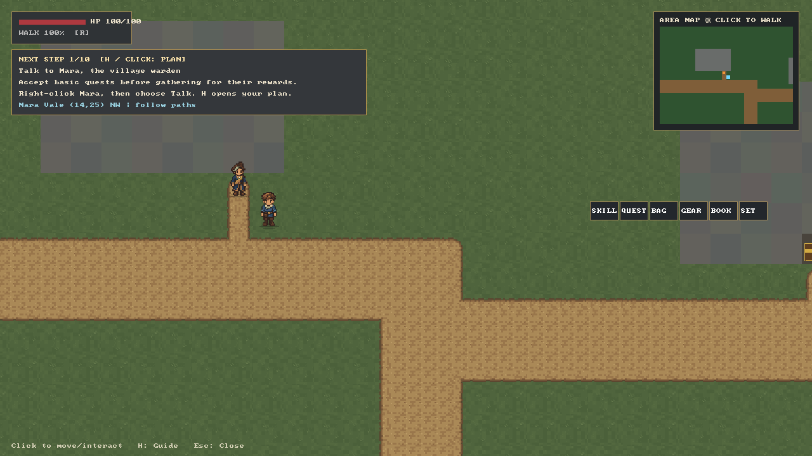
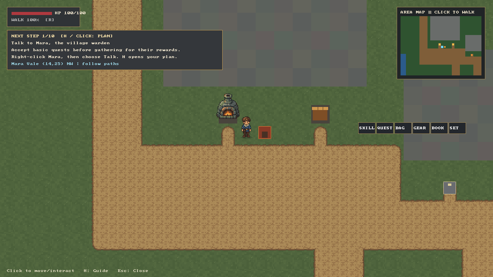

# Player, Mara, furnace and first walk cycle

**Date:** 19 November 2026\
**Base:** master `6f137db8ded3827481972ac22d4922843a59531c` (forest renderer, PR #34).\
**Work packages:** next bounded ART-001/002 pilot, extending STUDIO-061/062.\
**Status:** Source and art integrated; client/launcher builds and renderer captures passed. Regression suites and visible interaction/playthrough acceptance remain deferred.





## Artwork and source workflow

The [cast pilot](../../../assets/embervale/cast-pilot/README.md) adds three
editable LibreSprite masters and 18 named runtime frames: sixteen player poses,
one Mara sprite and one furnace. A retained original generated reference is
sampled to native scale, mapped to the batch palette and cleaned to binary alpha
in LibreSprite JavaScript. Stride poses are authored from the cleaned standing
pixels. Player/Mara ink height is 36 pixels; the furnace is up to 48 pixels tall.
Their contact points and scale agree with the existing ground and tree kit.

The default export reads saved masters and preserves their bytes. It creates
the PNGs, editor metadata, a static art board and a four-frame GIF using
LibreSprite's numbered PNG sequence import. `--regenerate` is the explicit
operation that recreates masters. The player remains an editable atlas rather
than sixteen editor timeline frames; runtime frame rectangles are recorded in
the manifest. Both export commands refresh the same generated C++ binding,
which now covers 39 frames and six images across the two batches.

## Runtime presentation

The later [walk continuity correction](WALK_CYCLE_CONTINUITY_2026-11-19.md)
repairs the waist separation in the first stride sheet. Its enlarged previews
and per-frame checks supersede the original walk art in this record.
The [20 November eight-way update](PLAYER_EIGHT_WAY_2026-11-20.md) extends the
player to eight facings and 32 poses; it supersedes the four-way direction and
atlas descriptions below while preserving the original cardinal artwork.

- The local player uses four facings and a four-pose walk cycle. Facing follows
  the dominant visual movement axis. Cycle phase advances by actual interpolated
  travel distance; it does not loop on a wall-clock timer while standing still.
  Stopping returns to the neutral pose of the last direction.
- Player and Mara share subtle ground-contact shadows. Mara keeps the blue
  coat/gold sash specified in the character contract. Only her existing NPC
  definition selects this sprite.
- The existing furnace definition selects its new static stone/fire sprite.
  This does not introduce an active/inactive smelting state or change recipes.
- The existing world texture cache handles both batches. Nearest-neighbour
  scaling, ground-based ordering, tall-tree fade and per-image fallback remain.
  F6 also returns the new characters/station to their prior basic shapes.
- Mara's original interaction rectangle is retained, with opaque head pixels
  extending the target. Furnace pixels beyond its base map back to the existing
  station tile. Ground-item/object priorities and explicit Walk here remain.
- CMake packages only the six required PNGs. The source/generated-reference
  images and editor are not required to start the game.

These are presentation changes. Player movement, resource/quest outcomes,
dialogue sessions, station access, collision, equipment bonuses, world content
and save formats are unchanged. The new player image is a base outfit; weapon
layers, attack/death poses and character customisation remain future work.

## Reproduce

Update and run `Play-RiverCrossing.cmd` for normal play. To export saved art:

```powershell
python tools/art/build_cast_pilot.py --editor "C:\Program Files\Asprite\libresprite.exe"
```

In a UCRT64 client configuration with content tools and SDL 3.4+:

```powershell
cmake --build build-client --target GameEngine EmbervaleRenderPreview --parallel 6
.\build-client\EmbervaleRenderPreview.exe content/worlds/river-crossing.blockout.json mara.png --focus 15 26 --zoom 1.5
.\build-client\EmbervaleRenderPreview.exe content/worlds/river-crossing.blockout.json furnace.png --focus 69 51 --zoom 1.5
.\build-client\EmbervaleRenderPreview.exe content/worlds/river-crossing.blockout.json walk.png --focus 15 26 --walk-to 16 26 --zoom 1.5
```

The zoom option uses the game's existing limits. The preview initializes the
real camera before applying anchored zoom. `--walk-to` is a presentation fixture:
after an initial frame it changes the in-memory player position and renders
interpolation frames 40ms apart. `--frames N` chooses 1..120 output iterations;
only the last is saved. This exercises the same renderer and walk-pose selection
as play, without simulating pathfinding or a server-tick movement session.
No world input or player progress is written.

## Evidence and remaining scope

[results.json](art/2026-11-19/cast/results.json) records builds, captures,
source-preservation and packaged PNG checksums. The captures cover the player
beside Mara, the actual workshop furnace, and movement in
[east](art/2026-11-19/cast/walk-east.png),
[west](art/2026-11-19/cast/walk-west.png),
[north](art/2026-11-19/cast/walk-north.png) and
[south](art/2026-11-19/cast/walk-south.png) directions. They use dummy video and
software rendering at 1280x720, not a visible GPU/window playthrough.

The original forest masters remain unchanged and normal cast export preserves
the new masters. Both client build directories contain matching runtime PNGs.
The cache reports 6/6 images. Full regressions, visible walking/interaction and
broader combat/quest acceptance remain deferred at the owner's request.
Other characters, stations, terrain families and equipment art remain separate
batches; this is not completion of the full starter visual kit.
