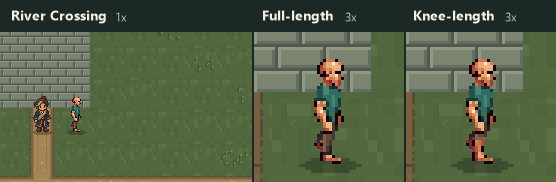
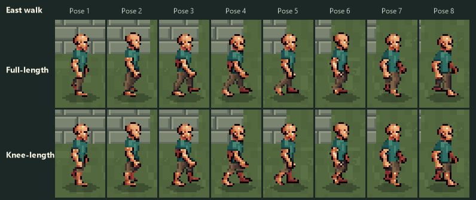

# East-facing character walk in River Crossing

The custom player walks three tiles east past Mara at the same 60% scale as the [south-facing fit](CHARACTER_FIT_2026-11-25.md). Watch the near hand cross the tunic hem on the forward swing, then compare where the two trouser lengths end as the trailing leg lifts.



The left panel shows the full-length outfit at normal camera zoom. The middle and right panels enlarge the actual game pixels three times. Both use the same camera, route, foot position and capture clock. The player holds the east-facing standing pose after the third step.



## Art and playback

One PixelLab generation added eight walk poses to the existing character's walk animation group. The standing pose comes from its original eight-view sheet. Each 84-by-84 source walk cell has a two-pixel transparent border that can be removed on every side. The resulting 80-by-80 cells use the same ground pivot, (40, 70), as the south character.

The teal tunic has a separate neckline and sleeve opening for each pose. The exposed forearms and hands remain visible where they cross the waist. Each trouser length follows the near and far legs separately, including the trailing ankle. The body, trousers and tunic share one pose index. The editable PixelLab drawings, original walk strip and exported layers are listed in the [east asset manifest](../../../assets/embervale/custom-character-pilot/revisions/east-walk-v1/manifest.json).

The developer renderer plays one eight-pose loop per tile. After arrival, east has one held standing pose. South retains its four-pose idle. The six other walk directions and equipped or action states use the existing player art. The 60% size remains provisional, and the east fit is ready for visual review.

## Reproduce the capture

From the repository root, use a Windows client build with content tools enabled. The two frame directories must be new.

```powershell
cmake --build build-client --target EmbervaleRenderPreview
.\build-client\EmbervaleRenderPreview.exe content/worlds/river-crossing.blockout.json east-full.png --focus 15 25 --walk-to 18 25 --fit-outfit full --frames 66 --frames-to east-full-frames
.\build-client\EmbervaleRenderPreview.exe content/worlds/river-crossing.blockout.json east-knee.png --focus 15 25 --walk-to 18 25 --fit-outfit knee --frames 66 --frames-to east-knee-frames
```

The 25 fps comparison starts at frame 1, when the player turns east. Frame 0 faces south. Frames 1–45 cover the three steps and frames 46–65 hold the standing pose.

## Verification

- All three garment atlases matched the PixelLab drawing exports at every RGBA pixel. All eight source walk cells are distinct. Removing their transparent borders discarded no visible pixels.
- For each outfit, every opaque reference pixel in the independently composited, nearest-neighbour-scaled body matched the corresponding player pixel in all 65 east-facing world frames. Both outfits matched the same pose and foot position on every frame. The ground anchor moved from x=498 to x=592 and stayed at y=358.
- Switching trousers changed 23–37 lower-leg pixels per captured pose at normal zoom. The moving hand, sleeves and upper body matched between outfits.
- The Windows game and developer renderer built. The four focused checks covered the character preview, player animations, graphics resources and startup options. West-facing movement and shield-equipped east movement matched the existing renderer frame for frame.
