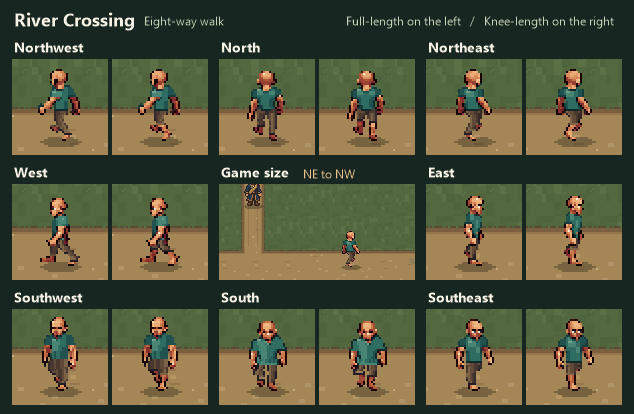
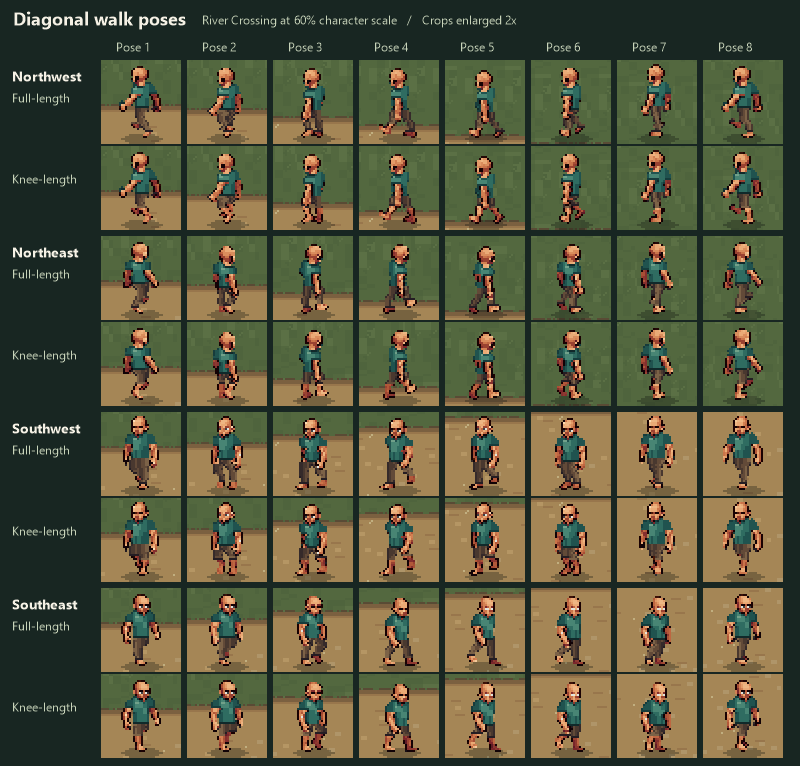

# Eight-way custom character walk in River Crossing

The tunic, full-length trousers and knee-length trousers now follow the custom character in all eight walking directions. Each compass position below pairs full-length trousers on the left with knee-length trousers on the right. The close-ups use the same game frames at 2× magnification. The centre shows the change from northeast to northwest at normal game zoom near Mara.



## Four diagonal walks

Four PixelLab generations added 32 moving body poses to the existing human walk group. Each direction uses its own original standing view and eight distinct walk frames. Each moving frame is cropped from 84 × 84 to 80 × 80 and translated vertically until its support sole reaches row 69, directly above the shared (40, 70) pivot. Both trouser choices reuse that body and the same tunic.

The front views expose the swinging hand as it passes the hip. The rear views have differently shaped sleeves and often partly hide the far arm. The two legs also reach different heights within a pose. Each garment recipe records the neckline, sleeves and trouser hems for the actual pose. The transparent spaces under the arms and between the legs show the world.

| Facing | Source and editable layers | First walk column |
| --- | --- | ---: |
| Southeast | [Southeast manifest](../../../assets/embervale/custom-character-pilot/revisions/south-east-walk-v1/manifest.json) | 1 |
| Southwest | [Southwest manifest](../../../assets/embervale/custom-character-pilot/revisions/south-west-walk-v1/manifest.json) | 2 |
| Northeast | [Northeast manifest](../../../assets/embervale/custom-character-pilot/revisions/north-east-walk-v1/manifest.json) | 8 |
| Northwest | [Northwest manifest](../../../assets/embervale/custom-character-pilot/revisions/north-west-walk-v1/manifest.json) | 5 |

Column zero holds the stand. The eight motion columns retain their source order and wrap back to the beginning. For each diagonal, the first column was chosen by comparing the leg and foot silhouettes at each possible starting phase with the two neighbouring cardinal walks. The sheet follows playback order.



## Timing in the world

Each accepted tile step takes 600 ms. A diagonal advances on both map axes during that time. The developer preview used to advance the gait by Euclidean distance, which counts a complete diagonal step as approximately 1.41 strides. It now advances by the larger of the two axis displacements. All eight directions play one complete eight-pose stride per tile, with alternating holds of 80 and 70 ms.

On the northeast-to-northwest turn, the final northeast frame and the first northwest frame place the head 36 screen pixels above its ground anchor and the sole one pixel above it. The character holds the matching diagonal stand on arrival. South retains its four-pose idle.

## Reproduce the recordings

From the repository root, use a Windows client build with content tools enabled. The example exports the eight straight walks and the centre turn for both outfits. It uses fresh output directories, a two-tile walk and 45 frames per take at 25 fps.

```powershell
cmake --build build-client --target EmbervaleRenderPreview
$preview = '.\build-client\EmbervaleRenderPreview.exe'
$world = 'content/worlds/river-crossing.blockout.json'
$destinations = [ordered]@{
    north = @(17,25)
    'north-east' = @(19,25)
    east = @(19,27)
    'south-east' = @(19,29)
    south = @(17,29)
    'south-west' = @(15,29)
    west = @(15,27)
    'north-west' = @(15,25)
}
foreach ($outfit in 'full','knee') {
    foreach ($facing in $destinations.Keys) {
        $x, $y = $destinations[$facing]
        $take = "$facing-$outfit"
        & $preview $world "$take.png" --focus 17 27 --walk-to $x $y --fit-outfit $outfit --frames 45 --frames-to "$take-frames"
    }
    & $preview $world "turn-$outfit.png" --focus 17 27 --walk-via 18 26 --walk-to 17 25 --fit-outfit $outfit --frames 45 --frames-to "turn-$outfit-frames"
}
```

## Verification

- Compared all 12 diagonal garment atlases with their editable PixelLab drawings, including transparent pixels. Each exported body retains every opaque source pixel through cropping and registration. Checked shoulder coverage, near-wrist visibility and exposed feet across the four stands and 32 new walking poses.
- Matched every opaque body and garment pixel against an independently composited pose in 810 captured frames. This covers eight straight routes and the diagonal turn in both outfits. Each of the four new facings showed all eight phases on each tile, held its stand at the end and kept its sole one screen pixel above the pivot. Switching trousers changed 22–48 lower-leg pixels per diagonal frame at the working size.
- The Windows game and developer renderer built. All five focused tests passed, covering the fitted walks, distinct diagonal stands, equipped fallback, camera follow, player animation, world-art resources and startup options.

The custom body is available through the developer renderer. Equipping a weapon or shield, gathering and melee use the existing character art. Playable character creation, appearance saves and broader equipment fit remain open. [Custom-character plan](../05-game/CUSTOM_CHARACTERS.md)
