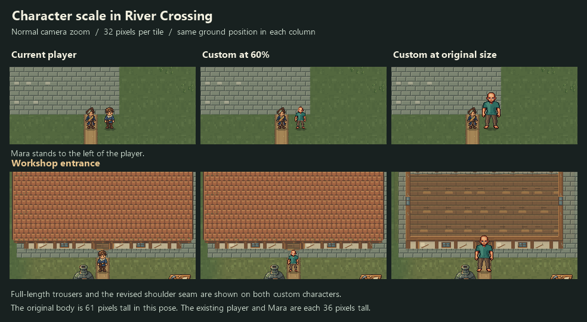
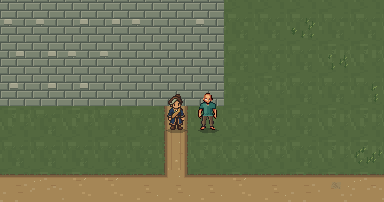

# Custom character fit in River Crossing

25 November 2026 · ART-006 / ART-007 · [Character design](../05-game/CUSTOM_CHARACTERS.md)



The custom character at 60% stands **37 screen pixels tall** in the first idle pose. Mara and the current player each stand **36 pixels tall**. At the original size the same custom pose stands **61 pixels tall**. All three columns use one-times camera zoom and the same tile and foot position. The source-scale character overlaps the workshop eave, so the renderer fades the roof. The 60% character clears the eave.

After reviewing the south-facing preview, the owner said it “seems pretty good for now”. Use 60% as the working size for the next facing. Final production proportions are still open.

## Idle and walk



The first shot shows the four south idle poses beside Mara. The second starts at the doorway, follows three accepted southward steps and settles back to idle. These are one-to-one crops of 1280×720 frames from the Windows SDL software renderer, recorded at 25 frames per second. The full frame retains the ordinary game camera and HUD. [Full-resolution workshop capture](character-fit/2026-11-25/workshop-at-1x.png)

## Reproduce the capture

From the repository root, configure a client build with content tools enabled and build `EmbervaleRenderPreview`. The commands below use a Windows build directory named `build-client`. The sequence directory must be new.

```powershell
cmake --build build-client --target EmbervaleRenderPreview
.\build-client\EmbervaleRenderPreview.exe content/worlds/river-crossing.blockout.json mara-fit.png --focus 15 25 --fit-outfit full
.\build-client\EmbervaleRenderPreview.exe content/worlds/river-crossing.blockout.json workshop-fit.png --focus 69 49 --fit-outfit full
.\build-client\EmbervaleRenderPreview.exe content/worlds/river-crossing.blockout.json workshop-walk.png --focus 69 48 --walk-to 69 51 --fit-outfit full --frames 92 --frames-to workshop-walk-frames
```

Use `--fit-outfit knee` for the short trousers. Add `--fit-scale native` to see the full source size. Omitting the outfit selects the existing player. To reproduce the first shot of the clip, use the Mara command with `--frames 44 --frames-to mara-idle-frames`.

## Implementation and verification

- The developer preview loads three bounded 960×80 RGBA atlases once. They hold the original body, one v5 trouser length and the v6 tunic. Their combined logical texture size is 921,600 bytes. All three layers share one frame, pivot and nearest-neighbour scale. The manifest supplies the geometry, file paths and timing. [Garment manifest](../../../assets/embervale/custom-character-pilot/revisions/shoulder-crest-v6/manifest.json)
- The four idle poses use 400 ms each. Eight walk poses share one cycle per tile travelled. The image is anchored at the existing ground contact point, 16 pixels across and 24 pixels down a tile. The measured source silhouette determines roof and tree overlap in the preview. Other facings, equipment and action presentations use the existing character. The normal game build retains its current player assets and save version.
- The Windows client and preview tool built. All four focused tests passed, covering the new character preview, player animation, world-art resources and startup options. The renderer loaded all 32 world textures. Combining the three source layers reproduced all 76,800 pixels of each dressed reference sheet.
- The four idle poses and all eight walk poses were identified in the world captures by comparing opaque pixels against the independently sampled dressed reference. The first shot covers a full idle cycle. The middle step beyond the eave shows every walk pose with an exact match on the sampled pixels.
- Swapping trouser length changed 53 pixels on the lower legs in each of the two stationary 60% captures. Twenty east-facing frames and two sword-and-shield frames matched the existing character pixel-for-pixel with the option on and off.

The next comparison is a side-facing walk at the same scale and foot position. Check how the tunic shoulder and trouser legs move through that turn. The remaining directional coverage, action poses and player-facing creator are still open.
