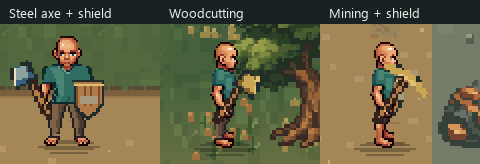

# Held items on the fitted character

The River Crossing playtest switched to its earlier full-body sprites whenever a weapon, shield or action was present. The fitted renderer now draws the selected body, tunic and trousers through equipping, walking, chopping, mining and melee. The action supplies its facing and phase. Equipment supplies the object in each hand.

## What one more item costs

| Addition | Author once | What carries over |
|---|---|---|
| Another metal for an existing axe | Add its shadow, midtone and highlight, then map the gameplay item to the axe and its material. | Head shape, wooden shaft, both hand tracks, eight facings, carry, chop and melee |
| A differently shaped hatchet or pick | Make its PixelLab item artwork, put the grip on the sheet anchor, and assign its views and compatible action. | Fitted body, clothes, gait and compatible swing |
| A decorated or asymmetrical shield | Provide the visible faces or rim views the design needs. Assign each of the eight facings its view and set the mirroring option. | Left-hand track, walking and depth ordering |
| A bow, spear thrust or different two-hand grip | Author and review a shared draw, thrust or two-hand motion with its hand positions. Include the second grip or string where the action needs one. | Every compatible model and material can use that motion |

For example, twenty axe shapes in five common metals produce one hundred item appearances. That catalogue needs twenty sets of shape art, five material ramps and a shared chopping motion for compatible grips. A longer handle, different point of balance or wider head needs a reach and clearance check.

## How the playable assets fit together

- The [hand positions](../../../assets/embervale/custom-character-pilot/held-items/grips.json) are native pixel coordinates in the approved 80 × 80 body cells. There are 75 pairs across standing, south idle and walking. The order of each pair is anatomical right x/y, then anatomical left x/y. Profile poses include the projected grip of the hidden hand.
- Each [catalogue](../../../assets/embervale/custom-character-pilot/held-items/catalogue.json) entry maps the gameplay item ID to a shape and material. The view order is south, west, east, north, southwest, southeast, northwest and northeast. Reuse a cell across facings where its silhouette reads correctly. An asymmetrical shape can use eight individually painted views with mirroring disabled.
- The [shape sheet](../../../assets/embervale/custom-character-pilot/held-items/shapes.png) uses 40 × 48 cells, with the grip at pixel (20, 32). It contains an axe, pickaxe, sword, godsword, shield face and shield edge. These cells reuse Embervale's [melee equipment art](../../../assets/embervale/melee-pilot), with the earlier character's painted fingers removed. Only metal-region pixels marked RGB (255, 0, 1), (255, 0, 2) and (255, 0, 3) take the three material colours. Fixed trim, skin, cloth and wood keep their own pixels.
- The renderer splits this sheet into fixed-colour pixels and three reusable metal masks at load time. A new material adds three colours to the catalogue. Every material uses the same four textures. More shapes can occupy further rows of the sheet.
- Fitted layers and held items use the same pose. Walk distance selects the body column. An action plants the feet, moves the torso and wrist, and turns the object about that wrist using the existing gameplay presentation phase. The near hand overlaps the handle. The shield follows the off hand, or rides on the back with the heavy sword.

## Review a batch

Equip each supported shape, turn through side and rear views, and capture a raised pose, contact and recovery. Inspect the full shaft path and the cutting edge or point at contact. At game scale a weapon can stay connected to the correct hand and still hide the face or miss the apparent contact point. Check a shield alone and alongside the tool, switch trouser length with F7 while equipped, then unequip and check the empty-handed pose.

Ten focused Windows tests passed. The world-renderer checks exercised both trouser lengths during real gathering and melee. The isolated character test checked all eight facings, all eight walk phases, both hands, the metal-only pixel differences and the action phases. In the extracted Windows package, inventory clicks equipped the shield, equipped the bronze axe, swapped it for the bronze pickaxe and removed the shield. The fitted tunic remained visible in each capture and F7 switched trousers while equipped. The gameplay result and audio contacts still use the existing simulation and presentation timing.

The walk uses the previously approved source frames. The working swings use a planted stance and a shared wrist-and-torso movement. Dedicated overhead arm poses, a connected second grip for the heavy sword, and bow/string poses remain future family artwork. Review the motion once per family at game size before making a large batch of variants.
