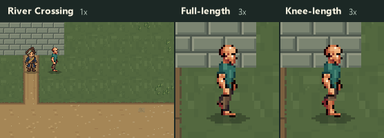
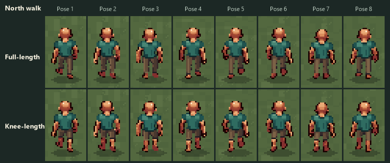

# East-to-north walk beside Mara

The custom character walks two tiles east, turns north for three tiles and comes to rest in River Crossing. The left panel uses normal game zoom. The two close-ups enlarge the same game frames three times to show the rear neckline, shoulders and each trouser hem. All three panels use the 60% character fit.



## How the turn reads

On the final east frame and first north frame, the top of the head is 35 screen pixels above the foot anchor and the planted sole is one pixel above it. The change of facing introduces no height or sole offset. During the rear stride the visible figure varies between 34 and 35 pixels tall.



The starting point for the back view was the character's original north-facing stand. One PixelLab generation supplied the eight moving body poses. Their lowest visible soles differed by three source pixels. After removing the two-pixel transparent border, each complete pose was moved down by 0, 1, 2, 1, 0, 0, 3 or 2 pixels respectively. This puts the support foot on row 69 in every 80-by-80 cell, directly above the existing (40, 70) ground pivot.

The tunic follows the first visible shoulder pixels on either side of the nape. Each sleeve stops above its moving forearm. The knees and ankles have separate cut lines on each leg, including the lifted leg. Both outfits share the same body motion and hold the original rear stand after arrival. [Source artwork, registration offsets and editable PixelLab recipes](../../../assets/embervale/custom-character-pilot/revisions/north-walk-v1/manifest.json)

## Camera correction

In the first recording, the on-screen foot anchor moved from y=358 to y=364 on the first north frame. The shared camera had started following the next authoritative tile while the sprite was still crossing into it. The revised camera follows the interpolated player position used to draw that frame. On the same turn, the anchor now moves from y=358 to y=356, in the direction of travel.

The camera keeps its existing damping, map limits and cursor-anchored zoom. During steady north travel the integer viewport and sprite occasionally round onto adjacent screen rows, a one-pixel variation. The sole stays one pixel above its own anchor throughout.

## Reproduce the capture

Use a Windows client build with content tools enabled. Run these commands from the repository root with new frame directory names.

```powershell
cmake --build build-client --target EmbervaleRenderPreview
.\build-client\EmbervaleRenderPreview.exe content/worlds/river-crossing.blockout.json north-full.png --focus 15 25 --walk-via 17 25 --walk-to 17 22 --fit-outfit full --frames 96 --frames-to north-full-frames
.\build-client\EmbervaleRenderPreview.exe content/worlds/river-crossing.blockout.json north-knee.png --focus 15 25 --walk-via 17 25 --walk-to 17 22 --fit-outfit knee --frames 96 --frames-to north-knee-frames
```

The preview queues the next destination on the first server tick after reaching the waypoint. The clip starts at frame 1 when the player first faces east. Frames 1–30 show east movement, 31–75 show north movement and 76–95 show the held north pose. The two captures run at 25 frames per second.

## Verification

- All eight north source walk cells are distinct. The crop and vertical registration preserve every opaque source pixel. Each exported garment matches its PixelLab drawing at all 57,600 RGBA pixels.
- Each outfit matched every opaque pixel of its independently composed reference pose in all 95 east and north frames. Switching trouser length changed 35–43 lower-leg pixels per north frame. Both outfits used the same pose and foot anchor throughout.
- The Windows game and developer renderer built. The camera regression reproduced the backward step on the previous follow code and passed after the correction. All five focused checks passed, covering the turn and outfits, ordinary camera follow, player animation, world-art resources and startup options.

The clothed developer preview covers south, east and north. West and the four diagonals still use the existing character. [South scale and idle](CHARACTER_FIT_2026-11-25.md) · [East walk](CHARACTER_EAST_WALK_2026-11-25.md)
