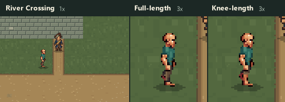
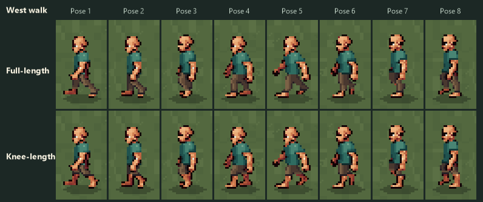

# East-to-west walk beside Mara

The player walks east past Mara, turns back along the same three tiles and stops facing west. The left panel shows River Crossing at normal zoom. The two close-ups show the same game frames with full-length and knee-length trousers. The character uses the working 60% scale in all three panels.



## What happens at the turn

As the character starts back, the ground anchor moves two screen pixels left, from x=527 to x=525. Three pixels of the planted sole occupy the same ground on both sides of the turn, at x=529–531 and y=357. The top of the head rises and falls by one pixel through the west stride. On arrival, the final stride and the held west stand have the same head and sole heights.



## Body and clothing

One PixelLab generation added eight west-facing walk poses to the human base's existing walk group. The stand is the original west-facing view. Each walking cell has a two-pixel transparent border. After cropping, the poses move down by 1, 2, 2, 2, 1, 1, 1 and 1 source pixels. The support sole lands on row 69 of each 80-by-80 cell, one row above the shared (40, 70) ground pivot.

Four poses had small transparent holes inside the hip. The editable repair fills 50 pixels across those poses and restores charcoal shading to bright brief pixels. The reference strip retains the original artwork. The repair leaves the openings between the swinging arm and the body visible.

The tunic and both pairs of trousers follow the same eight body poses. Each sleeve ends above its own forearm. The hands pass in front of the cloth, and separate cuffs follow the near and far legs. The walk plays eight poses in 600 ms. [West source, repair recipe and garment layers](../../../assets/embervale/custom-character-pilot/revisions/west-walk-v1/manifest.json)

## Reproduce the capture

From the repository root, use a Windows client build with content tools enabled. Give each recording a fresh frame directory.

```powershell
cmake --build build-client --target EmbervaleRenderPreview
.\build-client\EmbervaleRenderPreview.exe content/worlds/river-crossing.blockout.json west-full.png --focus 13 26 --walk-via 16 26 --walk-to 13 26 --fit-outfit full --frames 111 --frames-to west-full-frames
.\build-client\EmbervaleRenderPreview.exe content/worlds/river-crossing.blockout.json west-knee.png --focus 13 26 --walk-via 16 26 --walk-to 13 26 --fit-outfit knee --frames 111 --frames-to west-knee-frames
```

Mara stands at (14, 25). The player crosses one tile south of her. At 25 frames per second, capture frames 1–45 travel east, 46–90 travel west and 91–110 hold the west stand. The recording starts on the first east frame.

## Verification

- Every pixel in the three garment layers and the brief repair matches its editable PixelLab drawing. Both lengths preserve the face, exposed wrist, toes and openings in each west pose.
- Both outfits matched every opaque pixel of their reference poses in all 110 moving and standing capture frames. Changing trouser length affected 24–47 lower-leg pixels per west frame. The sole stayed one screen pixel above its anchor.
- The Windows game and developer preview built. Five focused tests cover the outfitted turns and stops, shield and diagonal fallback, camera follow, player animation, world-art resources and startup options.

The developer preview now covers all four cardinal walks. The four diagonal walks and the playable appearance renderer remain open. [South fit](CHARACTER_FIT_2026-11-25.md) · [East walk](CHARACTER_EAST_WALK_2026-11-25.md) · [North turn](CHARACTER_NORTH_WALK_2026-11-26.md)
