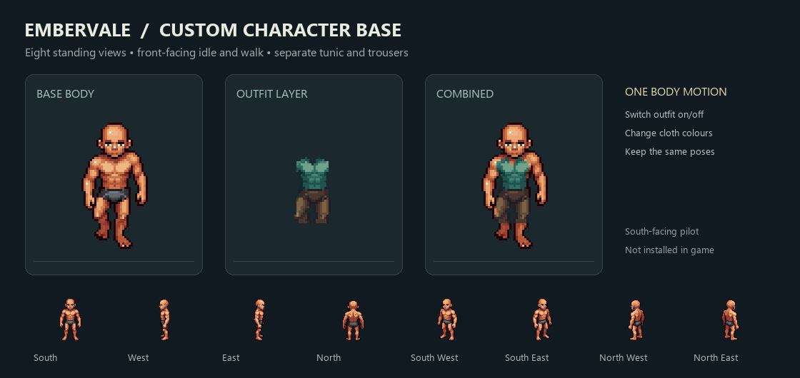

# Custom character pilot review and improvements

**Latest owner-reported coverage defect:** The owner confirms visible shoulder/leg skin in the revised garments, then requests both pant lengths. The [v4 correction](GARMENT_COVERAGE_2026-11-22.md) replaces sparse fit samples with whole-area checks and fixes mislabelled hand/thigh pixels. Both alternatives and the shared top now pass their declared coverage checks; owner visual acceptance remains pending.

**Owner-confirmed garment defect:** The owner subsequently reported that the tunic does not fit. The [v2 correction](TUNIC_FIT_2026-11-22.md) supplies a new pose-fitted garment and stronger checks; owner visual acceptance remains pending. The original v1 observations and results below remain historical evidence, not an accepted fit.

**Date:** 22 November 2026.  
**Request:** Preserve the first PixelLab base on GitHub, identify improvements and prepare a comprehensive route to custom characters.  
**Runtime baseline inspected:** [f2b5c6b](https://github.com/Adzffs/GameEngine/commit/f2b5c6b210654040e449ffe8101f32052a93d980).  
**Status:** Reference art and documentation delivery. No custom-character renderer, player appearance save data or creator UI has been installed into the game.

At the first publication the owner said improvements were needed without enumerating them. The later report specifically confirms the tunic fit defect, now recorded in the linked follow-up. Other findings below still distinguish measured facts, agent visual observations and future design work; no final owner approval is invented.

The [design and staged implementation plan](../05-game/CUSTOM_CHARACTERS.md) owns future behaviour. The [workflow](../05-game/CUSTOM_CHARACTER_WORKFLOW.md) owns production recipes. The [asset entry point](../../../assets/embervale/custom-character-pilot/README.md) owns the retained source pack.

## 1. What was made

The image is an offline authoring comparison. The moving [GIF](../../../assets/embervale/custom-character-pilot/v1/previews/character-layer-preview.gif) shares one clock across body, outfit and composition. Neither is a game screenshot or owner playthrough.

| Component | Exact current coverage |
|---|---|
| Standing body | South, West, East, North, Southwest, Southeast, Northwest, Northeast |
| Breathing idle | South only; four generated poses |
| Walking | South only; eight generated poses |
| Tunic and trousers | Separate transparent layers for the same four idle/eight walk poses |
| Clothing colours | Three tunic ramps in the offline preview; brown trousers |
| Skin choices | Original plus two illustrative preview palette mappings |
| Hair/beards/armour/tool tracks | Not authored for this base |
| Real game renderer / saved appearance / creator | Not implemented |

Clothing has no separate eight-way standing set. The preview's standing mode displays the base views; animated outfit testing is front-only. This is not complete eight-direction character customisation.

## 2. Inputs, geometry and provenance

The PixelLab character is [Embervale Modular Human Base v1](https://www.pixellab.ai/create-character/506e9990-e9e3-4771-b17f-892c787939d1), low top-down, selective outline, basic shading and medium detail. It is bald, barefoot, adult and in plain charcoal underwear.

| Item | Recorded result |
|---|---|
| Standing source sheet | 64×512: eight 64×64 views |
| South idle source | 336×84: four 84×84 frames |
| South walk source | 672×84: eight 84×84 frames |
| Layer proof | 1008×252: body/outfit/dressed rows, twelve 84×84 cells per row |
| Packaged cells | 80×80; two transparent source pixels removed from every animated edge |
| Packaged ground pivot | (40,70); standing facings translated without scaling to the same contact line |
| Source front visible bounds | (16,2) to exclusive (47,62): 31×60 visible-pixel bounding box |
| Timing retained for review | Idle 4×400 ms; walk 80/70 alternating, total 600 ms |
| Generation charge | Two for the eight views; one idle; one walk; total four |
| Balance after that task | 4.75 generations, a dated receipt only |

Idle group: 249aa0d8-8620-4863-853b-f294efdaa4b0. Walk group: 21093bb9-a630-4aaf-8252-60ec1414f034.

The source/layer PNGs and exact decision files are retained under [v1](../../../assets/embervale/custom-character-pilot/v1/README.md), including the [original manifest](../../../assets/embervale/custom-character-pilot/v1/manifest.json), [validation](../../../assets/embervale/custom-character-pilot/v1/validation.json) and [file hashes](../../../assets/embervale/custom-character-pilot/v1/sha256.json). No API credential or service subscription was created. No new generation was requested for this publication/planning task.

The original download is preserved as an expanded source set, rather than an extra duplicate ZIP in Git. Its repository provenance record links its SHA-256 to the retained per-file inventory.

## 3. Verification actually performed

| Check | Executed result | What it does not establish |
|---|---|---|
| Generated body conservation | All twelve idle/walk cells match the retained source PNG pixels exactly | Good anatomy, attractive motion or owner approval |
| Garment alpha | Binary alpha; zero opaque garment pixels outside the corresponding body | Semantically correct sleeves/hand/skin coverage or general loose-cloth support |
| Composition | Body + outfit exactly reproduces PixelLab's dressed cells | Correct world scale or equipment fit |
| Material separation | Independent tunic and trouser layers recompose to the same outfit | A general clothing catalogue |
| Crop/padding | No visible animated source pixels removed; eight standing views retain their pixels | The chosen physical world size is appropriate |
| Preview JavaScript | Syntax check passed | A completed browser interaction test |
| Browser preview interaction | Blocked because Computer Use could not confidently verify the active Windows browser address | No successful interaction test is claimed |
| Runtime / saves / gameplay | Not run for this isolated art task | No engine integration or new runtime regression result is claimed |

The v1 checked PNG inputs were retrieved as real transparent images. A workbench inline image with frame labels/matte was recognised as a preview and replaced with raw source bytes before the retained pack was built.

This repository update checks original file hashes and documentation/backlog consistency separately; see the [publication record](custom-characters/2026-11-22/publication.json). Its publication checks do not retroactively turn the pilot into an in-game test.

## 4. Prioritised improvement register

Priorities refer to making a coherent custom-character feature. “Open” means the required improvement or evidence has not been delivered. The v1 source remains intact.

| Finding | Priority / type | Evidence or concern | Required improvement and completion evidence | Parent work |
|---|---|---|---|---|
| CHAR-F01 — native scale and pivot | P0 integration prerequisite; open | 80×80/(40,70) pilot differs from the current body/bindings; visible front body is about 60 px tall | Compare at the actual map camera beside existing actors, doors and tools; choose a native scale/rig contract and preserve adjusted pivots | ART-006 / ENG-007 |
| CHAR-F02 — base style and proportions | P1 visual review; open | Agent observation: prominent muscular shading and a specific physique; owner has requested improvements but no exact change is recorded | Compare a quieter neutral body/proportion candidate at native size and record actual owner feedback before wardrobe expansion | ART-006 / ART-005 |
| CHAR-F03 — identity across views | P1 visual review; open | Eight generated views exist, but no real turntable/world acceptance | Inspect face, head/shoulder/pelvis sizes, perspective, lighting and asymmetry together; correct source views where needed | ART-006 |
| CHAR-F04 — gait, idle and transitions | P1 motion review; open | Only south is animated; exact pixel conservation does not prove planted feet, a smooth seam or readable weight | Review loop velocity, foot contacts, arm opposition, idle-to-walk/start/stop/turns in the renderer at ordinary camera zoom | ART-005 / ENG-007 |
| CHAR-F05 — incomplete facing/action coverage | P1 feature gap; open | Clothes/idle/walk south only; no matching carry, gather, melee or recovery set | Publish an explicit compatible matrix and complete required motions before making the character the normal default | ART-007 / ENG-007 |
| CHAR-F06 - fabric design and garment fit | P1 owner-confirmed persistent coverage defect; v4 review open | Owner still saw shoulder/leg skin after v2/v3. Sparse checks missed complete edges, and hand rectangles mislabelled thigh pixels | V4 repairs a shared top and provides both requested pant lengths; whole-area coverage passes for twelve south poses. Enlarged shoulder/leg evidence retained; owner visual acceptance and broader coverage remain open | ART-007 |
| CHAR-F07 — production skin/material regions | P1 pipeline gap; open | Skin preview uses a warm-colour heuristic; clothes use exact ramps | Add semantic masks/regions that protect eyes, underwear, hair, leather and metal; prove palette isolation | ART-006 / ART-007 |
| CHAR-F08 — editable and repeatable pipeline | P1 production gap; open | v1 has source PNGs and decisions, but no layered editor master; builder uses Windows fonts and can replace evidence fields on rebuild | Add an explicit revised master/import/export path, portable preview fonts and durable verification separate from regenerated previews | ART-006 |
| CHAR-F09 — hair and body fit families | P2 content gap; open | Bald body only; no beard, head tracks or hat rules | Add a small compatible hair/facial-hair set, front/rear pieces and head/helmet tests; treat different physiques as separate fit work | ART-007 |
| CHAR-F10 — weapon and hand fit | P1 integration prerequisite; open | No grip/aim/hand-order tracks for this body; earlier axe masking was explicitly rejected | Measure this body's joints; validate unmasked paths, two grips, edge/point and front/rear order against sword/shield/axe/pick fixtures | ART-007 / ENG-007 |
| CHAR-F11 — appearance state and saves | P1 implementation gap; open | Inspected Player/rendering definitions have no general appearance descriptor; saves remain v13 | Add bounded cosmetic IDs, compatibility/default resolution and an intentional migration preserving current player data and no-save sessions | GAME-011 |
| CHAR-F12 — player controls and browser evidence | P1 implementation/verification gap; open | HTML preview exists, but no game creator or completed browser interaction check | Implement Apply/Cancel/default/keyboard flow in game; validate preview separately without presenting authoring UI as runtime evidence | GAME-012 / QA-005 |
| CHAR-F13 — runtime cost and fallback | P1 integration prerequisite; open | New reference set is absent from runtime catalogue; layered colour/content growth has no measured runtime cost | Add only selected images through existing guards/cache; measure representative actors and prove complete compatible fallback | ENG-007 / QA-005 |
| CHAR-F14 — unfinished-feature status | P1 documentation correction; addressed for this delivery | “Custom character” could otherwise imply the game already has a creator | Preserve prototype labels, publish this register, link the canonical plan and synchronise current status/roadmap/backlog | ART-006 |

CHAR-F06 now has explicit owner feedback and linked before/after evidence. CHAR-F02/03/04 remain agent review targets, not invented owner complaints. Record actual feedback and the exact accepted version before closing visual work.

## 5. Equipment failure that must not be repeated

The [modular equipment candidate](https://github.com/Adzffs/GameEngine/blob/2c7b9155ec7dc561046aeb0613a88375041f6393/docs/embervale/06-development/MODULAR_AXE_OCCLUSION_FIX_2026-11-22.md) records a handle routed through the torso/head and an apparent behind-to-front switch. The owner rejected an initial masking-only correction. Later pose work repositions the hands/path; visual acceptance remains open.

This is directly relevant to the new base. A passing mask/composition test is not a physical grip test. Do not reuse old hand tracks on a body with different limbs, or hide a penetrating shaft with clothing and call it fixed. The plan requires actual pose, hand, tool-path and final-pixel review.

## 6. Source reconciliation and publication scope

Default master f2b5c6b contains the integrated existing player actions and nine registered art batches. The separate [2c7b915 candidate](https://github.com/Adzffs/GameEngine/tree/2c7b9155ec7dc561046aeb0613a88375041f6393) contains the later PixelLab walking and modular axe work. Neither this reference pack nor its documentation merges that branch.

The retained pilot's 600-ms walk convention corresponds to the later one-tile walking candidate. Default master has the earlier authored 900-ms reference. Record the actual selected runtime branch before adapting timelines or replacing generated constants.

The new asset directory is a reference folder outside the named runtime batch list and explicit CMake image copies. Adding it changes no runtime texture count, geometry binding, save format or gameplay rules. Runtime integration is future ENG-007/GAME-011 work.

## 7. Next concrete work

1. Use CHAR-F01/02/03 to compare the base in a temporary world-renderer fixture and settle a fit revision.
2. Improve the selected native body/art source, preserving v1 and recording specific visual feedback.
3. Prove one south-facing body/tunic/trouser composition in the renderer, with unchanged gameplay.
4. Complete eight-way locomotion/layers and matching equipment/action coverage.
5. Add persistent appearance and player controls, then the full acceptance matrix.

Do not spend the remaining recorded balance automatically or generate a full wardrobe before the improved base is settled. The next task is a small visible integration/scale proof, not another disconnected pile of animations.
