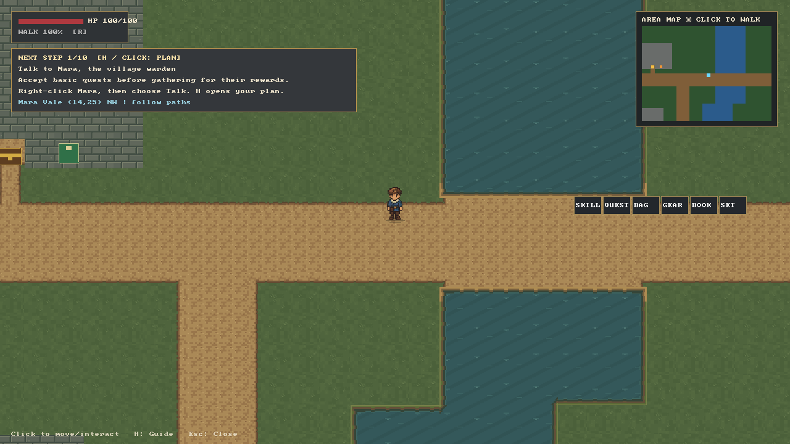
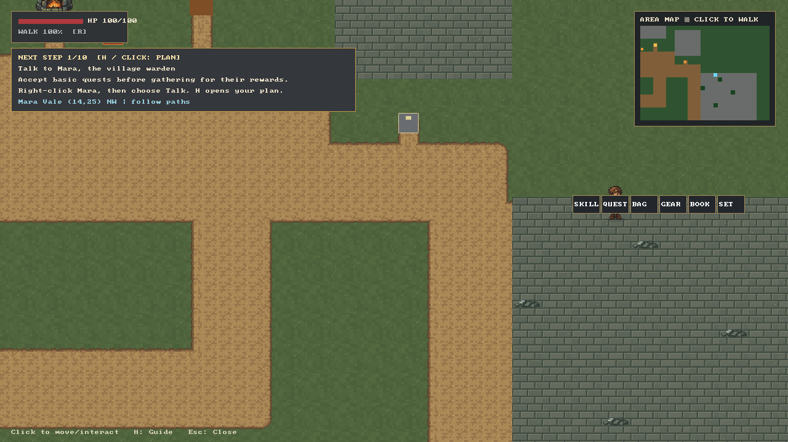

# River banks, stone floors and mining sprites

**Date:** 19 November 2026\
**Base:** master `ec47382d4ce6509149f518fc097d58cce619aabf` (corrected player walk).\
**Work packages:** next ART-001/002 batch, extending STUDIO-061/062.\
**Scope:** Existing River Crossing ground, copper/tin rocks and depleted states.






## Source and runtime behaviour

The [environment pilot](../../../assets/embervale/environment-pilot/README.md)
adds four editable LibreSprite masters and 45 frames: three water variants,
three stone floor variants, twelve bank overlays for each of three land
families, copper, tin and shared rubble. The combined generated layout holds
84 frames across ten PNGs. CMake packages the four new PNGs beside each
client/preview executable. Sources, editor metadata, reference images and art
boards are authoring inputs, not startup dependencies.

Water is static, with blue-green ripples. Shore quarters select straight edges,
outside corners or inside corners from cardinal and diagonal ground neighbours.
Grass/earth, stone and bare-dirt banks preserve the material at crossings;
bank pixels stay within the existing blocked water cell. Dirt roads meet water
cuts and stone floors without an invented grass seam. Pavers replace the grey
stone areas, including workshop footprints and the mining pad. World layout,
walkable cells and collision rules stay the same.

`Tile` now preserves ground separately from occupancy. Applying TREE, STATION
or WALL retains the authored GRASS/DIRT/STONE/WATER underlay. Rendering reads
that ground for floor and shoreline selection; movement still reads the same
blocked flag and occupancy. This fixes grass squares beneath rocks on stone
and keeps roads connected beneath stations. Save schemas are unchanged.

Copper/tin select intact or rubble sprites from `ResourceNode::IsActive()`.
The existing lifecycle supplies respawns. Opaque pixels outside the occupied
tile also select the corresponding active rock through the cached texture
alpha. Transparent areas, ground-item priorities, explicit Walk here and modal
input retain their existing actions. F6/basic mode and per-image fallback remain.
Iron/coal keep basic art. The corrected player walk sheet is unchanged.

## Reproduce and evidence

Update your checkout and run `Play-RiverCrossing.cmd` to rebuild and play.
To export saved environment masters without replacing them:

```powershell
python tools/art/build_environment_pilot.py --editor "C:\Program Files\Asprite\libresprite.exe"
```

In a client configuration with content tools and SDL 3.4+:

```powershell
cmake --build build-client --target GameEngine EmbervaleRenderPreview --parallel 6
.\build-client\EmbervaleRenderPreview.exe content/worlds/river-crossing.blockout.json river.png --focus 46 29 --zoom 1.5
.\build-client\EmbervaleRenderPreview.exe content/worlds/river-crossing.blockout.json mine.png --focus 87 57 --zoom 1.5
.\build-client\EmbervaleRenderPreview.exe content/worlds/river-crossing.blockout.json depleted.png --focus 87 57 --zoom 1.5 --deplete-rocks
```

`--deplete-rocks` consumes copper/tin uses only in the temporary preview world.
It writes no input world, player progress or gathering rewards, and exercises
the real depleted-state renderer rather than a separate mockup.

[results.json](art/2026-11-19/environment/results.json) records client/launcher
builds, capture options, packaged PNG hashes and preservation of all four
masters during default export. Captures include the river at
[native zoom](art/2026-11-19/environment/river.png) and 1.5x, the
[workshop](art/2026-11-19/environment/workshop.png), intact/depleted mining and
[basic mode](art/2026-11-19/environment/mine-basic.png). They use dummy video
and software rendering at 1280x720. The cache reports 10/10 images loaded.

Regression suites and a visible interaction playthrough remain deferred at the
owner's request. The captures establish renderer output, not full gathering/
respawn acceptance or GPU performance. Buildings, bank/table art, remaining
cast, ore tiers, animated water and the complete visual kit remain open. This
batch does not close the full roadmap art gate.
