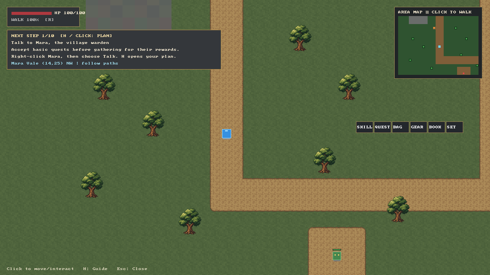

# First forest kit in the game

**Date:** 19 November 2026\
**Base:** master `2b2433f40d239f798163b6ec72a4f3282e9307a4` (editable forest pilot, PR #33).\
**Work packages:** bounded runtime portions of STUDIO-060/061/063 and ART-001.\
**Status:** Implemented; Windows client/launcher builds and real-renderer captures passed. Regression suites, visible input and a gameplay playthrough remain deferred.



## What appears in play

- Three grass variants use the existing 32-pixel grid. Tree marker tiles receive
  grass underneath the resource image.
- Dirt paths select north/east/south/west connections from the actual loaded
  map. Interior quarters on wide roads use the centre of the existing dirt art,
  so broad roads and yards do not become a repeated grid of grass holes.
- Ordinary trees select the intact sprite or the matching stump using
  `ResourceNode::IsActive()`. Oak/willow tiers, rocks, water, stone, characters
  and stations keep their current presentation.
- The tree/stump use their authored **(32, 88)** pivot on a 64x96 canvas, placed
  at **(16, 24)** within their tile. Their interaction/collision footprint stays
  one tile. World/save files and authoritative gathering rules are unchanged.
- Resources, stations, monsters, NPCs and the interpolated player draw in order
  of ground contact. A normal tree fades to alpha 155 if it overlaps the player
  behind it. HUD, selection and combat feedback draw above world objects.
- Normal-tree canopy picking checks the decoded image's opaque pixels and maps
  that click back to the existing tree tile. Empty pixels retain world actions.
  Existing ground-item and object actions retain priority on occupied tiles;
  explicit **Walk here** retains the actual clicked location.
- **F6** switches between forest art and basic shapes. Settings shows the art
  preference alongside the grid control. This display preference is not saved.

## Files, cache and fallback

[ForestSprites](../../../src/Graphics/ForestSprites.cpp) owns three textures
and alpha masks. Files are decoded only during graphics initialization and are
destroyed before the renderer. Scaling uses nearest neighbour. Ground drawing
visits the visible map range; canopy drawing is independent of ground-tile
culling, so trees anchored beyond a viewport edge can still overlap the view.

The [art export command](../../../tools/art/build_forest_pilot.py) generates
[ForestPilotLayout.h](../../../src/Graphics/ForestPilotLayout.h) from stable
asset IDs, rectangles and pivots in the authoring manifest. C++ reads this
checked binding; there is no new runtime JSON parser. Source `.ase` masters are
preserved on normal export. No Python/editor dependency is added to game startup
or ordinary CMake builds.

CMake copies only the three required PNGs next to each client executable.
Changed PNG inputs trigger a relink/copy even if no C++ changed. The cache first
looks beside the executable, then in the current checkout for development.
Missing files, invalid dimensions or failed texture creation fall back per
image to the existing shapes and log one initialization diagnostic. PNG file
size/dimensions are checked before decoding. This is a bounded three-image
pilot, not a general asset importer or a hot-reload system.

PNG loading requires **SDL 3.4+**. Earlier SDL header builds keep basic shapes
and omit the PNG preview tool; the headless core still has no SDL dependency.
The observed Windows toolchain uses UCRT64 GCC 16.1 and SDL 3.4.12.

## Build and reproduce a real renderer preview

For normal play, update the checkout and run `Play-RiverCrossing.cmd`. It builds
the client, packages the PNGs and starts a fresh temporary River Crossing player.
Press F6 to compare the two presentations.

For an offline image with the same `Graphics::Render` implementation, use a
client configuration with content tools enabled and SDL 3.4+. In the usual
UCRT64 environment, from the repository root:

```powershell
cmake --build build-client --target GameEngine EmbervaleRenderPreview --parallel 6
.\build-client\EmbervaleRenderPreview.exe content/worlds/river-crossing.blockout.json woodland.png --focus 18 58
.\build-client\EmbervaleRenderPreview.exe content/worlds/river-crossing.blockout.json depleted.png --focus 18 58 --deplete-trees
.\build-client\EmbervaleRenderPreview.exe content/worlds/river-crossing.blockout.json basic.png --focus 18 58 --basic
```

The tool uses SDL dummy video/software rendering to a target texture, reads
pixels before presentation, and writes a 1280x720 PNG. It creates a temporary
fresh player and never saves progress or edits the input world. Focus must be
walkable, and output must be a separate `.png` file. `--deplete-trees` changes
only the preview's in-memory normal-tree state; it is not a simulated gathering
session and grants no loot or XP. Ensure UCRT64 runtime DLLs are on PATH when
launching these tools outside the supplied game launcher.

## Observed evidence and limits

- The Windows client and `EmbervaleRenderPreview` linked successfully.
- `Play-RiverCrossing.cmd --build-only` configured and built the dedicated
  game-only launcher configuration, with the PNGs packaged beside the binary.
- The real renderer produced the [woodland](art/2026-11-19/woodland.png),
  [depleted state](art/2026-11-19/depleted.png),
  [player behind tree](art/2026-11-19/player-behind.png),
  [player in front](art/2026-11-19/player-front.png) and
  [basic mode](art/2026-11-19/basic.png) captures. These are actual game-renderer
  outputs; the earlier composition preview remains an art-board reference.
- The cache reported 3/3 textures. The export command preserved the editable
  sources; packaged image hashes match the committed art. Execution metadata
  and capture hashes are recorded in [results.json](art/2026-11-19/results.json).
- A copied preview executable also ran from a directory without any art files.
  It reported 0/3 textures and still rendered successfully using basic shapes.

The captures establish static scale, alpha, layout and player overlap. They do
not establish a visible GPU/window playthrough, interactive canopy picking,
quest completion, measured performance or full regression acceptance. The
general Studio asset importer, player/prop art, animation and broader starter
kit remain open. No roadmap gate is declared complete by these captures alone.
