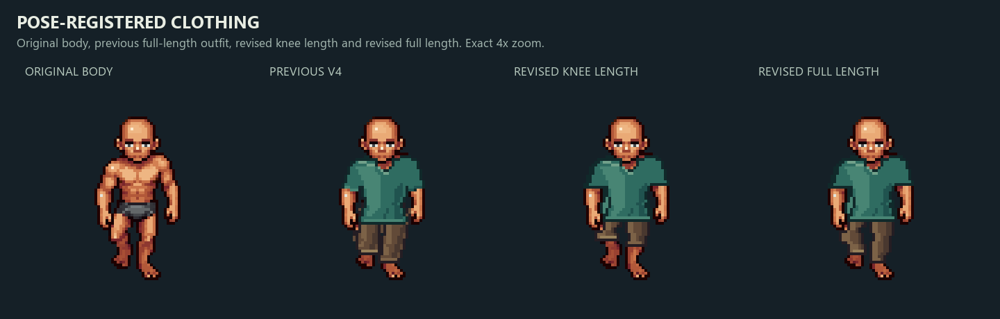

# Garment alignment correction

**Date:** 22 November 2026.  
**Owner feedback:** V4 still did not align; inspect every pixel and frame.  
**Baseline:** [9320e40](https://github.com/Adzffs/GameEngine/commit/9320e40c7a85a62d613dbe4b2510d606e69f7d98).  
**Parent:** ART-007 remains in progress; owner visual acceptance is pending.

The [v5 pack](../../../assets/embervale/custom-character-pilot/revisions/alignment-fit-v5/README.md) contains the revised layers, editable masters, moving comparison and twelve individual review boards. Every board shows the same original pose, v4, both new pant lengths and enlarged shoulder, hip and cuff crops.

## Diagnosis and changes

The crop/pivot itself was correct. The garment shapes were the problem: rigid outlines and wide cuff bars did not follow changing body contours. Filling uncovered body pixels established coverage while leaving the underlying fit issue unresolved.

Inspecting the actual row contours also found twenty-nine forearm pixels wrongly included in the earlier trouser regions. Those produced cloth-coloured strips or scraps on exposed arms. They are now protected forearm pixels, with the leg labels corrected explicitly.

The replacement registers the top to actual shoulder/arm/waist contours and both pants to actual thigh, knee and ankle row spans. Cloth ease is bounded to one lateral pixel from the source silhouette. The top keeps its authored V neckline and cloth shading. Pant shading uses the cloth palette and each leg's own shape, independently of skin/muscle shading. Cuffs use measured cross-sections; source separation between the legs is preserved through every pose.

The first local v5 draft was inspected and corrected before publication: it had excess torso ease, forearm scraps and an over-simplified neckline. The final retained masters/export contain the corrected result. These sources do not mutate or deform the original body.

## Executed verification

| Check | Result |
|---|---|
| Every exported source pixel | All 254,016 pixels across 36 garment cells match the editable masters |
| Every declared covered body pixel | 8,193 coverage checks; zero missing pixels |
| Complete garment silhouettes | Zero pixels farther than the permitted lateral fabric ease; zero protected body overlaps |
| Connectivity | Each garment is one connected piece; no detached scraps in any pose |
| Cuffs | All 48 cuff placements cover the actual source cross-section; at most one extra pixel of width and 0.5 pixel centre difference |
| Leg separation | All declared inter-leg source spaces remain clear |
| Previous v4 comparison | 352 pixels outside this contour bound, 37 cuff placements outside the new bound, and 59 forearm-overlap checks across layers |
| Body/provenance | Original body and v1/v2/v3/v4 hash inventories preserved |
| Export/composition | Lossless 84-to-80 crop; exact body/pants/top composition in both variants |
| Preview | Exact 4× overviews and 8× details, original timing, both embedded pant choices and JavaScript syntax checked |
| Visual review | All twelve poses individually inspected in both lengths; per-frame notes and boards retained |

The old comparison counts test explicit registration/protection bounds; they are not a subjective art-quality score. Pixel parity verifies the master/export boundary. Visual review checks how those pixels read together. Owner acceptance, live browser interaction, eight-way garment coverage and native game rendering remain open.

## Future fit changes

Coverage alone is insufficient. Compare complete contours, source part labels, cuffs and empty spaces in every pose. Detect stray connected components and compare artwork exports with the editable master. Use integer preview zoom; the earlier 280-pixel preview enlarged an 80-pixel cell by 3.5× and gave adjacent source pixels uneven display widths. Keep old failures as evidence and update the owning plan with actual owner feedback.
