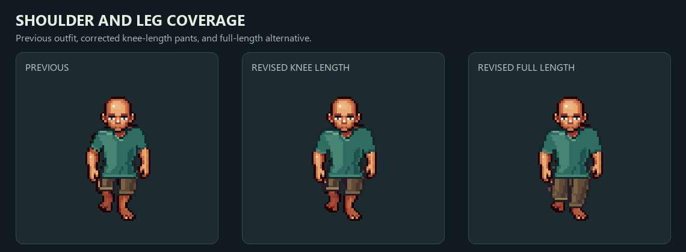

# Shoulder and leg coverage correction

**Date:** 22 November 2026.  
**Owner feedback:** Both revised garments still showed skin at the shoulders and leg muscles. When asked about pant length, the owner requested both alternatives.  
**Baseline:** [04f3b84](https://github.com/Adzffs/GameEngine/commit/04f3b844baf402e283d6518b7ba1d39ba9451f03).  
**Parent:** ART-007 remains in progress; revised visual acceptance and in-game adoption remain open.

The [v4 revision](../../../assets/embervale/custom-character-pilot/revisions/coverage-fit-v4/README.md) supplies a shared repaired top and two independent pants layers on the unchanged original body. The [moving comparison](../../../assets/embervale/custom-character-pilot/revisions/coverage-fit-v4/previews/before-after-walk.gif), [shoulder enlargements](../../../assets/embervale/custom-character-pilot/revisions/coverage-fit-v4/previews/shoulders-closeups.png) and [leg enlargements](../../../assets/embervale/custom-character-pilot/revisions/coverage-fit-v4/previews/legs-closeups.png) expose the edges that the previous review missed.

## Why the previous checks were insufficient

Tunic v2 and trousers v3 passed selected fit points and composition checks. Passing them did not establish complete skin coverage. Closer inspection found visible body pixels along the shoulder slope/crest and thigh edges. Broad rectangular hand protection also incorrectly classified sixteen actual leg pixels as hands in five walking poses, preserving gaps that should have been clothed.

The v3 knee-length design intentionally exposed the calves. That is separate from unwanted thigh pixels above the hems. The owner requested both knee-length and full-length options, so v4 retains intentional bare lower legs in one variant and covers the full legs to authored ankle boundaries in the other.

## What changed

The top has wider shoulder slopes and longer short sleeves over the deltoids. A complete source-body area audit then found and closed thirty-two remaining edge pixels after that first widening. The full-length garment has independent brown fabric panels, folds and ankle cuffs, with a flat coverage foundation that does not inherit anatomical shading. Sixteen leg pixels incorrectly excluded by the old hand masks were corrected. The knee-length alternative closes sixty uncovered body pixels within its own waist-to-cuff areas.

Hands/forearms and legs are now distinguished at their actual source boundaries. The original body, neckline opening, frame order, timings and pivots are preserved. All v1/v2/v3 source files remain byte-for-byte unchanged. No body was rescaled, bent or regenerated.

## Verification

| Check | Executed result |
|---|---|
| Shoulder coverage | All 1,700 declared source-body pixels covered in all twelve poses |
| Knee-length coverage | All 2,770 declared waist-to-cuff pixels covered; lower legs remain bare |
| Full-length coverage | All 3,781 declared waist-to-ankle pixels covered |
| Protected hands/forearms | 1,144 source pixels; zero garment overlaps |
| Protected feet | 893 source pixels; zero garment overlaps |
| Face/neck | Protected face clear; neckline opening retained |
| Previous candidates | Ninety uncovered shoulder body pixels and sixty uncovered knee-garment body pixels detected; counts include outlines |
| Crop/composition | Binary alpha, lossless 84-to-80 packing and exact body/pants/top composition for both variants |
| Preservation | Original inventories pass: 22 v1, 18 tunic-v2 and 19 trouser-v3 entries, excluding their inventory files |
| Preview | Both embedded pant layers match exports; length selector, eight-frame 600-ms GIF and JavaScript syntax checked |
| Visual review | All twelve poses inspected in both lengths, including enlarged shoulder and leg comparisons |
| New paid body/animation generations | Zero; exact PixelLab garment drawing and revisions |

The [read-only validator](../../../assets/embervale/custom-character-pilot/revisions/coverage-fit-v4/validate.py) uses whole-area body labels, not a few garment fit samples. The [manifest](../../../assets/embervale/custom-character-pilot/revisions/coverage-fit-v4/manifest.json) declares both variants and south-only coverage. Runtime rendering, broader facings/actions, live browser interaction and owner acceptance remain open.

## Reusable lesson

Require all source-body pixels inside an intended clothed region to be covered, and inspect enlarged edges as well as normal-scale motion. Keep neck/face, arms, hands, feet and each garment's intentionally exposed areas explicit. A conservative protection rectangle can hide a fit bug by labelling thigh skin as a hand. A garment may extend outside the naked silhouette; fitting it must not require recolouring muscle shading or changing the body.
