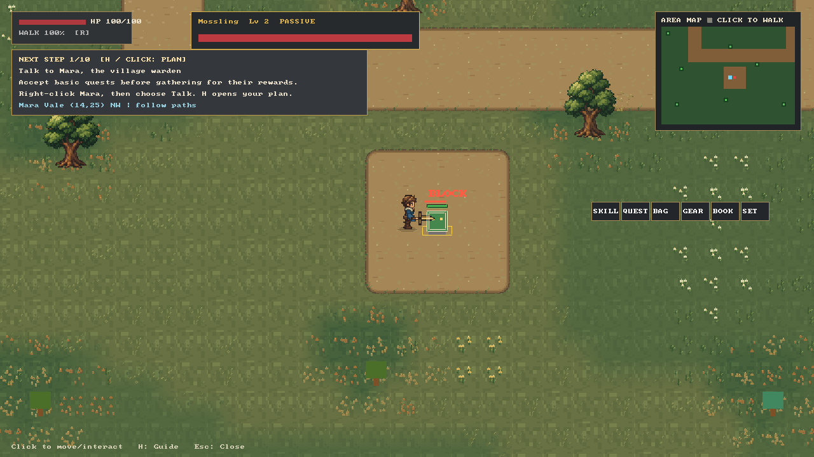
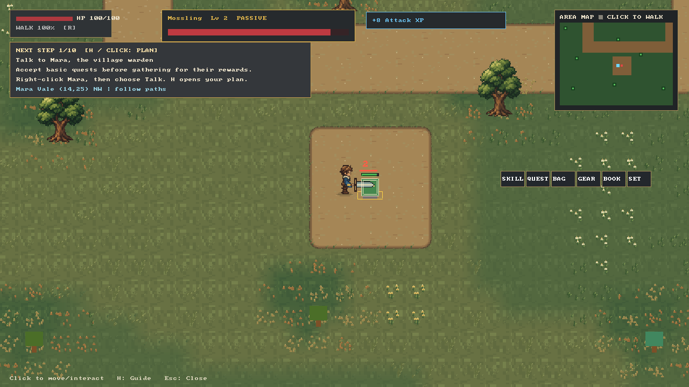

# Melee attack animations and visible equipment

**Date:** 20 November 2026  
**Source baseline:** `6bde02b` (`fix/axe-blade-orientation`)  
**Scope:** local-player combat presentation and equipped standing/walking.

The subsequent [research and polish pass](ANIMATION_RESEARCH_2026-11-20.md)
supersedes the atlas counts, six-pose timing and three body styles below. This
record preserves the first implementation's evidence and authority contract.

The player now holds equipped weapons while standing and walking, turns toward
the combat target, draws back, strikes and recovers. This covers all eight
facings, bronze swords, the developer godsword, bronze/iron/steel axes and
pickaxes. Empty hands punch. The wooden shield is visible on the off hand or
across the back when holding the two-handed godsword.





## State and authority

`MeleePresentationState` reads the running melee action, adjacent living target,
player equipment and committed combat feedback. Wind-up progress interpolates
within the existing 600ms world tick, then holds its raised pose until the world
publishes a result. Rendering cannot deal damage or create contact by letting a
timer expire. A paused simulation therefore never invents a strike.

Combat feedback now carries its completion tick, actor/target coordinates and
weapon snapshot. The client consumes each completion once and plays 0.30 seconds
of contact, follow-through and recovery. The result identity distinguishes
repeated identical hits, blocks and misses. Stored coordinates also preserve a
killing blow when the target is dead or no longer available to the renderer.
The running action's start tick distinguishes repeated wind-ups.

Approach movement, cancellation, out-of-range/dead targets, weapon changes,
other actions and player death clear unsuitable poses. Gathering retains its
existing chopping animation. Empty equipment returns to the original walk
sprites. The world-art view replaces the player's old gold-line attack tell;
monster tells and the F6 basic view retain their existing rendering.

Combat rolls, damage timing, reach, attack durations, equipment bonuses,
movement, quests and save formats are unchanged. The new fields are transient
presentation data.

## Art and packaging

The [melee batch](../../../assets/embervale/melee-pilot/README.md) adds 240 body
frames and 720 equipment overlays in two editable masters. Each direction has
four standing/walk frames and six attack frames. Separate body styles support
one-handed weapons, two-handed weapons and unarmed punches. Main/off-hand
layers pass behind or in front of the body according to facing, within the
existing world depth ordering.

All eight batches now provide **1,943 frames across 30 textures**. The new PNGs
use the existing nearest-neighbour texture cache and per-image fallback. CMake
refreshes packaged textures when their source images change. The editor and
editable source files are not runtime dependencies.

## Local evidence

Observed on Windows with UCRT64 GCC 16.1.0, CMake/Ninja and SDL 3.4.12:

- `GameEngine`, `EmbervaleRenderPreview` and the selected tests build.
- Ten focused suites pass: `MeleePresentationTests`, `MeleeGraphicsTests`,
  `MeleeAttackResolverTests`, `MeleeCombatActionTests`, `MeleeEngagementTests`,
  `MeleeClickIntegrationTests`, `CombatFeedbackTests`, `PlayerAnimationTests`,
  `WoodcuttingPresentationTests` and `WoodcuttingGraphicsTests`.
- State coverage includes every facing, paused wind-ups, real instant/repeated
  attacks, result deduplication, misses/blocks, target removal, production
  killing blows, cancellation, movement, gear changes, gathering and death.
- Renderer coverage draws each supported attack direction/pose/weapon, all
  equipped walk poses, distinct metal tiers, visible shields in every direction,
  invalid-index fallbacks and the complete scene's wind-up/contact/recovery.
- LibreSprite validation passes all 960 cells. Normal export preserves both
  editable masters and reproduces both runtime PNG hashes. Packaged PNG hashes
  match source exports.
- Actual River Crossing captures load **30/30 textures** and show
  [wind-up](art/2026-11-20/melee/sword-windup.png), sword/godsword contact and
  [equipped movement](art/2026-11-20/melee/equipped-walk.png). Sword contact in
  this fixed-seed fixture produces BLOCK; the godsword produces damage and its
  existing Attack XP notice.

The captures use dummy video/software rendering. They are renderer and world
fixtures, rather than a visible GPU/manual combat playthrough. Enemy sprite
attack/death poses, impact audio and character customisation remain separate
work.

## Reproduce

```powershell
cmake --build build-client --target GameEngine EmbervaleRenderPreview MeleePresentationTests MeleeGraphicsTests PlayerAnimationTests WoodcuttingGraphicsTests CombatFeedbackTests MeleeClickIntegrationTests MeleeCombatActionTests MeleeAttackResolverTests MeleeEngagementTests WoodcuttingPresentationTests --parallel 6
$env:SDL_VIDEODRIVER = "dummy"
$env:SDL_RENDER_DRIVER = "software"
ctest --test-dir build-client --output-on-failure -R "^(MeleePresentationTests|MeleeGraphicsTests|MeleeAttackResolverTests|MeleeCombatActionTests|MeleeEngagementTests|MeleeClickIntegrationTests|CombatFeedbackTests|PlayerAnimationTests|WoodcuttingPresentationTests|WoodcuttingGraphicsTests)$"
python tools/art/build_melee_pilot.py --editor "C:\Program Files\Asprite\libresprite.exe"
.\build-client\EmbervaleRenderPreview.exe content/worlds/river-crossing.blockout.json sword-contact.png --focus 26 68 --melee 27 68 --weapon bronze-sword --shield --zoom 1.5 --frames 32
.\build-client\EmbervaleRenderPreview.exe content/worlds/river-crossing.blockout.json godsword-contact.png --focus 26 68 --melee 27 68 --weapon godsword --zoom 1.5 --frames 32
```

The preview options select temporary equipment and start a real two-tick melee
action against an existing adjacent monster. The tool advances the world every
fifteen 40ms frames and passes real result feedback through the normal renderer.
`--weapon` also works with `--walk-to`; `--shield` adds the wooden shield.
`--melee`, walking and chopping are mutually exclusive. These fixtures never
save player progress or change the input world file.
