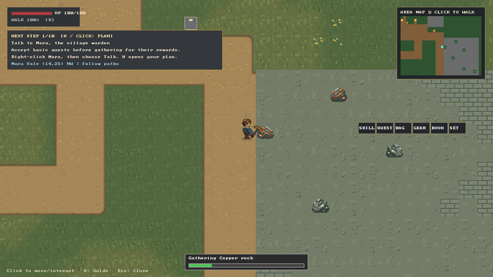
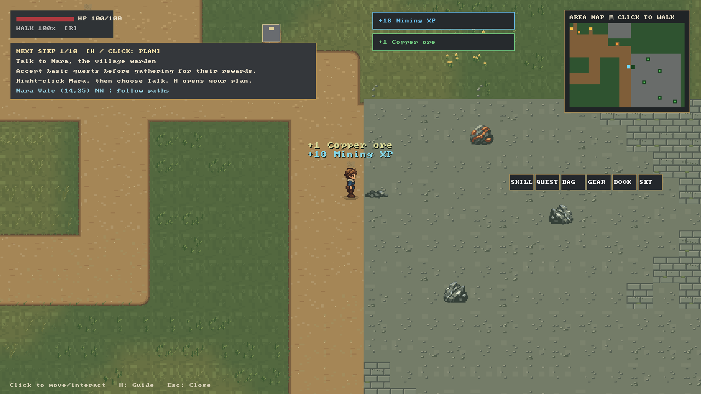

# Mining animation and ore feedback

**Date:** 20 November 2026\
**Source baseline:** master `a537902bbe4ff2c85f86ec3b67c15432b73986d4`\
**Scope:** mining presentation following the woodcutting and axe-orientation updates.

The player faces the selected rock and swings the equipped pickaxe with a
lower contact pose. Rock chips mark the strike. Actual ore and Mining XP
float above the player on successful gathers, including the final use that
depletes a rock. Copper, tin, iron and coal use the same existing requirements
and action outcomes as before.





## Shared presentation and authority

`GatheringPresentationState` now owns the common action gate, target-facing
selection, visual cycle, interruption handling and reward-notice lifecycle.
It selects tool tiers and resource definitions for Woodcutting or Mining.
The existing `WoodcuttingPresentationState` entry point delegates to that shared
state; its prior default and helper remain available. The animation's tool
field is named `toolTier` for both gathering types.

The two skills consume the same committed `GatheringRewardEvent` stream from
every simulation update. Each presentation filters by actor and resource skill,
deduplicates ticks and keeps up to four expiring notices. Tree rewards cannot
produce Mining XP notices, and ore rewards cannot produce Woodcutting notices.
Failed rolls and rejected actions do not publish success events. The existing
catch-up forwarding retains final-use rewards even when the action has ended.

Only a running owned action at an active, adjacent and skill-appropriate
resource with a usable tool can animate. Approaching retains walking until
visual interpolation settles. Movement, cancellation, depletion, missing
targets, wrong tools and death stop the swing. Repeat attempts retain their
visual rhythm. The cosmetic cycle does not grant ore or XP, affect RNG or change
the five/four/three tick intervals of bronze/iron/steel pickaxes.

## Art and packaging

The [mining batch](../../../assets/embervale/mining-pilot/README.md) adds 48
editable player poses and 144 bronze/iron/steel pickaxe overlays. The new head
is curved and tapered; its leading point faces the rock. It shares the corrected
direction geometry and body-authoring helpers with woodcutting while lowering
the hands and contact point to reach a rock. Existing walking and woodcutting
masters are preserved.

The shared cache now covers **1,175 frames in 30 PNGs** across eight batches.
Pivots, frame dimensions, nearest-neighbour scaling, ground shadows and the
missing-action-art fallback retain their existing conventions. Default mining
export preserves saved masters and refreshes the manifest, PNGs, previews and
generated geometry; source regeneration and pickaxe-only rebuilding are explicit.

## Verification

Windows local checks use UCRT64 GCC 16.1.0, CMake/Ninja and SDL 3.4.12. The new
state checks pass 252 assertions covering eight facings, all pickaxe tiers, all four ore types,
requirements, wrong tools/actors/resources, approach, interruption, depletion,
death, real world success/failure, exact reward quantities, deduplication,
catch-up retention and skill-specific feedback routing. Renderer checks cover
425 assertions, including all 144 combined action/tool cells, distinct poses/directions/tiers, leading-tip
pixels in all 48 striking combinations, active render selection, stopping and
final-use reward display. All 11 focused tests pass, including existing
woodcutting, walking, gathering, movement, camera and persistence checks.

LibreSprite validation covers all 48 body and 144 pickaxe cells. A normal export
preserves both mining masters. Production game, preview and affected local test
targets build. The River Crossing replay uses the fresh player's starting bronze
pickaxe and real gathering, displaying one Copper ore and 18 Mining XP followed
by rubble. The cache loads 30/30 images.

```powershell
cmake --build build-client --target GameEngine EmbervaleRenderPreview MiningPresentationTests MiningGraphicsTests WoodcuttingPresentationTests WoodcuttingGraphicsTests PlayerAnimationTests GatheringRandomTests GatheringSystemTests ActionLifecycleEventTests MovementPathSafetyTests CameraPresentationTests EnginePlayerPersistenceLifecycleTests --parallel 6
$env:SDL_VIDEODRIVER = "dummy"
ctest --test-dir build-client --output-on-failure -R "^(MiningPresentationTests|MiningGraphicsTests|WoodcuttingPresentationTests|WoodcuttingGraphicsTests|PlayerAnimationTests|GatheringRandomTests|GatheringSystemTests|ActionLifecycleEventTests|MovementPathSafetyTests|CameraPresentationTests|EnginePlayerPersistenceLifecycleTests)$"
python tools/art/build_mining_pilot.py --editor "C:\Program Files\Asprite\libresprite.exe"
.\build-client\EmbervaleRenderPreview.exe content/worlds/river-crossing.blockout.json swing.png --focus 83 60 --mine 84 60 --zoom 1.5 --frames 18
.\build-client\EmbervaleRenderPreview.exe content/worlds/river-crossing.blockout.json success.png --focus 83 60 --mine 84 60 --zoom 1.5 --frames 90
```

The `--mine` preview accepts a copper/tin rock adjacent to the fresh player,
equips the starting pickaxe and advances the real world every fifteen 40-ms
presentation frames. It shares the bounded gathering replay with `--chop` and
fixed authoring seeds 1337/7331/1. Conflicting walk or depleted-rock fixtures
are rejected. It does not write a save or change world input.

Captures and render checks use dummy video/software rendering. A visible GPU
playthrough is separate. Save formats and gathering rules are unchanged; melee
attack and visible-weapon work remain subsequent slices.
