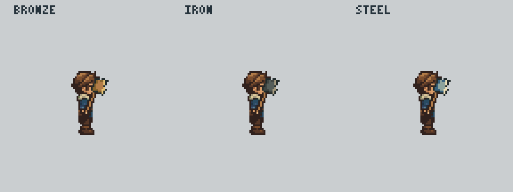

# Modular axe handle occlusion correction

**Date:** 22 November 2026.  
**Task:** ART-005, still in progress.  
**Defective published prototype:** `a58a53591309265dc4d3f5603fde742ae4fcf098`.  
**Scope:** Correct the east-facing authoring proof; the runtime art remains unchanged.

## The mistake

The owner correctly reported that the handle appeared to pass through the player and switch between behind and in front during the swing. This was a compositing mistake introduced in the first modular prototype.

Poses 1 and 2 used `tool_in_front: false` to hide head intersections. The other six poses used `true`. This moved the **entire axe** behind the entire body during loading, then in front again at contact. Restoring one main-hand pixel did not preserve the second grip or the surrounding forearm. The initial report incorrectly described that switch as a successful depth adjustment.

The original eight tests verified body preservation, materials, grips, bounds, hashes and export behaviour. They did not verify visible depth continuity or both hands covering the shaft. Passing those checks was insufficient evidence that the animation looked correct. This defect belongs to the prototype composition, rather than the source character, material colours or animation timing.

The retained [defective GIF](../../../assets/embervale/equipment-modular-pilot/reports/handle-layering-before.gif) and [contact sheet](../../../assets/embervale/equipment-modular-pilot/reports/handle-layering-before.png) record the mistake. They are historical evidence and must not replace the corrected export.

## The correction

Recipe version 2 uses one order for all eight poses and every material:

1. Draw the unchanged body.
2. Draw the independently transformed axe over the body.
3. Restore only explicitly authored foreground pixels for the head, main grip and offhand grip, including their small cuff/forearm areas.

The head continues to hide overlapping upper tool pixels. The exposed shaft stays in front of the shirt below it, and both grips cover the shaft. No pose can switch the whole tool behind the character. This is a small body-part occlusion contract for the current fixture, rather than a general 3D depth solver.

The source of truth is each frame's `foreground` spans in the [recipe](../../../assets/embervale/equipment-modular-pilot/recipe.json): named `head`, `main_hand` and `off_hand` groups, stored as inclusive `[y, x0, x1]` runs in 96x96 body-cell coordinates. Normal export reads those authored runs. It does not infer foreground from RGB, recolour the body, regenerate masks, or move the hands. All three material appearances receive the same correction.

Validation rejects missing grips, detached grip masks, unsorted/overlapping/out-of-bounds runs, excessive spans and old per-frame depth fields. The decoded-art check also rejects a foreground run that references transparent body pixels before replacing any usable output. The [mask diagnostic](../../../assets/embervale/equipment-modular-pilot/previews/occlusion.png) shows head pixels in purple, main grip in red and offhand grip in blue.

The [corrected contact sheet](../../../assets/embervale/equipment-modular-pilot/previews/contact.png) contains all eight poses across bronze, iron and steel. Review the wind-up, contact, recovery and loop seam together. A remaining body-performance concern should be addressed as its own art change, without reinstating a whole-tool depth toggle.

## Verification

The [focused suite](../../../tests/test_modular_equipment.py) now includes independent PNG readback of every composite pixel in all 24 material/pose cells. Fixed visual landmarks separately require the loaded shaft to cover the shirt/collar, the head and both grips to cover the tool, and the ready/closing poses to match exactly. These landmarks do not derive their expected colours from the authored mask. They fail on the original depth-switching output.

The [before/after verification receipt](../../../assets/embervale/equipment-modular-pilot/reports/occlusion-fix.json) records 30 failed comparisons in the original output and zero in the correction across 36 fixed landmark/material comparisons. It also records exact pilot-source hashes and the unchanged 33 runtime masters/textures.

Eleven tests pass with the real LibreSprite exporter and no skips. The [recorded test output](../../../assets/embervale/equipment-modular-pilot/reports/tests.txt) includes malformed foreground refusal, existing semantic-metal isolation, exact body reuse, deterministic repeat export and source preservation. The original timing remains `[260,200,200,80,80,80,100,200]` ms, total 1,200 ms.

The three pilot masters, standalone body, axe, semantic-mask and transformed-tool PNGs remain byte-exact against the defective prototype. Only composition, its review outputs and receipts change. Existing runtime art remains 33 masters/33 textures and 3,135 frames, with unchanged live costs of 24,342,528 RGBA bytes and 6,085,632 alpha bytes. This offline correction adds no runtime code, gameplay timing or save change.

The output remains an east-facing authoring candidate. Full eight-way coverage, owner acceptance of the corrected motion/body, runtime migration and the remaining [production plan](../05-game/MODULAR_EQUIPMENT_ANIMATION_PLAN.md) stay open.

## Reusable lesson

Keep a stable relationship between the tool and body parts throughout a motion. Resolve hand, head and arm overlaps with explicit foreground regions or appropriate authored geometry. Never conceal an intersection by changing the entire tool's depth relative to the entire character on selected frames. Material/pixel preservation checks and a visual occlusion review answer different questions; retain both.
