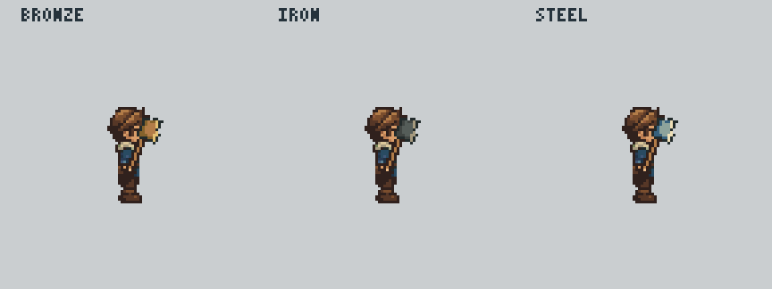

# Shared axe motion and material prototype

**Date:** 22 November 2026.  
**Task:** ART-005, in progress.  
**Starting published branch:** `b026c60e71d56927d4ad66043531d71089135a08`.  
**Result:** The first east-facing authoring proof is implemented and checked. Full eight-direction migration and new body-animation acceptance remain open.

## What now works

One saved body sequence, one explicit eight-pose hand track and one independent axe view produce bronze, iron and steel appearances. Changing material affects only semantic metal-mask regions. Body pixels, wooden handle, outline, silhouette and timing remain shared.

The recipe stores main/offhand positions, aim vectors, front-hand mask pixels and per-pose depth. The tool is rasterized onto each pose around its local grip. A small authored front-hand mask copies the original body pixels over the shaft. Loaded poses draw the tool behind the body to reduce head overlap; no character pixels are regenerated.

The saved body comes from the existing woodcutting master, east-facing row. It is an engineering fixture, not a new AI motion or a claim that the owner accepted the earlier procedural body's quality. The previously generated empty-handed PixelLab walk and equipped pilot remain separate. No subscription, generation request or credit purchase was needed for this proof.

## Source and output structure

The [pilot folder](../../../assets/embervale/equipment-modular-pilot/README.md) retains:

- Three editable masters: shared body, one axe view and a separate semantic metal mask.
- A bounded [recipe](../../../assets/embervale/equipment-modular-pilot/recipe.json), including all eight hand/aim poses and three material/item mappings.
- Native-size body, shape, mask, tool and composite PNGs.
- A timed side-by-side GIF, contact sheet and [grip/depth diagnostics](../../../assets/embervale/equipment-modular-pilot/previews/grips.png).
- Source/compiler/timing/output hashes, pixel validation, preservation checks and actual test output.

Normal export reads those masters and the recorded track. It does not call the old procedural body rig or regenerate hand coordinates. Shared player timing remains the source for the chopping cycle; the recipe's preview holds must agree with it.

Implementation locations:

| File | Responsibility |
|---|---|
| [modular_equipment.py](../../../tools/art/modular_equipment.py) | Bounded recipe, grip, identity, timing, material and source-space validation |
| [build_modular_axe_pilot.py](../../../tools/art/build_modular_axe_pilot.py) | Explicit bootstrap, normal export, staging, hash receipt and read-only verification |
| [modular_axe_pilot.js](../../../tools/art/modular_axe_pilot.js) | LibreSprite source import, local tool/mask artwork, pose composition and pixel invariants |
| [test_modular_equipment.py](../../../tests/test_modular_equipment.py) | Data failures and real editor/export behaviour, including independent PNG readback |

## Executed verification

| Check | Result |
|---|---|
| Focused Python/real LibreSprite suite | 8 tests passed, no skips in the recorded run |
| Body source comparison | All eight proof cells match the saved legacy east-facing pixels; independent PNG readback verifies the entire body strip |
| Material invariants | Zero changed body/handle pixels outside the metal mask; zero tool alpha mismatches |
| Semantic colour isolation | Changing bronze midtone, whose original RGB also appears in wood, changes metal while preserving wood and both other materials |
| Normal export | Repeated export reproduces the pilot inventory and preserves all editable masters |
| Rejected data | Invalid recipe and overwrite bootstrap preserve existing files |
| Actual decoded-mask refusal | A privately edited mask with an unknown colour is rejected without replacing usable outputs |
| Portable receipts | LF/CRLF changes in text remain valid; altered PNG bytes reject |
| Existing art preservation | 33 runtime editable masters and 33 runtime textures remain exact against the baseline; no runtime/CMake/resource-policy code change |
| Shared read-only world-art check | 33 textures, 3,135 frames; unchanged logical costs of 24,342,528 RGBA bytes and 6,085,632 alpha bytes |

The [test log](../../../assets/embervale/equipment-modular-pilot/reports/tests.txt), [preservation inventory](../../../assets/embervale/equipment-modular-pilot/reports/preservation.json) and [pixel report](../../../assets/embervale/equipment-modular-pilot/previews/validation.json) preserve the executed evidence. The body/shape/material source sizes are bounded; inputs and compiler identity are checked before publication. Candidate output is staged privately, replaced per file, and committed by a receipt last. This detects an interrupted mixed export; it does not claim a cross-file transaction.

The 2,074,624-byte RGBA estimate in the proof receipt covers its native diagnostic PNGs, including duplicated composite review output. It is not added to the live game's cache: this pilot is outside the runtime catalogue and packaging. Preview buffers and editor overhead are separate.

The actual environment uses Windows, Python 3.14.6 and LibreSprite 1.1-dev with a writable private profile. No new C++ build/result is claimed for this authoring-only change. The existing game is unchanged; actual gameplay integration is a later plan unit.

## Visual findings and limits

The single tool view stays attached through ready, load, contact, bite and recovery. The blade remains on the tree-facing side. The two loaded poses use recorded rear ordering, demonstrating that depth can be adjusted once for all materials. The secondary hand remains within the declared shaft-fit tolerance; the measured maximum perpendicular separation is about 0.80 native pixels.

The enlarged sheet and native composition show the current body performance without adding new body frames. Body weight, natural motion and some overlap limitations still belong to the art review. This proof has one local tool view, a small main-hand overlay and per-pose front/back ordering; general segmented occlusion, new body types, other action families and the bounded runtime visual registry are not yet delivered.

The [production plan](../05-game/MODULAR_EQUIPMENT_ANIMATION_PLAN.md) remains the full target. MEA-02 and MEA-04 now have a bounded engineering proof, and part of MEA-01 is evidenced by the preservation inventory. MEA-03's clean-body visual outcome is not completed merely by reusing the older fixture. MEA-05 onward remain planned. ART-005 stays in progress.

## Next implementation unit

Use the editable hand/shape/material workflow to select or improve the clean chopping performance once. Review that body and attachment together at native scale, then author the remaining seven directional tracks/tool views as required. Reuse the same three material mappings throughout.

After all required directions are ready, integrate the complete axe family through the actual gathering presentation, with an exact complete legacy fallback. Preserve eight chopping poses, six Mining poses, existing reward/audio edges, movement authority and save version 13. Generic item lookup, Mining, carry/shields, melee and catalogue-scale measurements follow the staged plan.
