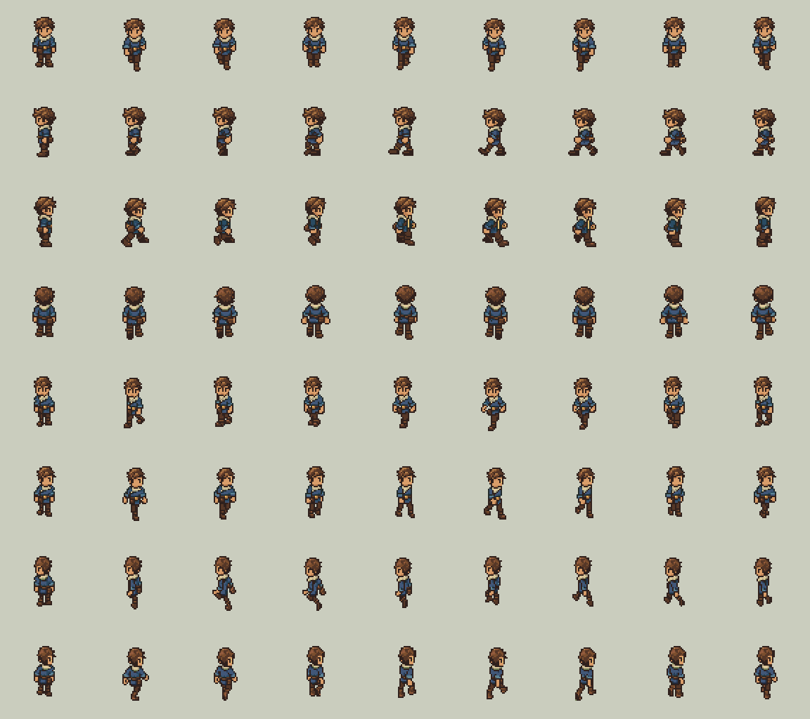
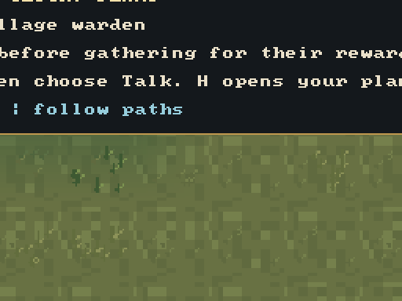

# PixelLab eight-way walking candidate

**Date:** 21 November 2026.\
**Baseline:** published master `f2b5c6b210654040e449ffe8101f32052a93d980` has the same source tree as `3a615bf`; the local east-only trial is `706048e`.\
**Task:** ART-005, in progress. Empty-handed walking is the current slice; full owner/native visual acceptance remains open.

## Result and boundaries

The owner rejected the procedural animation revision, liked the PixelLab east-facing trial and requested the next implementation step. All eight Walking directions now have eight generated moving frames plus a separate supplied neutral view. The new batch is an editable atlas with matching runtime geometry, preview timing and guarded packaging. The rejected uncommitted procedural changes remain preserved in the original worktree; this candidate uses a separate clean worktree.

Equipped walking, Mining, Woodcutting and melee retain their existing complete body/tool batches. Their wrists and weapon layers are not aligned to the new AI gait, so those actions need matching art before switching. Gameplay ticks, collision, movement authority, damage, gathering outcomes and save version 13 retain their existing contracts. The new art does not establish full animation acceptance.

## Generation and review

Source: [PixelLab character](https://www.pixellab.ai/create-character/73253a5c-9983-4f58-8d67-cd31a1c928d5). The eight original empty-handed views were supplied at 64x64 with low top-down camera. The animation uses the **Walking** template, **PixMiniMax**, eight frames and Keep first frame On, as reported by the service's settings dialog. The east and southeast results already existed when this step began; the other directions were completed through the signed-in website, one background job at a time. No subscription, upgrade or API credential was created.

The site's first West control mirrored East. West was then separately regenerated before import. The first Southwest generation added an unwanted staff; it was rejected during contact-sheet inspection and regenerated. The retained complete ZIP contains the replacement without that object. Automated geometry/transparency checks alone did not detect this visual defect.

The [batch README](../../../assets/embervale/pixellab-pilot/README.md) describes the raw inputs, editable master, explicit import command and normal export. The original east-only archive/GIFs and their historical settings remain unchanged. The complete ZIP and service metadata are retained separately.

## Runtime contract

| Property | Current candidate |
|---|---|
| Direction rows | South, West, East, North, South-West, South-East, North-West, North-East |
| Texture | 576x512; nine 64x64 cells per row |
| Binding | `character.locomotion.`; 0 idle, 1–8 moving |
| Ground | Pivot `(32,48)`, tile point `(16,24)` |
| Cycle | One tile of visual travel; `[80,70,80,70,80,70,80,70]` ms at normal walking speed, total 600 ms |
| Timing source | Manifest generates C++ constants and preview timing; validator checks ordinary 600-ms-per-tile travel agreement |
| Stopping | Separate idle; retain facing, reset the moving phase |
| Tick gap | Active path may hold its last moving frame for at most 80 ms without inventing distance; completed/cancelled paths idle immediately |
| Render clock | Nanosecond frame delta, no forced minimum frame duration; millisecond UI notice clock stays separate |
| Fallback | Missing new texture uses the original player per direction/pose; primitive fallback remains available |

Legacy cast/chopping/Mining/melee counts remain eight/eight/six/sixteen. Both resource validators and runtime tables add the independent nine-slot locomotion binding. The candidate has **10 batches, 33 textures/masters and 3,135 frames**, using **24,342,528 logical RGBA bytes** plus **6,085,632 alpha bytes**. Existing resource limits and the single pre-copy validation/copy owner remain intact.

## Verification

The actual source/output checks are retained under [the dated evidence folder](pixellab-walking/2026-11-21/). Pixel checks establish 72 nonempty, unclipped cells with binary alpha and exact imported visible pixels. The 32 earlier masters remain byte-identical. Normal export preserves all 33 masters and reproduces the new runtime PNG byte-for-byte.

The real SDL player animation test passes 533 assertions covering all 72 frame bindings, moving-phase selection, separate idle, eight facings, stopping, tick-gap bounds, cardinal/diagonal/running travel and 30/60-fps phase agreement. The resource graphics test exercises missing-new-texture fallback through every locomotion slot.

| Executed check | Result |
|---|---|
| Windows Debug build | Passed; UCRT64 GCC 16.1.0, SDL 3.4.12, zlib 1.3.2 |
| Complete CTest run | 124/124; labels include 99 headless, 10 client and 15 graphics |
| Python 3.14.6 unit suite | 82 run, 80 pass, two unavailable-symlink skips |
| Final resource/timing Python checks | 18 run, 17 pass, one unavailable-symlink skip |
| Pixel import/export | 72 exact imported cells, binary alpha, no empty/clipped cells; 32 earlier masters unchanged; normal export preserves all 33 masters and identical runtime PNG |
| Packaged assets | 33 PNGs plus 15 WAVs match sources; deleting the packaged PixelLab PNG repairs it without relinking GameEngine |
| Actual renderer | 90 captured frames, 40 ms each; real World path updates every 15 frames, 33/33 cached textures; no saves |
| Documentation | 110 Markdown files and 96 synchronized tasks; all local links pass |

The [verification summary](pixellab-walking/2026-11-21/verification.json), [export checks](pixellab-walking/2026-11-21/export-verification.json), [packaging hashes](pixellab-walking/2026-11-21/packaging.json) and JUnit/full logs retain the executed results. A real LibreSprite [private refusal check](pixellab-walking/2026-11-21/import-refusal.json) also confirms that an empty 72-cell import fails before replacing an existing editable master. The current 99 headless entries ran within the client configuration; a new separate SDL-free build is not claimed. The native executable also created its Windows review window, loaded 33 textures and started a temporary fresh session, then stopped normally; this is a launch smoke check, not owner visual acceptance.

This GIF uses the real game renderer with dummy/software SDL, 1.5 camera zoom, a `(384,192,512,384)` crop and integer 2x inspection scaling. Its 90 frames retain the actual 40-ms preview timeline. The separate [full-size final frame](pixellab-walking/2026-11-21/native-walk.png) preserves UI/map context. These captures are distinct from a native GPU/human playthrough.

Full native owner review, matching equipment/gathering/melee AI passes and the uncoached starter journey remain open. ART-005 is not complete on the strength of generated files or automated tests.
