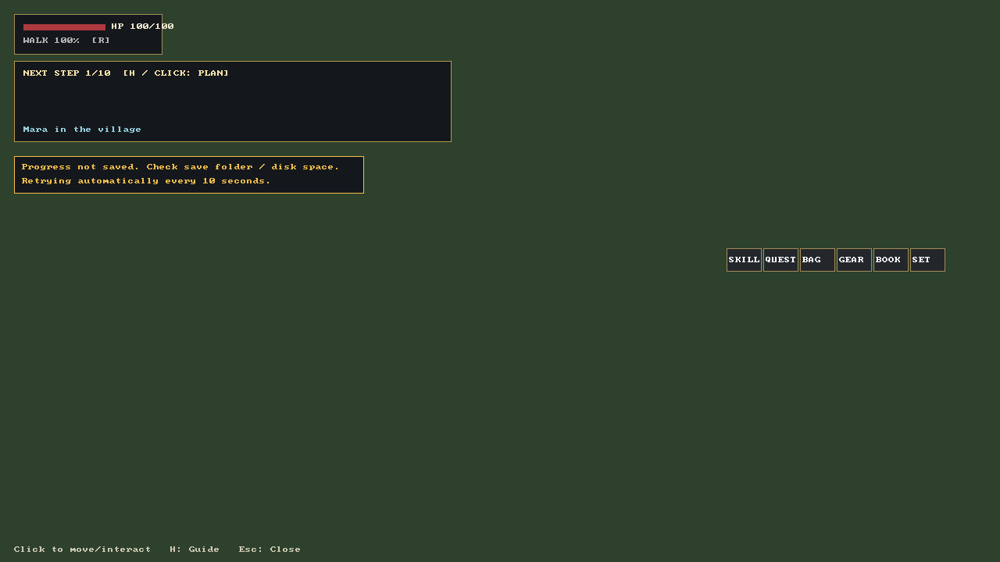

# Periodic player autosave — 20 November 2026

**Planning task:** GAME-010, complete for its bounded acceptance.\
**Published code:** [fa5e0e9](https://github.com/Adzffs/GameEngine/commit/fa5e0e93efa71ac60519287cfd9a35b328ec6270).\
**Baseline:** 9c4feb28258fd8a41047daebd56e5e054f9e77f3; the previous starter continuation is unchanged.\
**Evidence:** [machine-readable results](autosave/2026-11-20/results.json).

Persistent characters previously saved only through an explicit SaveNow call or controlled shutdown. A forced exit could discard the entire session. The application now checks for a periodic checkpoint after every committed World update, while preserving the existing launch/save isolation and transactional file store.

## Implemented policy

| Condition | Behaviour |
|---|---|
| Successful startup | Arm a steady-clock deadline for 60 seconds later; do not write the loaded/new character immediately |
| Deadline reached | Save the latest committed player snapshot once; schedule the next attempt 60 seconds from this attempt |
| Catch-up ticks or long time jump | Save one current snapshot; no backlog of historical writes |
| Explicit SaveNow success | Restart the 60-second deadline |
| Save failure | Retain active gameplay and the previous valid save; retry after 10 seconds |
| Due while dead | Perform no file write; leave the deadline due until the first committed living/respawn tick |
| Open crafting cursor/grid | Project owned items into the saved bag without moving live items or closing the session |
| Crafting items cannot fit | Reject before file writing; retain bag, escrow and old bytes, show an actionable warning, retry after 10 seconds |
| Failed/corrupt startup | Never arm autosave; retain primary and recovery artifacts |
| Successful shutdown | Save current state and disarm periodic work; repeated shutdown remains a no-op |
| Failed shutdown | Keep the existing retry/return-to-game/explicit-unsaved-exit behaviour; a returned session can retry periodically |
| Temporary session | No lifecycle, no autosave and no false saved-progress notice |

The interval uses monotonic elapsed time, independently of the 600-ms simulation tick count. The actual attempt runs after the next completed tick. Slow ticks, a blocked filesystem, death deferral or a failing save can extend the gap; this is not a hard 60-second durability guarantee.

The normal no-argument development application continues to select saves/development-player.save relative to its working directory. Imported-world and fresh-profile launches remain temporary unless an explicit --save path is supplied. --no-save always selects temporary play and cannot be combined with --save. An existing explicitly selected save restores its own progress. No launch defaults or world-file alias guards changed.

## Player feedback

A successful periodic save shows “Progress saved” for three seconds. A failure keeps a nonmodal warning visible until a successful retry. Storage failures suggest checking the folder/disk space; crafting-capacity failures suggest freeing bag space or finishing crafting. Warnings do not steal input or open a modal every ten seconds. Logging records the first failed attempt in an episode and its recovery.

This capture comes from PlayerSaveGraphicsTests with the real SDL software renderer, HUD and tabs. Its plain background and empty tutorial details are a rendering fixture, not a full gameplay or Windows acceptance screenshot.

## Verification

| Exercise | Observed result |
|---|---|
| Before first minute | No save directory, primary or sidecar created |
| First due checkpoint and reload without Shutdown | Latest saved coins restored |
| Repeated/catch-up polls and a large clock jump | One attempt per due interval; no write burst |
| SaveNow and shutdown | Deadline restarted; successful shutdown disarmed polling |
| Non-empty .tmp obstruction | Typed file-save error, byte-identical valid primary, active lifecycle retained |
| Obstruction removed | No early write at 9.999 seconds; successful retry at 10 seconds saved latest state |
| Corrupt primary plus backup | Startup failed; later poll remained inactive and preserved both artifacts |
| Open cursor plus crafting grid | Bag, cursor and grid quantities restored exactly once; live session unchanged |
| Full bag with escrow | Previous bytes and live ownership retained; freeing one slot allowed the scheduled retry |
| Real fatal melee / four-tick respawn | Due save deferred while dead; first respawn tick saved the outstanding recovery pile |
| Reload and reclaim | Pile remained outside bag until claimed; repeated updates could not duplicate it |
| Actual Engine tick integration | A drop committed in the due tick was included in the saved snapshot |
| Temporary Engine over ten simulated elapsed minutes | No persistence lifecycle or saved-progress notice |
| Kill live child after autosave | New process restored 71 saved coins; the later unsaved coin was absent |
| Real SDL status rendering | Storage/crafting warnings persisted, success replaced warning and expired |

The interruption test starts a separate process with a private disposable path, waits for a completed periodic checkpoint, then kills it while its live inventory has changed. It deliberately bypasses controlled shutdown and normal destruction, then reloads through the production World persistence path in another process. On this Linux run the termination is SIGKILL. This tests interruption **after a completed checkpoint**; it does not simulate power loss or termination inside an individual filesystem operation. Existing file-store interruption/recovery cases remain in the passing suite.

| Configuration | Passed | Composition |
|---|---:|---|
| Linux Debug, SDL client/graphics/content tools enabled | 112/112 CTest entries | 93 headless, 7 client, 12 graphics |
| Separate Linux Debug, client/graphics disabled | 93/93 CTest entries | SDL-free core and content tools |
| Python editor units | 42/42 tests | Separate from CTest |
| Focused headless autosave executable | 31 assertions | Included above |
| Engine persistence executable | 34 assertions | Included above |
| Save-notice graphics executable | 5 assertions | Included above |
| Interruption script | 1 CTest entry | Included above |

Toolchain: Linux GCC 14.2.0, CMake 4.4.5, Ninja 1.13.2, Python 3.12.14 and audio-enabled SDL 3.4.12. SDL tests used dummy video/audio and software rendering. The new three CTest entries extend the preceding 109/91 results to 112/93. The executable-backed editor bridge's twelve cases and the starter replay CLI's five cases remain included within their respective single CTest entries.

### Reproduce

~~~bash
cmake --build build-headless
ctest --test-dir build-headless --output-on-failure
cmake --build build-client
SDL_VIDEODRIVER=dummy SDL_RENDER_DRIVER=software SDL_AUDIODRIVER=dummy \
  ctest --test-dir build-client --output-on-failure
python3 -m unittest discover -s tests -p 'test_*.py'
~~~

Configure Python explicitly when necessary; PlayerAutosaveInterruptionTests is registered when Python is found. The headless policy test itself uses injected steady-clock timepoints, so it needs no real minute-long wait. See [Getting started](GETTING_STARTED.md) for build options.

## Reusable implementation boundaries

- [Lifecycle policy](../../../src/Persistence/WorldPlayerPersistenceLifecycle.h) owns the timer, selected path and tracked runtime player. World ticks alone do not save.
- [Engine integration](../../../src/Core/Engine.cpp) polls after World.Update, consumes committed state and includes synchronous save cost in tick performance accounting.
- [World persistence](../../../src/World/World.cpp) and [file store](../../../src/Persistence/PlayerSaveFileStore.cpp) retain snapshot validation, crafting projection, bounded encoding and transactional replacement. No new save version is needed: version 13 remains current.
- [Policy/ownership/death tests](../../../tests/PlayerAutosaveTests.cpp), [process interruption](../../../tests/PlayerAutosaveInterruptionTests.py), [application integration](../../../tests/EnginePlayerPersistenceLifecycleTests.cpp) and [visible status fixture](../../../tests/PlayerSaveGraphicsTests.cpp) protect these boundaries.

This is synchronous persistence for the local player. It adds no background writer, dirty-state tracker, whole-world/RNG persistence, editor draft recovery or online account system. Save text remains bounded by the existing 64-KiB limit; that bounds data size, not operating-system I/O latency. Physical-media flushing and power-loss durability remain outside the tested guarantee.

## Remaining acceptance

GAME-010's interval, isolation, retry, crafting/death and interruption/reload scope is complete and published. Current Windows behaviour, physical storage failure and human review of notice placement remain part of QA-003 and platform acceptance. The existing native failed-exit dialog still needs visible Windows acceptance.

REL-004 still needs the unavailable original Windows animation worktree; no combined Mining/melee result is claimed. ART-005 polish stays owner-deferred. Editor interruption recovery and guarded in-place publication remain STUDIO-025/026.
