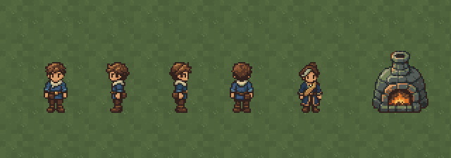
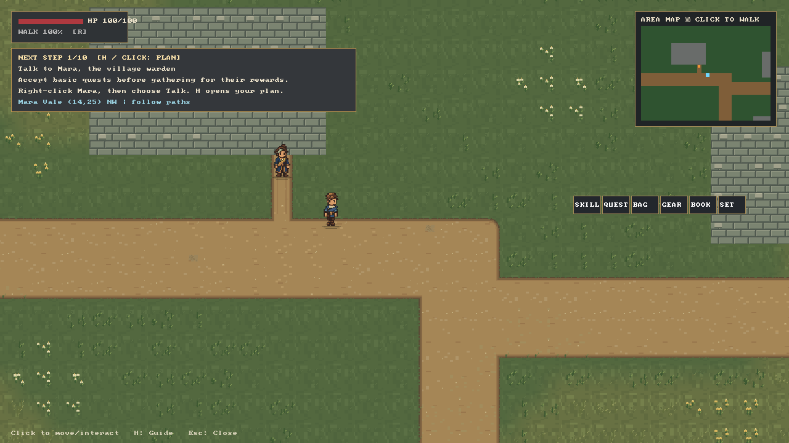

# Eight-way default character animation

**Date:** 20 November 2026\
**Source baseline:** master `9de07844e5d4b7e1bf1d79de11117b6daf8387c4`\
**Scope:** default player outfit, directional walking, asset export and focused verification.

Diagonal movement previously selected a cardinal sprite because both the
renderer cache and the atlas contained only four directions. The default player
now has southwest, southeast, northwest and northeast views, each with its own
neutral and alternating stride poses.



## Runtime behavior

Visual travel selects one of eight 45-degree compass sectors. A small remaining
displacement on the previous axis during interpolation does not turn a straight
route diagonally. Facing stays fixed during the last pixel of arrival so
per-axis position snapping cannot change a diagonal stop into a cardinal pose.
The walk phase continues to advance by distance, including
the longer distance of a diagonal step. Stopping selects pose zero and retains
the last facing. The existing interpolated position, foot pivot, ground shadow,
texture cache and missing-art fallback remain in use.

The atlas is now **128x384**, with four 32x48 poses per row. The first four rows
and their existing IDs retain their original order and artwork. New rows append
the diagonal views in the following order:

| Facing index | Atlas row | Runtime ID prefix |
|---|---|---|
| 0 | South | `character.player.s` |
| 1 | West | `character.player.w` |
| 2 | East | `character.player.e` |
| 3 | North | `character.player.n` |
| 4 | Southwest | `character.player.sw` |
| 5 | Southeast | `character.player.se` |
| 6 | Northwest | `character.player.nw` |
| 7 | Northeast | `character.player.ne` |

The [manifest](../../../assets/embervale/cast-pilot/manifest.json), editable
master, PNG, export geometry and generated C++ layout agree on all 32 player
poses. This is a presentation change; it does not change movement authority,
collision, character progression or save formats.

## Authoring

The new three-quarter views use the existing front/back outfit and side profile
in LibreSprite. The waist overlap and connected lower legs are checked across
all 32 poses. The [contact sheet](../../../assets/embervale/cast-pilot/previews/walk-contact-sheet.png)
shows all eight rows on a contrasting background.

Normal export preserves saved masters. `--rebuild-walk` rebuilds strides from
all eight saved neutral poses. `--add-diagonals` migrates an old four-direction
master by appending the diagonal rows; it rejects an already expanded atlas.
`--regenerate` explicitly recreates all masters from the retained reference and
authoring scripts. See the [cast authoring guide](../../../assets/embervale/cast-pilot/README.md).

## Local verification

Observed on Windows with UCRT64 GCC 16.1.0, CMake/Ninja and SDL 3.4.12:

- `GameEngine`, `EmbervaleRenderPreview` and the four selected test targets built.
- `PlayerAnimationTests`, `CameraPresentationTests`, `MovementSystemTests` and
  `MovementPathSafetyTests` passed: **4/4 tests**.
- The new animation test passed **134 assertions**, exercising all eight
  directions, distance advancement, retained facing, neutral stopping,
  small perpendicular smoothing tails, 32 rendered sprite cells, distinct
  directions and distinct alternating strides. Eight uneven-arrival cases
  reproduce the axis-snap stopping issue before its correction and pass after it.
- LibreSprite walk validation passed **32/32 poses** with no missing waist
  pixels or detached lower-body pixels. Both animated previews contain four
  playback frames, displaying all eight facings together.
- A pixel comparison against the original editable atlas confirmed that all
  **24,576 original cardinal pixels** were retained. The complete 49,152-pixel
  editable atlas matches its PNG export.
- The game renderer loaded **26/26 world textures** and produced the southeast
  movement capture below using the River Crossing snapshot.

```powershell
cmake --build build-client --target GameEngine PlayerAnimationTests CameraPresentationTests MovementSystemTests MovementPathSafetyTests EmbervaleRenderPreview --parallel 6
$env:SDL_VIDEODRIVER = "dummy"
ctest --test-dir build-client --output-on-failure -R "^(PlayerAnimationTests|CameraPresentationTests|MovementSystemTests|MovementPathSafetyTests)$"
.\build-client\EmbervaleRenderPreview.exe content/worlds/river-crossing.blockout.json walk-southeast.png --focus 15 26 --walk-to 16 27 --zoom 1.5 --frames 3
```



The screenshot and rendered-pixel checks use dummy video/software rendering.
A visible GPU/window playthrough was not run. This change adds walking and idle
facings; combat, gathering, death and equipment-overlay art remain separate work.
