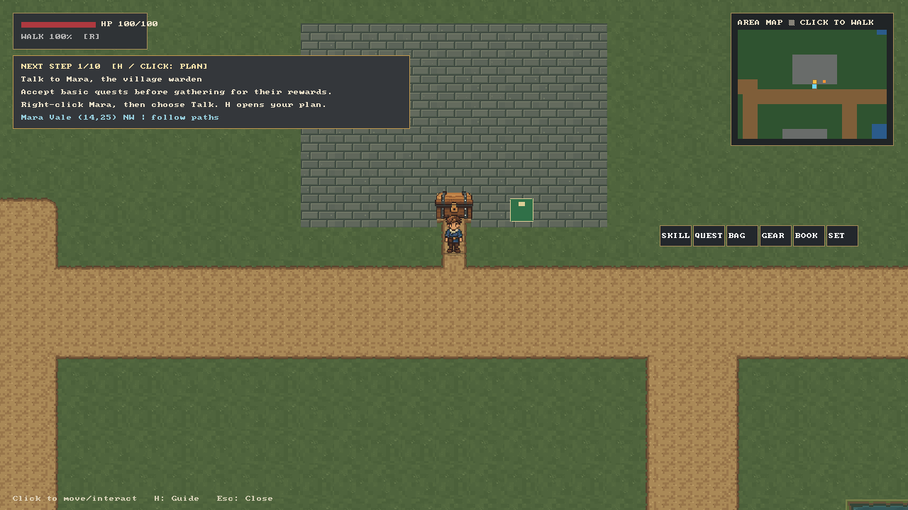
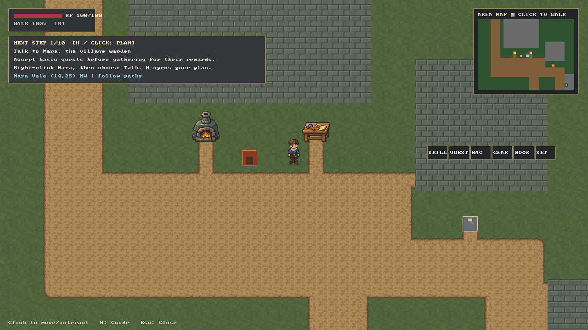

# Bank chest and crafting table in River Crossing

**Date:** 19 November 2026\
**Base:** master `9672a74bb781dee22b6a8c92e20b4c21da427f27` (environment/mining art).\
**Work packages:** next bounded ART-001/002 batch, extending STUDIO-061/062.\
**Result:** Editable sources, client/launcher builds and actual renderer captures completed.





## Art and interaction

The [service pilot](../../../assets/embervale/service-pilot/README.md) adds a
closed oak chest and a wooden workbench with tools/materials on its top. Both
have 48x48 editable LibreSprite masters, PNG exports, stable IDs, palette,
pivots, hashes and provenance. Existing BANK and CRAFTING_TABLE definitions
select them. The chest stays static while the bank panel is open.

The shared renderer cache now handles 86 named frames across twelve PNGs in
four batches. Typed station drawing/picking covers furnace, bank and table.
Opaque overhang pixels map to the original tile and its Bank/Craft/Smelt
action. Transparent areas retain normal world targeting. Occupied ground-item
priorities, explicit Walk here, modal routing and authoritative station
sessions retain their existing paths. Objects keep ground-based draw order
and authored floor underlays.

Station IDs, locations, footprints, recipes, bank storage, adjacency and save
formats are unchanged. F6 returns to the basic shapes. Missing/invalid images
fall back individually; their unavailable overhangs do not capture clicks.
Previous forest/cast/environment masters and PNGs, the corrected walk sheet
and the world snapshot are untouched.

## Reproduce

Update the local checkout and run `Play-RiverCrossing.cmd` to rebuild and play.
The bank is at (33,27); the table is at (73,50), beside the furnace.

```powershell
python tools/art/build_service_pilot.py --editor "C:\Program Files\Asprite\libresprite.exe"
```

Default export preserves saved masters. `--regenerate` explicitly replaces
only the two service masters. CMake packages the two new runtime PNGs beside
the prior ten images; source/reference files and the editor are not needed
at startup. All sampling and pixel cleanup happens in LibreSprite JavaScript.

With client/content tools enabled and SDL 3.4+:

```powershell
cmake --build build-client --target GameEngine EmbervaleRenderPreview --parallel 6
.\build-client\EmbervaleRenderPreview.exe content/worlds/river-crossing.blockout.json bank.png --focus 33 28 --zoom 1.5
.\build-client\EmbervaleRenderPreview.exe content/worlds/river-crossing.blockout.json table.png --focus 72 51 --zoom 1.5
```

## Evidence and remaining work

[results.json](art/2026-11-19/services/results.json) records successful client
and launcher builds, six captures, default-export preservation of both
masters/PNGs and matching copies of all twelve runtime PNGs in both build
directories. The cache reports 12/12 textures loaded. Captures use dummy video
and the real software renderer at 1280x720, without writing player/world saves.

Bank captures cover [native zoom](art/2026-11-19/services/bank.png), 1.5x and
[basic mode](art/2026-11-19/services/bank-basic.png). Table captures likewise
cover [native](art/2026-11-19/services/crafting-table.png), 1.5x and
[basic](art/2026-11-19/services/crafting-table-basic.png) views. The source kit
also includes enlarged transparency and terrain contact boards.

Regression suites and a visible interaction/playthrough remain deferred at
the owner's request. Captures establish renderer output, not complete bank/
crafting acceptance or GPU performance. The roadmap records ART-001/002 as
in progress with four bounded art pilots. Buildings, remaining NPCs, gear/
ore tiers, water animation, audio, general importing and full R4 acceptance
remain open.
