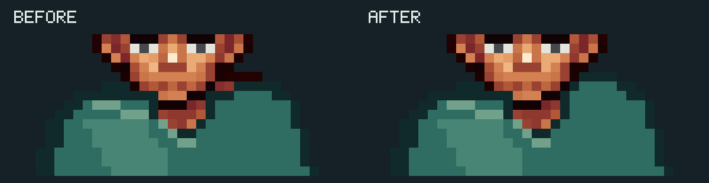

# Top shoulder ridge correction

**Date:** 23 November 2026.  
**Owner feedback:** Look at the top of his shoulders.  
**Baseline:** [bbedb9d](https://github.com/Adzffs/GameEngine/commit/bbedb9d4b8109a8555aad2b30286cd33b6d44f6b).  
**Parent:** ART-007 remains in progress; owner visual acceptance pending.

The latest v5 image still exposed a narrow ridge beside the jaw as either shoulder lifted. The face/neck protection rectangle incorrectly included those shoulder pixels. Previous master/export and fit checks therefore passed an incorrect semantic boundary.

The [v6 pack](../../../assets/embervale/custom-character-pilot/revisions/shoulder-crest-v6/README.md) records explicit source coordinates for thirty-nine crest pixels across all eight walk poses. The actual penultimate/final jaw spans are protected separately. Local edge cleanup changes thirty-six neighbouring garment colours to avoid leaving the old outline inside the new contour.

The four idle cells are pixel-identical to v5. The body, v5 pant layers, lower top, timing and pivot are unchanged. Both pant lengths use the shared corrected top.

## Evidence

- Every corrected point is opaque original-body shoulder area and is covered by the new garment.
- The actual jaw spans have zero garment overlap.
- Only the declared seventy-five garment pixels change; no edits occur elsewhere.
- All new PNGs round-trip exactly and the codec was checked against the previously verified v5 PNG/master.
- All twelve enlarged shoulder before/after crops were inspected. [Poses 1–4](../../../assets/embervale/custom-character-pilot/revisions/shoulder-crest-v6/previews/shoulders-01-04.png), [5–8](../../../assets/embervale/custom-character-pilot/revisions/shoulder-crest-v6/previews/shoulders-05-08.png), [9–12](../../../assets/embervale/custom-character-pilot/revisions/shoulder-crest-v6/previews/shoulders-09-12.png).
- Existing body and pants PNG inputs are retained unchanged in the interactive preview.

The PixelLab correction rendered before the editing environment disconnected. Live export then became unavailable. The PNGs were recovered from retained pixel decisions, rather than represented as original service-download bytes. Two tied cloth-neighbour samples use a deterministic highlight choice, recorded in the [manifest](../../../assets/embervale/custom-character-pilot/revisions/shoulder-crest-v6/manifest.json). The [export receipt](../../../assets/embervale/custom-character-pilot/revisions/shoulder-crest-v6/EXPORT_RECOVERY.md) distinguishes that recovery from the original render.

Remote PNG/pixel, JSON/reference and GitHub byte/tree checks were performed. Local command-line and full documentation-check execution, live browser interaction and native game review were unavailable for this revision. No owner visual acceptance is inferred.
