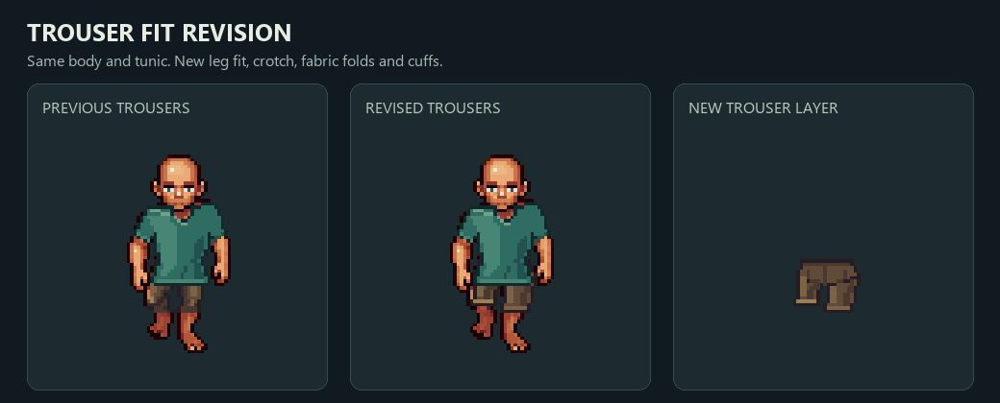

# Trouser fit correction, 22 November 2026

**Request:** After the tunic correction, the owner asked for the same treatment for the pants.  
**Result:** New south-facing trouser art candidate with separate leg geometry and cloth shading.  
**Baseline:** [2cabcc2](https://github.com/Adzffs/GameEngine/commit/2cabcc284b7cc1e37cc326b55c5eeacef80feb1f), containing the v2 tunic.  
**Parent:** ART-007 remains in progress; owner visual acceptance and game integration remain open.

The [revision pack](../../../assets/embervale/custom-character-pilot/revisions/trouser-fit-v3/README.md) includes a [moving comparison](../../../assets/embervale/custom-character-pilot/revisions/trouser-fit-v3/previews/before-after-walk.gif), [every dressed pose](../../../assets/embervale/custom-character-pilot/revisions/trouser-fit-v3/previews/all-poses.png), and a [hip/leg study without the tunic](../../../assets/embervale/custom-character-pilot/revisions/trouser-fit-v3/previews/fit-study.png).

## What needed changing

The v1 trouser mask was a waist-relative quadrilateral extending fifteen pixels downward. Its colour mapping reused the body's light/dark values. Agent review found anatomy-like shading and cuffs that needed to follow each leg independently. The owner's actual request was to apply the tunic improvement process; it was not a detailed owner rejection of every trouser feature.

The replacement keeps brown knee-length work trousers. It authors the seat, crotch, left/right leg bends and cuffs for the original four idle and eight walk poses. Cloth folds, pocket/seam hints, edging and cuff highlights use the existing brown ramp without sampling muscle shading. Garment volume can extend outside the naked body's outline.

The original body, all v1 files and the complete tunic-fit-v2 revision remain byte-for-byte unchanged. The newest combined outfit draws the v1 body, v3 trousers and v2 tunic on the same frame clock and pivot. No body was deformed, scaled or regenerated.

## Corrections found during this work

| Candidate | Observation | Correction |
|---|---|---|
| Initial PixelLab drawing | Ten pixels overlapped protected hand/forearm samples in idle/walk poses; the first two walking left cuffs also needed alignment with the actual knee | Narrow the relevant outer edges, revise both leg panels and align cuffs to original-body landmarks |
| Second candidate | Walk pose 2 still covered the forward hand at source (33,54) and (33,55) | Move that cuff edge inward by one native pixel |
| Published candidate | All sampled coverage, leg gaps and protected body areas pass | Retain for owner review; checks do not establish final visual acceptance |

The initial rejected source and service revision IDs are retained in the new pack. Review includes the pelvis and upper thighs with the tunic hidden, so the longer shirt cannot conceal fitting errors.

## Verification actually performed

| Check | Executed result |
|---|---|
| Original-body coverage | 96 waist/hip/upper-thigh samples covered across all twelve poses |
| Leg separation | Twelve independently chosen source gaps remain clear |
| Hand/forearm protection | 1,055 original body pixels checked; zero final garment overlaps |
| Exposed lower legs/feet | 1,192 source pixels below both knees protected; zero overlaps |
| Source/export | Binary alpha; twelve 84×84 cells losslessly cropped to 80×80; no visible pixel lost |
| Composition | Body + new trousers + unchanged v2 tunic exactly matches the published dressed reference |
| Previous sources | Both existing inventories pass: 22 v1 entries and 18 tunic-v2 entries, excluding their inventory files |
| Preview data | Embedded body/tunic unchanged; new trouser data matches the published export |
| Preview JavaScript | node --check passed |
| Visual evidence | Agent inspected all twelve dressed and tunic-hidden poses; before/after PNG and timed GIF retained |
| New body/animation generations | Zero; PixelLab's free exact drawing tools used |

The read-only [validator](../../../assets/embervale/custom-character-pilot/revisions/trouser-fit-v3/validate.py) reads separate original-body samples rather than deriving acceptance from the trouser drawing recipe. The [manifest](../../../assets/embervale/custom-character-pilot/revisions/trouser-fit-v3/manifest.json) declares south-only coverage, timing and provenance. The preview builder only packs/composites the retained artwork.

No live browser interaction, game-renderer playthrough, eight-way wardrobe completion or owner visual acceptance is claimed. The existing game and save format are unchanged. The [custom-character plan](../05-game/CUSTOM_CHARACTERS.md) still owns the world-scale proof and broader feature work.
