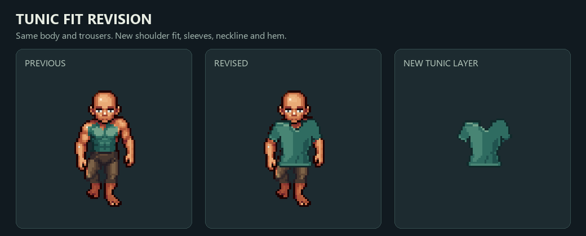

# Tunic fit correction: v2

**Date:** 22 November 2026.  
**Owner report:** “the tunic dont fit properly”.  
**Baseline:** [135c63e](https://github.com/Adzffs/GameEngine/commit/135c63e582e0bf2f4da7b488d24b632edc94b546).  
**Status:** Revised authoring candidate, checked across all twelve supported south poses. Owner visual acceptance remains pending; no game renderer or save change is made.

## What was wrong

The v1 clothing helper derived a narrow polygon from the underwear waistband and recoloured body pixels inside it. That was enough to demonstrate independent layers, but it was the wrong shortcut for a properly fitting tunic.

The upper body leans and shifts relative to the hips during the walk. A waistband-centred shape therefore missed shoulder coverage, produced a short tight-looking top and reused the body's muscle highlights as fabric shading. Its “no clothing outside the body” and exact composition tests passed while the garment still looked wrong. The owner's report confirms CHAR-F06 as a real fit defect, not merely an agent review suggestion.

## Actual artwork change

The [v2 revision](../../../assets/embervale/custom-character-pilot/revisions/tunic-fit-v2/README.md) supplies a new garment drawn in PixelLab's exact layered workbench:

- Separate neck, shoulder-crest, sleeve, armpit, waist and hip landmarks for each of the twelve original poses.
- Short sleeves and shoulder coverage that follow the torso rather than only the waistband.
- A longer, slightly flared hem covering the hips.
- Cloth planes, seams and folds independent of skin/muscle shading.
- A left hem correction in the final walk pose so the forward hand remains clear.

The original body and trousers are reused unchanged. All 23 v1 files remain preserved, including the faulty tunic and its original validation history. Four idle and eight walk poses remain South-only; no extra direction or gameplay coverage is implied.

This is an authoring comparison, not an in-game capture. The [moving comparison](../../../assets/embervale/custom-character-pilot/revisions/tunic-fit-v2/previews/before-after-walk.gif) and [all-pose sheet](../../../assets/embervale/custom-character-pilot/revisions/tunic-fit-v2/previews/all-poses.png) provide the actual retained evidence.

## Better acceptance checks

The revised [read-only validator](../../../assets/embervale/custom-character-pilot/revisions/tunic-fit-v2/validate.py) checks independent anatomical samples read from the unchanged source body, not just the polygon that produced the garment.

| Check | Actual result |
|---|---|
| Required shoulder, chest and hip coverage | Old tunic rejected in 12/12 poses; revised tunic passes 12/12 |
| Neck opening and face clearance | Opening stays clear; protected face region remains untouched, including raised shoulder poses |
| Protected hand/forearm samples | Zero revised overlap in all twelve poses |
| Real defect caught during revision | Final walk pose initially covered two left-hand pixels; the hem geometry was corrected |
| Asymmetric shoulder crests | Nineteen additional source-body samples across the eight walking poses verify that raised shoulders do not leave exposed strips above the sleeves |
| Source/export geometry | 84×84 source to 80×80 export removes only declared transparent padding |
| Composition | Body + original trousers + new tunic matches the retained revised outfit/dressed exports exactly |
| Body/trouser/source preservation | Original v1 file inventory remains byte-identical |
| Preview script | Syntax check passes; no successful browser interaction test is claimed |
| New paid generations | Zero; free exact PixelLab tools were used |
| Runtime and owner acceptance | Not established by this art-only correction |

For this garment, some new sleeve/cloth pixels are deliberately outside the naked body silhouette. That is legitimate garment volume. The old universal inside-body rule is not carried forward as a fit criterion; protected anatomy, declared bounds and independently observed coverage are checked instead.

## Production lesson

A colour mask can be a reuse proof without being a correctly designed garment. Fit the neck, shoulders, sleeves and hips to the actual pose. Give cloth its own silhouette/shading, then protect exposed hands/face. Check every pose and the loop at native/gameplay size.

The same principle applies to the earlier axe defect: tests must establish the intended physical/art relationship, not merely verify that a masking operation ran. A passing composition check never substitutes for visual review.

The [workflow](../05-game/CUSTOM_CHARACTER_WORKFLOW.md), [improvement register](CUSTOM_CHARACTER_REVIEW_2026-11-22.md) and ART-006/007 backlog notes are updated. This correction advances garment work; body proportions/world scale, eight-way animated clothing, hair, equipment tracks and runtime integration remain open.

## Source and next review

The editable [recipe](../../../assets/embervale/custom-character-pilot/revisions/tunic-fit-v2/recipes/tunic.json), [fit landmarks](../../../assets/embervale/custom-character-pilot/revisions/tunic-fit-v2/recipes/fit-landmarks.json), [independent acceptance samples](../../../assets/embervale/custom-character-pilot/revisions/tunic-fit-v2/recipes/acceptance-samples.json), [manifest](../../../assets/embervale/custom-character-pilot/revisions/tunic-fit-v2/manifest.json) and [validation](../../../assets/embervale/custom-character-pilot/revisions/tunic-fit-v2/validation.json) are preserved with the revised raw PNG.

PixelLab drawing: e809e23b-a129-4cee-9b88-9653fa41c058. Gallery: 4c2fd884-0d51-48a9-9344-d36413b80243.

Review the revised fit with the owner, especially shoulder/cuff width, neckline and hem length. Continue the planned in-world size/fit proof afterward; this correction does not settle the final body style or install the character into the game.

