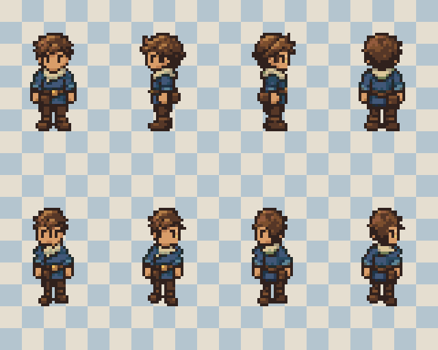

# Player walk-cycle continuity correction

**Date:** 19 November 2026\
**Base:** master `021711805a7b1171da0cb30c6e8c1cc4ae63cc86` (cast art, PR #35).\
**Scope:** Correct the reported waist gap in both stride poses, in all directions.



The original pose generator cut the torso above the legs and moved it upward
without retaining a hip overlap. Both stride poses lost waist pixels in all
four directions; south/north first strides also disconnected an entire lower
body component. The issue was present in the source atlas and the GIF.

The corrected generator keeps the pelvis closed, overlaps torso and thighs,
and moves the calves below the joint. It retains the subtle chest bob and the
existing planted-foot pivot. Only the eight stride cells were rebuilt from the
saved standing art; the eight neutral cells and the other characters/props
remain unchanged. Frame sizes, IDs, timing, walking logic and collision do not
change.

The corrected `.ase` master is exported to the player PNG used by the game.
Both `--regenerate` and `--rebuild-walk` use the same pose routine; normal export
preserves source files and checks every pose. Missing waist pixels and lower
body pixels disconnected from the torso produce a named direction/pose error.
The existing defective sheet failed this check before repair: 8 of 16 frames.
The repaired sheet passes all 16, with zero missing waist or detached lower
pixels. The [per-frame report](../../../assets/embervale/cast-pilot/previews/walk-validation.json)
and [enlarged contact sheet](../../../assets/embervale/cast-pilot/previews/walk-contact-sheet.png)
record the result.

## Reproduce

```powershell
python tools/art/build_cast_pilot.py --editor "C:\Program Files\Asprite\libresprite.exe" --rebuild-walk
```

This explicitly replaces the stride cells from the current neutral frames.
Omit `--rebuild-walk` for ordinary source-preserving export. Rebuild/restart
with `Play-RiverCrossing.cmd` to refresh the cached runtime PNG.

The focused [evidence record](art/2026-11-19/walk-fix/results.json) includes the
before/after continuity counts, unchanged neutral cells, build/package results
and actual renderer captures in [east](art/2026-11-19/walk-fix/east.png),
[west](art/2026-11-19/walk-fix/west.png),
[north](art/2026-11-19/walk-fix/north.png) and
[south](art/2026-11-19/walk-fix/south.png) movement fixtures. Captures use the
real renderer with dummy video/software output. Full regression suites and a
visible GPU/window playthrough remain deferred.
