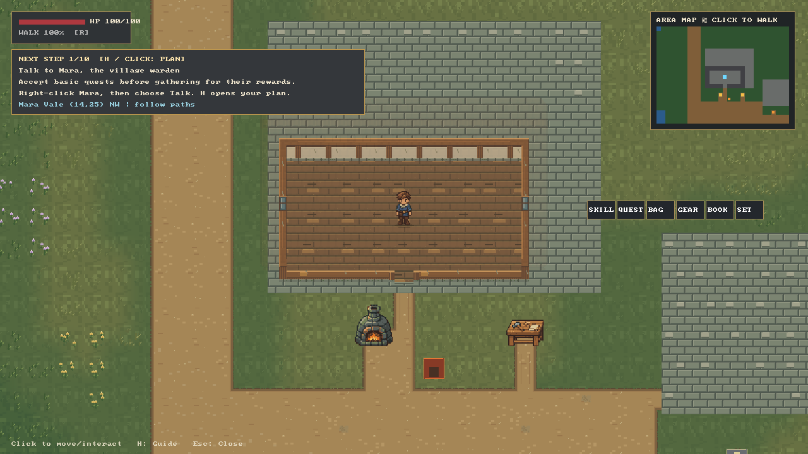

# Correct wall orientation inside the workshop

**Session:** 19 November 2026\
**Base:** master `d71f93814d756a84e5a7beee031cf3d61e3ad5ff` (world variation).

The previous side and corner pieces were front-facing panels with small detail
changes. Inside the workshop, windows faced the camera on all four edges and
the corners did not form a convincing room. This pass replaces those silhouettes
with directional wall sections for the existing overhead camera.



The [previous interior](art/2026-11-19/variation/workshop-interior.png) is retained
as the before view.

## What changed

- North/south sections run horizontally. The north wall shows its interior face.
- West/east sections run vertically as narrow wall caps. Their window recesses
  follow that axis instead of reusing full-width front-facing windows.
- Four corner pieces connect the appropriate horizontal and vertical arms.
  Lighting stays upper-left; entire facades are not rotated with their shadows.
- When the player's foot position is inside the building or doorway, the south
  wall uses four dedicated low-wall/door/corner pieces. Side returns remain joined
  and the entrance stays open. The full facade returns outside.
- Interior planks extend to the inner edges of the wall profile. The south roof
  eave now meets the revised wall tops without exposing an outside strip of floor.
- New/weathered/repaired variants derive from the same directional silhouettes.
  Age marks are clipped to opaque wall pixels, preventing floating plaster or
  moss around narrow sides and corners.

The authored building footprint, blocked cells, doorway, saved data, services,
world snapshot and player walk sheet are unchanged. This is a rendering/art
correction. Existing roof fading and object depth sorting remain in use.

## Editable sources

The base kit uses sixteen 32x48 wall parts in the existing 256x96 master,
including the four new interior cutaways. Together with its roof and floors it
contains 31 pieces. The condition atlas now contains 96 wall frames in 512x288:
three conditions, two panel variants and sixteen directional parts. All six art
batches total **775 frames in 26 runtime PNGs**.

Both builders still preserve saved masters by default. For deliberate wall-only
reauthoring, while preserving all roof/floor/landscape/resource work:

```powershell
python tools/art/build_building_pilot.py --editor "C:\Program Files\Asprite\libresprite.exe" --regenerate-walls
python tools/art/build_variation_pilot.py --editor "C:\Program Files\Asprite\libresprite.exe" --regenerate-walls
```

Omit `--regenerate-walls` to export existing manual work. `--regenerate` remains
an explicit replacement of the respective whole batch. LibreSprite authors the
pixels; Python creates empty canvases and orchestrates exports. The generated
binding and both base/condition atlases are updated together.

## Evidence

[results.json](art/2026-11-19/wall-orientation/results.json) records the Windows
client/preview and tools-disabled launcher builds, default-export preservation,
unchanged non-wall masters/PNGs, matching packaged images and an unchanged world
snapshot. Game-camera captures include:

| View | Capture |
|---|---|
| Native zoom | [Interior](art/2026-11-19/wall-orientation/interior-native.png) |
| Side walls and corner joins | [West](art/2026-11-19/wall-orientation/west.png), [east](art/2026-11-19/wall-orientation/east.png) |
| Low front wall and opening | [Doorway](art/2026-11-19/wall-orientation/doorway.png) |
| Eave and full front facade | [Exterior](art/2026-11-19/wall-orientation/exterior.png) |
| Full facade and roof return after leaving | [Exit](art/2026-11-19/wall-orientation/exit-restored.png) |
| Other conditions | [New](art/2026-11-19/wall-orientation/new.png), [weathered](art/2026-11-19/wall-orientation/weathered.png) |
| Diagnostic fallback | [Basic](art/2026-11-19/wall-orientation/basic.png) |

These use the actual game renderer with dummy video/software rendering. The exit
view uses the preview tool's in-memory position change, not a pathfinding replay.
GPU performance, full interaction/playthrough acceptance and regression suites
remain separate; the latter remain deferred at the owner's request. R4 and the
larger building/furnishing kit are still in progress.
