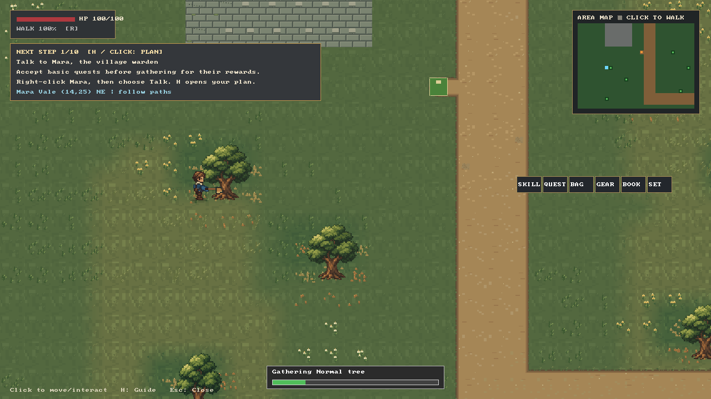
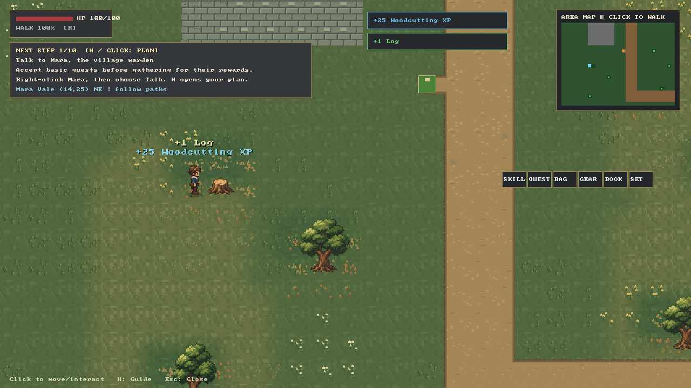

# Woodcutting animation and gathering feedback

**Date:** 20 November 2026\
**Source baseline:** master `6d4b7058616fb1a0af33685eab19b015b9544591`\
**Scope:** one complete woodcutting presentation slice, following the eight-way walk update.

The subsequent [animation polish pass](ANIMATION_RESEARCH_2026-11-20.md) replaces
the six-pose artwork and uniform timing below. The reward/event authority
described here remains in use; this record preserves the first implementation.

The player now faces the selected tree, raises and swings the equipped axe,
shows contact chips and returns to standing when the action ends. Confirmed
gathers display the actual item and Woodcutting XP above the player, including
the final gather that leaves a stump.





## State and authority

`WoodcuttingPresentationState` is SDL-free. It reads a running gathering action,
its target, the player and the equipped axe. Active targets, adjacency, skill
requirements, actor identity and life state gate the animation. Walking remains
visible until interpolated movement settles. Target or tool changes restart the
pose sequence; repeat attempts at the same tree keep a continuous swing rhythm.
Cancelling, moving, invalid targets and death remove the chopping pose.

The six-pose, 1.2-second swing is cosmetic. It does not change the five/four/three
tick gathering intervals of bronze/iron/steel axes or any RNG rolls. World
completion remains the authority for items, XP, quest progress, use consumption
and depletion.

`GatheringRewardEvent` is published only after the world commits an item, XP
and resource use. Its tick, actor, target, coordinates, item, quantity and XP
identify the actual result. Failed rolls, invalid actions and inventory rejection
publish no reward. Engine update forwards each result before processing another
catch-up tick; client deduplication prevents repeated reads from duplicating a
notice. Notices are bounded to four and expire after 1.4 seconds. Ordinary swing
contact chips communicate an attempt, not success.

## Assets and export

The [woodcutting batch](../../../assets/embervale/woodcutting-pilot/README.md)
adds 48 body poses and 144 axe overlays. It covers all eight directions and all
three currently equipped axe tiers. Editable masters, PNGs, export metadata,
previews and the manifest are committed together. The shared layout now covers
**983 frames in 28 textures** across seven art batches. Existing cardinal and
diagonal walking art remains unchanged.

Default export preserves saved masters. Explicit regeneration uses the current
cast neutrals and LibreSprite script. Validation rejects wrong dimensions,
nonbinary alpha, disconnected lower bodies, empty tools and clipped tool cells.
The renderer uses the same cache and per-image fallback as other world art.

## Local evidence

Observed on Windows with UCRT64 GCC 16.1.0, CMake/Ninja and SDL 3.4.12:

- The game, render-preview tool and selected test executables build.
- `WoodcuttingPresentationTests` passes 241 assertions: eight directions, all
  tool tiers, wind-up/contact, repeat rhythm, approach gating, cancellation,
  depletion, movement, wrong tool/skill category, wrong actor, death, real
  successful and failed world attempts, exact committed reward amounts,
  duplicate reads and retention across catch-up updates.
- `WoodcuttingGraphicsTests` passes 328 assertions, rendering all 144 combined
  action/tool cells, checking distinct directions/tiers/poses and exercising
  live render selection, animation advancement and final-use reward display.
- Existing walking, gathering RNG/system, action lifecycle, movement safety,
  camera and engine persistence checks pass alongside the new coverage.
- LibreSprite validation passes all 48 body and 144 tool cells. Normal export
  preserves both editable action masters.
- The real River Crossing render preview loads 28/28 textures, shows the
  chopping action and reproduces a successful normal-tree gather of one Log
  and 25 XP followed by depletion. No player save or world input is written.

```powershell
cmake --build build-client --target GameEngine EmbervaleRenderPreview WoodcuttingPresentationTests WoodcuttingGraphicsTests PlayerAnimationTests GatheringRandomTests GatheringSystemTests ActionLifecycleEventTests MovementPathSafetyTests CameraPresentationTests EnginePlayerPersistenceLifecycleTests --parallel 6
$env:SDL_VIDEODRIVER = "dummy"
ctest --test-dir build-client --output-on-failure -R "^(WoodcuttingPresentationTests|WoodcuttingGraphicsTests|PlayerAnimationTests|GatheringRandomTests|GatheringSystemTests|ActionLifecycleEventTests|MovementPathSafetyTests|CameraPresentationTests|EnginePlayerPersistenceLifecycleTests)$"
python tools/art/build_woodcutting_pilot.py --editor "C:\Program Files\Asprite\libresprite.exe"
.\build-client\EmbervaleRenderPreview.exe content/worlds/river-crossing.blockout.json chopping.png --focus 7 55 --chop 8 55 --zoom 1.5 --frames 18
.\build-client\EmbervaleRenderPreview.exe content/worlds/river-crossing.blockout.json success.png --focus 7 55 --chop 8 55 --zoom 1.5 --frames 90
```

The `--chop` preview equips the fresh player's starting axe and starts a real
gathering action at an adjacent normal tree. The authoring tool uses fixed
combat/reward/gathering seeds 1337/7331/1 for reproducible captures; production
game randomness is unchanged. It advances the world every fifteen
40-ms presentation frames and forwards each reward result. It is a bounded
authoring fixture, not a human pacing measurement. `--walk-to` and tree depletion
fixtures cannot be combined with it.

These checks and captures use dummy video/software rendering. A visible GPU
playthrough was not performed. The change does not alter save formats, resource
rates or progression. Mining and combat action art are subsequent slices.

## Axe-blade orientation correction

The first axe overlays used a fixed perpendicular side for the blade, which
made the cutting edge face away from the tree in some views. The corrected
overlays select the outward blade side per facing and angle the contact shaft
so the cutting edge leads into the tree. All three tool tiers are corrected.
`--rebuild-axes` preserves the player action master while replacing the tools.
The renderer test now checks the actual edge/head pixels in all 48 combinations
of direction, tier and contact/follow-through pose; it reproduces the original
orientation fault and guards the corrected exports.
