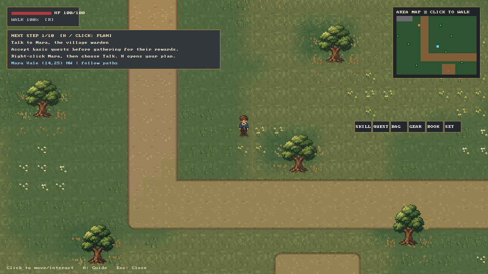
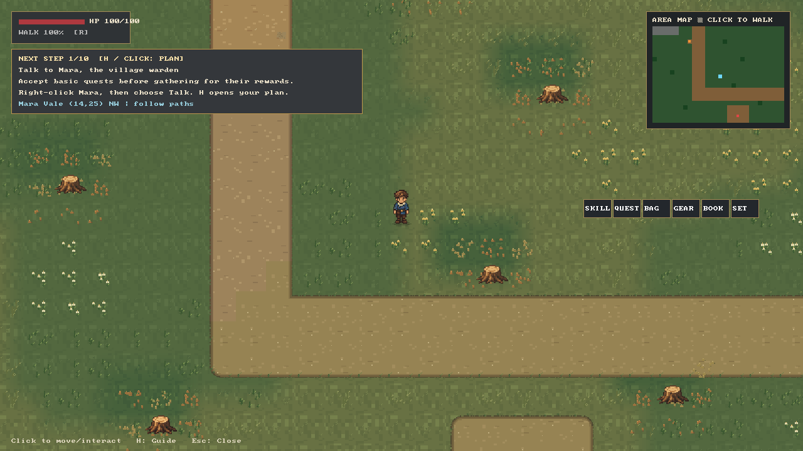
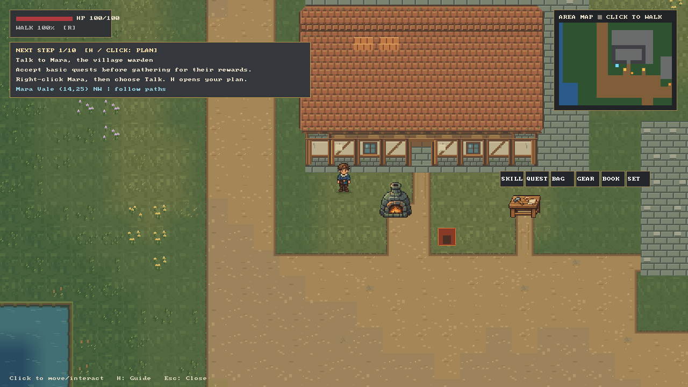

# Landscape variation, leaf litter and building condition

**Date:** 19 November 2026\
**Base:** master `0a127434be42e5e0f17736ad7f63bbc7b81b773e` (first workshop).\
**Work:** ART-001/002 contextual variation; R4 remains in progress.

Grass, paths, water, stone, vegetation, normal trees, mining rocks and the
building kit now have additional variants. Their placement follows settlement
activity, paths, water, open ground and actual tree/resource positions.
The [editable kit](../../../assets/embervale/variation-pilot/README.md) contains
634 frames in eleven masters; all six batches total 747 frames in 26 cached PNGs.





## Where each feature belongs

| Context | Result |
|---|---|
| Buildings, services and friendly NPC homes | Maintained surroundings and clear approaches; fewer plants |
| Quiet outskirts | More grass clumps and suitable wildflower clusters |
| Open meadow away from paths and shade | Four wildflower families, two group shapes each |
| Damp river margin | Lush grass and four reed shapes, kept on land |
| Normal/oak/willow canopy | Dense or sparse leaf groups; eight beds plus four sparse variants |
| Busy path beneath a canopy | Usually clear; only quiet distant path sections retain sparse litter |
| Mining area | Rough stone and small debris groups instead of uniform civic paving |
| Workshop | Repaired terracotta profile with older fabric and localized newer work |

The field uses stable coordinate hashes and coherent patches, independent of
simulation RNG. It is computed from real world data and cached by map revision
and placement counts. Terrain/building edits rebuild it. Player movement,
camera changes, repeated frames and resource depletion retain the same dressing.
Ore nodes do not count as trees. Flora stays off water, buildings and occupied
resource/service cells. Decorative pixels never become movement or action targets.

Grass blends compatible meadow/lush/dry corners. Dirt overlays that grass and
uses independent connected borders and fully filled wide-road interiors. Four
surface variants reduce repeated pebbles/scuffs, with small maintained-road
infill patches. Water blends shallow/deep shared corners and quiet horizontal
ripples. Stone has clean, worn, repaired and rough-ground versions.

## Buildings and resources



The existing overhead modular kit now supports new, weathered and repaired
walls/floors/roofing, two wall-panel variants and terracotta/slate roof materials.
The current workshop keeps its terracotta identity with a small roof repair,
fresh plaster and replacement beams among older surfaces. New and weathered
inspection views are [new](art/2026-11-19/variation/workshop-new.png) and
[weathered](art/2026-11-19/variation/workshop-weathered.png).
An [interior view](art/2026-11-19/variation/workshop-interior.png) retains roof fading.
The tool's `--condition` override changes inspection only; normal play uses the
building's stable presentation profile. Slate is available for subsequent
assemblies; the world still contains one authored building.

Normal trees and copper/tin rocks have three silhouettes each, with matching
stump/rubble variants and unchanged ground pivots. Drawing and opaque-pixel
targeting choose the same variant. The accepted player walk cycle is untouched.
The existing snapshot, save schema, collision, resource rules and simulation RNG
are unchanged. Map revision is an in-memory presentation-cache invalidation token.

## Reproduce

Update the checkout and run `Play-RiverCrossing.cmd`. Existing supported Windows
dependencies are used by the launcher. For editing/export:

```powershell
python tools/art/build_variation_pilot.py --editor "C:\Program Files\Asprite\libresprite.exe"
cmake --build build-client --target GameEngine EmbervaleRenderPreview --parallel 6
.\build-client\EmbervaleRenderPreview.exe content/worlds/river-crossing.blockout.json woodland.png --focus 23 59 --zoom 1.5
.\build-client\EmbervaleRenderPreview.exe content/worlds/river-crossing.blockout.json repaired.png --focus 66 49 --zoom 1.5 --condition repaired
```

The default export preserves editor masters. `--regenerate` explicitly reauthors
only this batch. CMake packages all eleven new runtime PNGs. Earlier images remain
available as per-image fallbacks; absent flora safely omits decoration. F6 shows
the existing basic presentation.

## Evidence and limits

[results.json](art/2026-11-19/variation/results.json) records Windows client and
tools-disabled launcher builds, real software-renderer captures, saved-master
export preservation, matching packaged images and a bounded production-data
placement/stability inspection. That inspection checks flowers avoid occupied,
shaded or maintained approach cells, leaves require actual tree cover, resource
depletion/player movement preserve dressing, and terrain revisions rebuild it.
The snapshot source remains byte-for-byte unchanged.

Additional captures cover [river](art/2026-11-19/variation/river.png),
[village](art/2026-11-19/variation/village.png),
[mine](art/2026-11-19/variation/mine.png),
[depleted mine](art/2026-11-19/variation/mine-depleted.png) and
[basic woodland](art/2026-11-19/variation/basic.png).
Software captures establish integration and appearance, not GPU performance or
a visible interaction playthrough. Regression suites and full starter acceptance
remain deferred at the owner's request.

Age is currently an authored appearance, not a time/season/decay simulation.
Flowers are decoration, not gatherable resources. Other building assemblies,
furnishings, broader cast/ore art, general importing, audio and full starter
presentation acceptance remain open. This pass does not complete R4.
